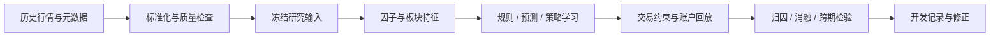

# Quant · 量化研究开发记录

围绕 A 股选股、行业轮动与组合管理的个人研究记录。项目从早期日内交易、规则择时和机器学习选股，逐步发展为数据平台、自动因子挖掘、账户级回测、策略学习和板块事件建模。

这里整理各阶段的代表代码、研究思路与工程经验，保留方法的演进过程。记录截至 **2026-09-24**。

## 项目导航

| 方向 | 主要内容 | 代码入口 |
|---|---|---|
| 数据平台 | 历史行情查询、指标计算、日历与历史元数据、冻结快照 | [datahub](datahub/) |
| 因子研究 | 表达式计算、遗传规划、CPU/GPU 算子、截面评价与中性化 | [alpha_lab/src](alpha_lab/src/) |
| 组合与策略学习 | 账户回测、独立流水核验、预测与排序、神经策略及演化搜索 | [portfolio.py](alpha_lab/src/portfolio.py) · [initialized_policy.py](alpha_lab/src/initialized_policy.py) |
| 板块事件 | 历史成员聚合、权重限制、形态识别、多窗口事件合并 | [sector_dataset.py](alpha_lab/src/sector_dataset.py) · [sector_shape_events.py](alpha_lab/src/sector_shape_events.py) |
| 模糊神经网络 | 训练期预处理、标签成熟检查、可训练模糊规则与线性后件 | [sector_fuzzy_v1](alpha_lab/experiments/sector_fuzzy_v1/) |

## 研究框架

### 数据平台

原研究环境整理了 2014—2026 年 A 股历史数据，包含退市股票；2026-09-20 冻结版本有 **12,280,264 条日线记录**，另有美股及全球市场的 33 个序列。这里记录的是原环境规模，行情数据不随仓库发布。

工程工作包括单位统一、缺失交易日修复、复权与公司行动核查、Parquet 分区存储、查询起点一致性、历史成员区间查询，以及数据与源码哈希留档。历史元数据的可得时点、行业覆盖和供应商修订仍需逐项核验。

### 因子挖掘与模型比较

研究量价、波动率、换手率、估值、资金流、动量与反转等特征；使用 IC / Rank IC、分层比较、行业与市值中性化及风格匹配对照分析信号。

遗传规划模块以表达式树组织因子，通过变异、交叉、复杂度惩罚和相关性约束搜索候选。CPU 与 PyTorch 后端分别实现时间序列、截面算子，保留并列秩和缺失值语义的回归测试。

学习方法覆盖 Ridge / ElasticNet、LightGBM 回归与排序、CNN、HMM 等。后续进一步从规则基线初始化神经策略，直接基于执行后的账户回报进行演化搜索，并考察训练窗口、训练预算和重训间隔的关系。

### 回测与账户约束

执行引擎处理信号后的交易时点、现金和整手限制、T+1、停牌与涨跌停、分红和送转等事件。逐笔成交与事件流水能够独立重建现金和股数，用于检查账户状态。

策略接口区分“维持当前策略动作”和“退出持仓”，把真实成交后的状态反馈给下一次决策。缓存回放与原引擎的等价性、未来行情扰动和历史截断检查均有对应测试代码。

### 板块形态与模糊模型

基于历史成员区间构建申万二级板块代理指数，明确前日权重、单股权重上限、报价覆盖及连续有效段。形态研究关注前期上涨、回撤、价格参照区域和下跌减速，并进行多尺度事件去重。

事件筛选比较固定模糊规则、岭回归与一阶 Takagi–Sugeno 模糊神经网络。网络包含可训练高斯隶属度及线性规则后件；实验分别探索时间滚动和随机留出，两者的解释边界分开记录。

## 开发记录

- [研究全景与历史方向](docs/research-map.md)：选股、择时、跨市场、日内、可转债及组合管理。
- [阶段演进](docs/development-log.md)：从早期模型尝试到数据、账户和实验方法的重构。
- [源码阅读路径](docs/code-guide.md)：从数据接口到策略状态与模型实现。
- [研究方法与已知边界](docs/methodology.md)：标签时点、样本复用、交易成本及归因。
- [本次整理说明](docs/archive-scope.md)：纳入范围、源码改动与检查口径。
- [来源清单](docs/source_manifest.json)：原文件与整理副本的 SHA256 记录。

## 仓库范围

这是个人开发归档，保留代表性源码和原有测试，未整理为可直接部署的完整产品。部分历史实验依赖原研究环境、外部数据和未纳入的运行脚本；不承诺下载后即可复现全部实验。

测试主要体现检查方法，本次整理不把历史测试记录当作当前全量验收结论。原始行情、模型权重、账户状态、运行日志和连接凭据不在仓库内。

历史高收益结果曾因标签泄露、成交假设、数据质量及样本选择问题被修正。这里保留研究问题、实现和修正经验，不将旧回测数字作为已证实的策略能力。
