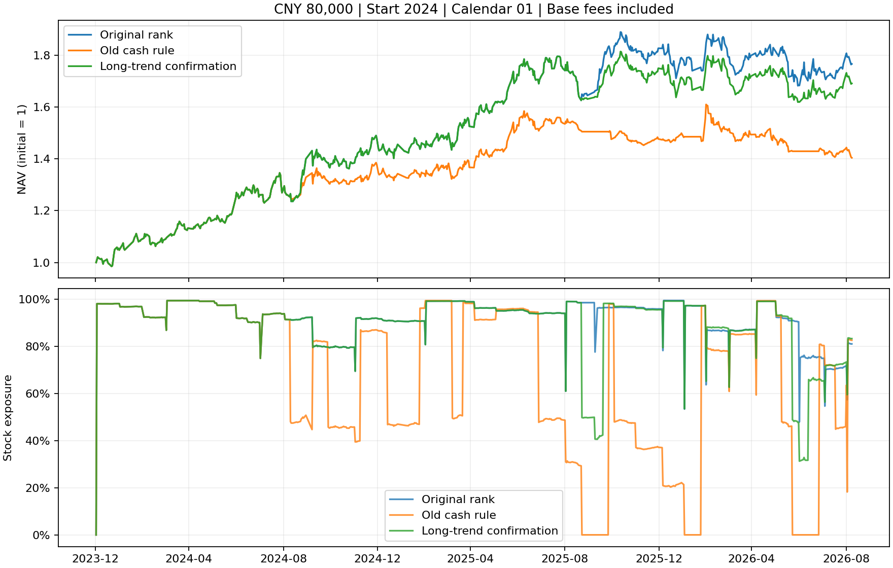

# 主动减仓的经济性：过程归因、机制修正与邻域验证

## 本轮范围与结论

本轮只解决收益／防守规则的经济性问题。邮件与人工执行状态接入、真实前向执行按用户意见留待小资金测试阶段，本轮没有发送邮件、下单或更改真实账户。

旧现金规则的主要问题是**在正常回撤后卖出，再在反弹后补回**。新增长期趋势确认后，收益牺牲显著缩小，中央参数通过首轮预定筛选，但回撤改善较小，且剩余减仓仍缺正向择时证据。不能把通过宽松筛选等同于已解决大跌防守。本报告末尾给出完整邻域检验和最终裁定。

## 先检查实际过程

冻结原始恢复版本 `targeted_restore/20260914T081149_007200Z`，逐账户分析8个零额外成本快速恢复账户；窗口重叠，以下事件和成交配对不属于独立市场样本。

- 105次风险警报，风险限制持续时间中位数24个交易日。104段原篮子价格路径完整，1段含缺报价，明确标未知，没有填成零收益或安全。
- 固定警报后20日的原篮子复权价格收益中位数 **+2.85%**。这是固定期限事后诊断，不能作为当时输入，也不是可执行收益。
- 弱势权重已回落至40%以内后，原解除规则额外等待中位数10个交易日，期间原篮子上涨中位数 **2.36%**。按恢复时点统计收益有停止规则偏差，不能单独用来评价信号，因此另保留上述固定20日诊断。
- 旧规则计算各股距各自60日高点的回撤再加权；这些高点不同时发生。相对当次检查同一固定单位篮子的同步回撤，差额中位数 **1.63个百分点**。这不一定是程序错误，但作为共同风险解释会偏强。
- 按本轮次、同股、实际卖出／补回数量FIFO配对，288段中只有14段在扣除漏领税前股息和两端费用后优于一直持有对应股数。配对只覆盖补回部分，不涵盖未补回卖出或后续选股路径改变。
- 两个完整账户路径的每日损益差按前一收盘风险状态分组，能够精确加总到最终净值差。差额主要发生于风险限制期间；直接费用不是主要损失来源。该归因包含不同持仓与本金路径，不冒充纯择时alpha。

原始诊断首次因缺报价主动中止，修正为保留事件、价格归因标未知，失败回执保留。股息配对核算使用每股实际分红；`reference_share_fraction` 仅用于除权参考价，不用于缩减股东应得现金。早期诊断版本均保留，最终配对依据 `roundtrips_20260914_v3`。

## 首轮：四个机制消融，80个账户

冻结原选股、排名缓冲、风险预算、5股上限、8万元、整手和已审查恢复引擎。每项覆盖2022／2024起始、1／8／15／22日历及每边0／30bp额外成本，另有16个原快速恢复控制。

1. **缩短解除等待**：保留旧触发，弱势权重≤40%一次周首收盘检查即解除，不再要求组合20日收益为正、连续两周。
2. **同步篮子回撤**：在1基础上，用当次检查固定单位篮子的60日同步回撤替代加权个股异步高点回撤；风险期间冻结股票名单和权重，不因减仓重置风险。
3. **长期趋势转弱确认**：在2基础上，还要求加权60日收益<0，且至少60%权重低于60日均线。
4. **取消全退分支**：在3基础上，最多减至半仓，检验全退是否有贡献。

中央候选保持周首收盘检查、次日限价成交；60%权重低于20日均线、同步回撤≥5%及上述长期转弱同时成立才减至半仓，回撤≥10%才请求空仓。解除后仍需各股满足月度持有许可、当日20日趋势恢复和真实减仓额度，才允许补回。持仓数上限5；未成交不授予额度、不预支卖款。

以下是相对同日期同费用原排名缓冲账户的**配对差中位数**。回撤改善为正表示最大回撤减轻，0额外成本仍有基础费用。

| 规则 | 每边额外成本 | 年化差 | 最大回撤改善 | 成交笔数增加 | 回撤改善账户 |
|---|---:|---:|---:|---:|---:|
| 原快速恢复 | 0bp | −10.59个百分点 | −0.14个百分点 | 124.04% | 4/8 |
| 缩短解除等待 | 0bp | −9.85个百分点 | +0.87个百分点 | 155.10% | 5/8 |
| 同步篮子回撤 | 0bp | −8.23个百分点 | −3.53个百分点 | 77.22% | 3/8 |
| 加长期趋势确认 | 0bp | **−1.63个百分点** | **+0.58个百分点** | **21.77%** | **8/8** |
| 加长期趋势确认 | 30bp | **−1.82个百分点** | **+0.78个百分点** | **23.21%** | **8/8** |

中央候选零额外成本年化中位数18.53%、最大回撤中位数−13.34%、夏普中位数1.17；这三个中位数不一定来自同一账户。相对原排名缓冲，夏普配对差中位数仍为−0.056。8个账户中7个年化较低，回撤改善范围约0.22—3.03个百分点。中央参数达到了原协议的年化牺牲≤2个百分点、至少6/8回撤改善、成交增加≤25%，但这只是最低筛选门槛。

## 新规则改善的来源及限制

零额外成本警报从105次降至21次，风险限制周数从689降至71。缩短等待单独使用反而增加反复触发，只有约束“什么情况值得减仓”才显著减轻损失。

不过，这21次警报后固定20日原篮子价格收益中位数仍为 **+10.88%**；20段完整的警报至恢复路径均上涨，另1段缺报价。新规则81段实际卖出／补回配对中，仅2段比一直持有对应股数有利。改善主要来自**少做有害减仓**，不是剩余警报已能预测继续下跌。

本轮新候选未触发一次全退；有无全退分支的32账户四账本完全一致（需以封存核验为准）。因此本批历史不能证明“感知大风险后空仓”的有效性。合成严重下跌测试只验证分支能执行，不提供盈利证据。

## 检验纪律

两轮均事前固定案例，复用历史窗口，不称新增样本外。任何邻域最好结果不替换60日／5%中央参数。新研究文件独立保存，旧生产引擎及根目录已有 `AGENTS.md` 不变。

每账户检查现金、股数、最多五只、100股买入、先决策后成交、预约现金预算、逐股损益；逐事件独立重建本轮实际风控卖出与补回额度。16个首轮控制精确复现原四账本；4个真实账户截断前缀验证未来数据不能改变过去结果。主审另用上轮独立审查者的指标公式复算，本轮没有新增独立智能体审查，不混淆审查来源。

复现入口：`scripts/diagnose_cash_economics.py`、`attribute_restore_roundtrips.py`、`research_cash_economics.py`、`research_cash_robustness.py`、`analyze_cash_economics.py`、`verify_cash_economics.py`、`verify_cash_robustness.py`、`verify_cash_economics_metrics.py`。原始数据仍需同一封存依赖链；逐案例、源码哈希、日志和失败版本随产物保存。

## 第二轮：参数邻域80账户

固定60日／5%中央候选，再各自只改变一个参数：趋势40日、趋势80日、回撤4%、回撤6%。每个设置仍覆盖8个账户、两档费用；不以邻域最优替换中央候选。16个中央控制四账本精确复现首轮。

| 单变量设置 | 年化差：0／30bp | 回撤改善：0／30bp | 成交增加：0／30bp | 回撤改善账户：0／30bp |
|---|---:|---:|---:|---:|
| 中央60日／5% | −1.63／−1.82个百分点 | +0.58／+0.78个百分点 | 21.77%／23.21% | 8/8／8/8 |
| 趋势40日 | −4.77／−7.44个百分点 | +0.94／−2.49个百分点 | 49.03%／46.92% | 6/8／4/8 |
| 趋势80日 | 约0／约0 | 约0／约0 | 0%／0% | 2/8／1/8 |
| 回撤4% | −1.99／−1.87个百分点 | +0.58／+0.71个百分点 | 22.40%／25.17% | 8/8／8/8 |
| 回撤6% | −1.50／−1.52个百分点 | +0.60／+0.88个百分点 | 19.66%／17.18% | 8/8／8/8 |

表内均为同日期同费用配对差中位数。改善计数采用绝对差>1e−10，避免CSV读写产生的1e−17浮点残差被算成改善；修正后全部分析和指标复算重跑，未重跑不受影响的账户。80日方案零额外成本仅3次警报、加成本后仅2次，不能把几乎不触发的规则当成已验证防守。

协议要求四个单变量邻域至少三个在两档费用下均保留收益、不过度交易；实际只有80日和6%两个符合，**邻域要求未通过**。4%方案在30bp下成交增加25.17%，略超原25%门槛，差距本身很小，不夸大为断崖失效；40日明显恶化、80日几乎关闭才是更重要的不稳定来源。不能通过放宽门槛或改选6%来宣布整体成功。

## 最终交付与决策

两轮共160次账户执行、21,677笔成交，包含32次复现控制，不能当160份独立样本。共8个账户截断前缀四账本精确一致；2,885笔恢复计划与2,844笔恢复成交完成实际额度重建；9项新状态测试通过。采用上轮独立公式对两轮全部160账户及各轮16个rank对照复算，收益、回撤、夏普、费用与摘要一致。首轮16对有无全退分支四账本完全相同。

**已经解决的部分**：明确损失不是手续费主导，也不是五席位限制；缩短等待不能单独解决。加入长期趋势确认显著减少误减仓，将年化牺牲从约10.59个百分点压到1.63个百分点，恢复和退出的执行约束完整保留。

**仍未解决的部分**：中央候选相对原策略仍损失收益、夏普略降，回撤改善较小，邻域验证未通过，剩余触发也未显示继续下跌的预测能力。停止把“已有回撤／跌破均线”直接解释为“后面还会明显下跌”。本轮中央参数保留为研究对照，不替换生产策略，不以最好邻域宣布定稿。

下一项研究应先检验风险证据的前瞻效用：在不改变实际交易的条件下，对可获得的市场广度、波动／相关性冲击及流动性状态做严格历史顺序诊断，分清未来损失概率与仅仅已经跌过的状态；同时保留只降低风险敞口的静态对照。只有证据支持，才重新接入主动减仓。后两项实盘工程问题不作为本轮继续研究的阻断理由。

完整封存：[机制实验](../outputs/cash_economics/20260914T101455_810747Z/)、[邻域检验](../outputs/cash_robustness/20260914T102042_513326Z/)。每个 `completion.json` 校验产物哈希；哈希仅证明完整性，不证明来源或未来盈利。
