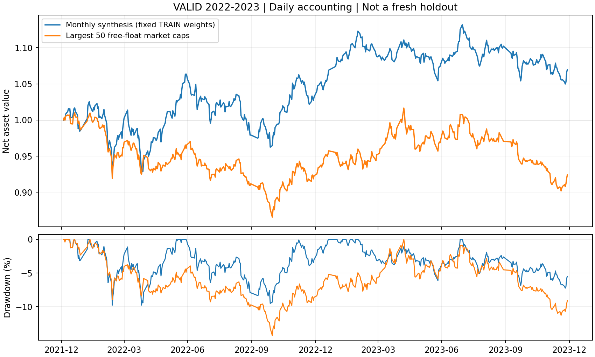

# 月频组合日频记账审计（2026-09-11）

## 判断

现金/股数记账、每日风险统计和固定 VALID 回放已完成；当前仍不具备实盘验收结论。月频组合绝对表现温和，存在已实际发生的退市风险，日常运行闭环尚未建立。

## 固定协议

- 原月频十一因子不变；修复后的 CPU 因子与成对 RankIC 在 TRAIN 2014–2021 定 ICIR 权重，末端 purge 20+5 日。
- VALID 2022–2023 只作修复后诊断。该窗口此前已被使用，不称为新 OOS；本轮未使用 TEST 行情、旧 TEST 合成权重或重跑 TEST。
- 模拟本金210,000元，top50、20个交易日调仓、保留带1.0；次交易日开盘交易、整数股、现金约束。参数未扫描。
- 对照为流通市值最大的50只，使用相同本金、费用和执行规则；不是原报告的最大市值500，也不是市场指数。
- 买入0.1%、卖出0.2%、单笔最低5元；现金分红统一扣减20%，配股采用不追加资金情景。这些是固定研究假设，不冒充券商真实结算。
- 549只候选，分红与官方历史涨跌停价共1,098份缓存；回放484个交易日、25个调仓日。

## 日频账本结果

| 方案 | 累计收益 | 年化 | 最大回撤 | 日频 Sharpe | 平均股票仓位 |
|---|---:|---:|---:|---:|---:|
| 月频合成 | +6.95% | +3.44% | -9.78% | 0.36 | 81.1% |
| 流通市值50对照 | -7.60% | -3.90% | -14.28% | -0.34 | 62.3% |

仓位差异明显：整数股及科创板起买门槛使部分高价股预算不足。收益差不能直接解释为纯选股 alpha，仍需规模、行业、仓位等暴露归因。



## 记账与真实风险核对

- 月频组合1,316笔买卖，综合费用8,753.04元；对照109笔，费用589.54元。
- 独立流水重建：股数误差均为0；现金最大误差不超过1.75e-10元，为浮点累加量级。两组合缺涨跌停价事件均为0。
- 月频组合在2023-04-03买入庞大集团4,500股，买价1.06元。该股后来变ST且无法正常退出，2023-06-21触发长期缺报价告警，2023-06-30摘牌按零回收减记。全部本金损失已进入净值，没有虚构最后价卖出。
- 组合仍保留1项长期停牌估值待审标记，`execution_data_sufficient=false`。对照此字段为true仅表示所列数据检查通过，不代表可以上线。
- 上游复权因子存在无对应参考价跳变的数值变化，接口复查也能重现，例如002054.SZ在2022-05-30从3.4304变为3.4310，原始前收价仍连续。合成/对照分别记录31/27次元数据变化，不据此增加股数或现金。因子端后复权输入受何种影响，仍待数据层审计。

## 公司行动核验

两笔“普通分红+特别分红”被源接口拆为多行，初次回放因此失败。已在 `configs/corporate_action_components.yaml` 登记核验组成，未知多行记录仍报错，原始缓存保留。

- 600188.SH：2023-07-17每股现金3.07+1.23=4.30、送股0.5。
- 601828.SH：2023-07-24每股现金0.034+0.046=0.08。
- 两笔金额均与原始除权参考价交叉核对；兖矿能源金额亦与[公开披露](https://static.sse.com.cn/bond/bridge/information/c/202411/5e76b0bc20734a85bed910d868fad6b1.pdf)核对。
- 对照涉及中信证券2022-01-27配股，依据[配股公告](https://www.cs.ecitic.com/newsite/tzzgx/ggyth/gg/aggg/202201/P020220119576021469431.pdf)记录不参与情景，股数和现金不虚增，承担除权影响。

分红应收款到账前不能用于交易，红股上市前不能卖；参考价无解释跳变即使复权列未变化，也会停止回放。

## 旧错误口径对照（禁止用于收益依据）

同一冻结信号在归档v3下的结果如下。差异同时包含股数/现金约束、公司行动、退出重试、费用和统计修复，不是单一改动的收益贡献。

| 方案 | 旧累计收益 | 旧年化 | 旧回撤 | 旧Sharpe |
|---|---:|---:|---:|---:|
| 月频合成 | -7.74% | -3.86% | -12.98% | -0.50 |
| 流通市值50对照 | -29.48% | -15.67% | -29.38% | -2.47 |

这不是对 README 中2024–2026成绩的重算。旧版存在稀疏估值、月频Sharpe错用周频年化、碎股/除权/退市等问题，旧 TEST 成绩仅作失效口径存档。

## 验证与复现

37项回归测试通过，其中22项覆盖组合账本。覆盖月中跌50%后恢复、最后调仓后的每日估值、初始手续费回撤、双边成本、股数门槛、T+1、跌停延期、停牌估值、分红应收款、红股锁定、退市、配股、公司行动异常和独立流水对账。

```bash
python -m unittest discover -s alpha_lab/tests -p 'test_*.py'
python alpha_lab/scripts/audit_monthly_portfolio.py --prepared alpha_lab/outputs/monthly_portfolio_audit/20260911T101938_965835Z
```

最终产物目录：`outputs/monthly_portfolio_audit/20260911T101938_965835Z/ledger_20260911T103601_452911Z/`。
含汇总、日净值、成交/权益/持仓流水、旧错误口径对照、配置/信号/源码指纹及执行输入文件SHA-256。此前失败和修复前回放目录保留，不覆盖证据。

## 下一步

先审计月频组合的规模、行业、仓位暴露和退市风险，核对后复权输入中的源端变化。随后建立每日增量、质量检查、固定信号和纸面持仓对账，配合前向跟踪再判断能否进入小额执行验证。当前不新增挖掘、不据此调参，也不切换现有实盘系统。

完整执行契约与外部规则依据见 [记账契约](PORTFOLIO_ACCOUNTING.md)。
