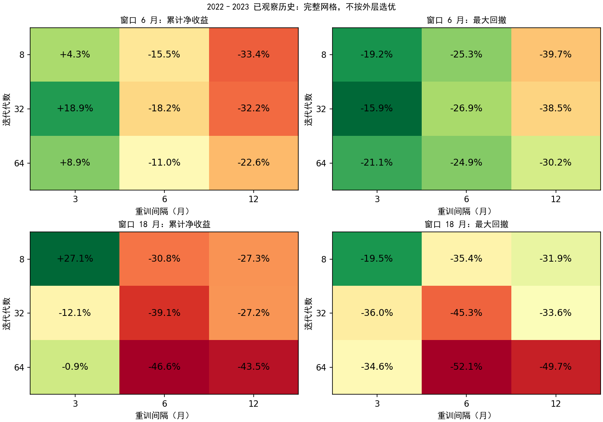
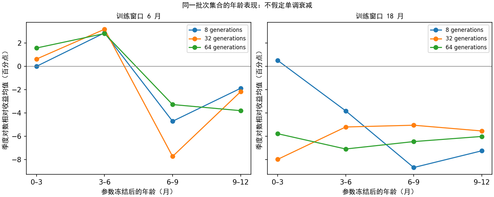

# 模型衰减—迭代—窗口联合实验结果

运行：`alpha_lab/outputs/policy_balance/20260921T043247_252598Z`。冻结数据/账户口径不变。全部区间已观察；这是方法与工程验证，不是新样本外认证。

## 已实现

低换手基线初始化，全部 1686 参数可学习。窗口 6/18 月 × 代数 8/32/64 × 重训 3/6/12 月，共 18 组。2021 年提供首轮历史评价，2022–2023 连续账户回放。每次仅用此前完整 12 月评价组合，选中重训间隔决定下次选择日期。

模型年龄无需服从指数或单调衰减：逐批次冻结参数，测 0–3/3–6/6–9/9–12 月的同历基线相对收益，同时保存旧模型与同窗口同代数的新模型比较。年龄结果不能解释为纯参数衰减，持仓路径和市场变化也会影响它。

## 连续外层结果（净费用）

| 策略 | 累计收益 | 最大回撤 | 正收益且回撤≤30% |
|---|---:|---:|---|
| adaptive | -3.86% | 17.36% | 未通过 |
| baseline | +31.81% | 13.31% | 通过 |
| w6_k8_r3 | +4.28% | 19.20% | 通过 |
| w6_k8_r6 | -15.52% | 25.32% | 未通过 |
| w6_k8_r12 | -33.40% | 39.66% | 未通过 |
| w6_k32_r3 | +18.86% | 15.89% | 通过 |
| w6_k32_r6 | -18.19% | 26.94% | 未通过 |
| w6_k32_r12 | -32.20% | 38.46% | 未通过 |
| w6_k64_r3 | +8.94% | 21.05% | 通过 |
| w6_k64_r6 | -10.98% | 24.87% | 未通过 |
| w6_k64_r12 | -22.60% | 30.16% | 未通过 |
| w18_k8_r3 | +27.09% | 19.49% | 通过 |
| w18_k8_r6 | -30.80% | 35.36% | 未通过 |
| w18_k8_r12 | -27.33% | 31.95% | 未通过 |
| w18_k32_r3 | -12.11% | 36.03% | 未通过 |
| w18_k32_r6 | -39.09% | 45.33% | 未通过 |
| w18_k32_r12 | -27.23% | 33.60% | 未通过 |
| w18_k64_r3 | -0.95% | 34.64% | 未通过 |
| w18_k64_r6 | -46.62% | 52.11% | 未通过 |
| w18_k64_r12 | -43.51% | 49.66% | 未通过 |

自适应相对固定基线累计收益差为 -35.68 个百分点。4 次决策中 4 次选用学习策略；这是历史结果，不能保证未来回撤。固定基线是 2021 参数全程不变，与过去逐年换参数基线不是同一对照。

## 决策记录

| 生效日 | 历史评价截止 | 选择 | 下次评价 |
|---|---|---|---|
| 2022-01-01 | 2021-12-31 | w6_k8_r3 | 2022-04-01 |
| 2022-04-01 | 2022-03-31 | w6_k8_r12 | 2023-04-01 |
| 2023-04-01 | 2023-03-31 | w18_k8_r6 | 2023-10-01 |
| 2023-10-01 | 2023-09-30 | w6_k64_r3 | 2024-01-01 |

## 联合映射与年龄诊断

固定窗口和重训间隔的 6 条代数切片中，4 条出现中间点峰/谷，不能使用“训练更久必然更好”的单调假设。此处为描述性统计，未据此再调参。

从 8 代增加到 64 代，24 条轨迹中 10 条同时出现训练收益提高、下一季度相对收益降低。训练改善和可部署改善必须分开判断。详见 completion/learning_generalization.csv。

年龄主图只保留全部四段年龄都完整的 9 个共同批次；原始汇总保留全部可见批次。批次重叠，未将其当成独立样本给显著性结论。

## 验证与边界

- 完成 24 条训练轨迹、18,456 次候选账户评估；全部候选执行独立账本审核。
- 6 月窗口单批次耗时中位数 227.2 秒；18 月窗口单批次耗时中位数 553.3 秒。耗时包含候选账本审计，采用 8 进程并行。
- 核验 6,978 个核心产物哈希、168 个历史模型截止日、576 个首末代候选参数重建。
- 自适应与强制季度学习路径均通过原引擎逐表等价和截断前缀检查；切换保留账户及持仓记忆。9 项针对性单元测试通过。
- 同分冠军保留旧参数，中心仍可探索；与旧实验相比，这是额外实现改动，不能把全部变化单独归因于三个超参数。
- 同一网格共享完整 64 代轨迹。本轮实际计算花费包含全部候选研究，选中 K×12/R 只是未来部署的名义训练负担。
- 历史选择账户重置为 10 万，外层账户连续，存在状态分布差异；时间边界正确不等于市场泛化已成立。
- 93 股全窗口质量隔离、既有宿主/基线选择、单随机种子和反复观察历史仍有偏差；季度网格无法测定短于 3 月的衰减。
- 不从本轮外层优胜组合反向改写选择规则；仍需新时段验证才能据此作交易判断。

完整过程见运行目录 `training/`、`selection/`、`outer/`、`age_details.csv` 和 `completion/verification.json`。
