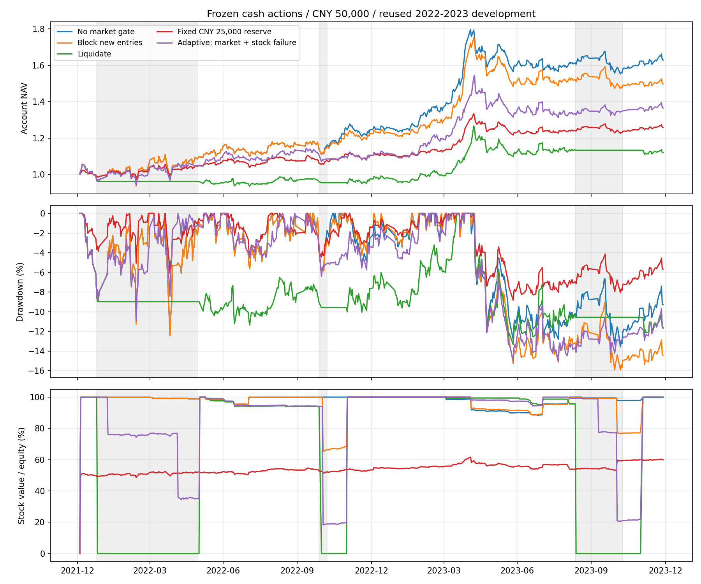

# 持有目标与现金动作：过程检验结果

日期：2026-09-13。**本轮研究完成，所有候选仍未准入。** 完成原8个目标模型及历史代码修正后的8次重拟合、原16组现金动作回放、追加5组个股确认回放及244项测试。没有读取2024+行情或改动生产。

本轮把问题进一步定位到了两处：**收益目标对齐有局部帮助，但改进没有跨开发窗口保持；全市场警报与账户所持五股的风险并不一致，而单次个股趋势失败又容易触发过早退出。** 当前信息还不能可靠区分暂时回调与值得退出的趋势破坏。

完整产物：[原始run](../outputs/policy_cash/20260913T063048_495344Z/)与[历史代码修正run](../outputs/policy_cash_alias/20260913T070201_664126Z/)。原始数据、模型、报告快照及失败记录均保留；下文P2使用修正后结果，P3账户结果不受此次连接修正影响。方法与追加实验的登记顺序见[研究协议](POLICY_CASH_PROTOCOL_20260913.md)。以下均为重复开发窗口结果，不是新的样本外验证。

## 一、实际账户：空仓动作没有带来稳定改善

固定主板、0—5只、月度复核、合法整手、不强求等额、不设任意股价过滤。原低换手分数、收益点估计与持有许可冻结；已有趋势退出和ST退出始终有效。“无市场门槛”并不等于永不卖出。

5万元、2022—2023年484个交易日，收益已计费用，Sharpe按每日账户收益计算：

| 动作 | 累计收益 | 年化收益 | 最大回撤 | Sharpe |
|---|---:|---:|---:|---:|
| 无市场门槛 | +62.93% | +27.90% | −13.57% | 1.33 |
| 警报仅禁新仓 | +49.85% | +22.62% | −15.91% | 1.11 |
| 警报直接清仓 | +12.02% | +5.89% | −13.33% | 0.49 |
| 固定保留2.5万元现金 | +25.84% | +12.29% | −8.83% | 1.15 |
| 追加：警报＋个股失败提前退出 | +36.51% | +16.99% | −15.05% | 0.98 |

固定储备是先让2.5万元子账户选择真实整手，再合并不动用的2.5万元现金；股票盈利后总账户股票权重可以超过50%，本轮平均为54.08%。它不是恒定50%仓位，也不是事后匹配全清策略的最优暴露。



不同本金累计收益：

| 动作 | 2万元 | 5万元 | 10万元 |
|---|---:|---:|---:|
| 无市场门槛 | +52.85% | +62.93% | +58.86% |
| 仅禁新仓 | +54.43% | +49.85% | +56.47% |
| 直接清仓 | +12.60% | +12.02% | +10.11% |
| 追加个股确认 | +31.71% | +36.51% | +40.01% |

仅禁新仓在2万元略增收益，但回撤由13.16%扩大至14.32%；不能从这一格认定有效。直接清仓在2万和10万元也未降低回撤。跨本金的整手路径差异必须保留，不能只报表现最好的本金。

原16案例还包含5万元三动作倒序与双倍费用。倍费后累计收益依次为55.66%、51.51%、11.96%，最低费用与比例费用同时翻倍。仅禁新仓的倍费结果反而略高，是重新分配整数股后交易路径发生变化，成交数28→30；不能解释成提高手续费有利。

## 二、警报过程：清仓等待与实际持仓风险不匹配

沿用已有`extreme_recovery`完整状态，包括风险与恢复等待，没有改阈值。直接退出在警报次交易日执行；恢复后等待原月度复核再买入。

| 清仓执行日 | 恢复状态执行日 | 首次真实重入日 | 零持股交易日 |
|---|---|---|---:|
| 2022-01-26 | 2022-05-30 | 2022-06-02 | 81 |
| 2022-10-31 | 2022-11-07 | 2022-12-02 | 24 |
| 2023-09-12 | 2023-11-09 | 2023-12-04 | 53 |

实际空仓158日，另有初始化1日。5万元三次均当日完成最初五股清仓，没有跌停/停牌延期。清仓少赚不能主要归咎于卖不出去。原16案例共75笔初始清仓请求、75笔对应成交，均已单独核验；共同观察期中恢复后的普通卖单没有混入清仓耗时。

仅禁新仓保留旧仓，本轮仍只在初始化时全空仓。它和直接清仓都否决7次月度新仓复核，却形成完全不同的资金路径。5万元无门槛/仅禁新仓/直接清仓平均股票仓位分别97.85%/95.56%/65.84%。

### 固定警报当时的真实五股，再看它们随后怎样

以警报收盘实际持仓价值占总资产的比例为固定权重，现金为零收益，跟踪同一篮子的后复权价格。它是**无费用冻结价格代理**，不包含再平衡、真实分红现金或可执行反事实。

第一次警报三策略持有完全相同的五股：600828、601006、601018、601811、603868。警报当日五股中只有一股出现可观察的原始趋势失败，其余四股仍满足条件。

- 后5/10/20个交易日，冻结篮子分别上涨约5.07%/4.93%/4.57%；
- 至恢复信号收盘，累计上涨13.35%，期间相对起点最不利幅度为−2.99%；
- 这与全清后等待81个交易日的路径明显不同，说明至少此次市场警报未准确对应所持五股风险。

其余警报不应与第一次合并成独立样本：此前动作已改变持仓。直接清仓分支第二、三次原篮子至各自恢复信号收盘分别为−0.77%、−1.29%；第三次至首次恢复后买入日已转为约+1.28%。不同篮子、不同观察终点不能直接相减后称纯择时收益。

来源：[冻结篮子窗口](../outputs/policy_cash/20260913T063048_495344Z/cash_held_baskets/frozen_basket_windows.csv)、[警报时逐股状态](../outputs/policy_cash/20260913T063048_495344Z/cash_held_baskets/alarm_held_states.csv)、[事件字段口径](../outputs/policy_cash/20260913T063048_495344Z/cash_execution/ALARM_FIELD_SCOPE.md)。

## 三、追加个股确认：更有针对性仍不等于更准确

看到上述P3结果后，单独登记P3b，明确属于**自适应追加研究**，不混入原16组。

追加政策只在原月度复核、市场仍禁止交易、且个股原始趋势可观察并失败时，提前退出该股。原双次失败退出始终保留，未知不触发新退出。它把共同证据下的确认从两次提前到一次，是新政策，不是修复原规则。

共改变2881个日期股票许可单元；每个账户实际新增9次退出、涉及7只股票，全部成交，无延期。5万元收益降至36.51%，回撤仅比原仅禁新仓略少。新增退出后5/10/20日价格代理均值分别约+1.50%/+2.45%/+5.36%，20日有7/9为正。

这些走势支持“部分首次失败只是暂时回调”的解释，但不足以证明所有卖出都错误，也不能将代理收益直接加回账户。多本金与倒序重复案例不是独立证据。追加5案例全部保留，未继续搜索确认次数或均线阈值。

详细触发、实际卖单及后续路径：[追加实验报告](../outputs/policy_cash/20260913T063048_495344Z/cash_confirm/README.md)。

## 四、持有目标对齐：局部改善未跨窗口保持

用原9特征、同Ridge容量分别预测三种费前单位路径：60日退出后持币、固定120日、原持有规则退出后持币；共同观察到T+121开盘，提前退出也不提前成熟。三个全局模型共用政策120日风险预测，避免收益目标和风险门槛同时变化。

官方限价、原价开盘、成交量、ST与退市均进入路径状态。无法卖出时继续待卖，期末未退出者只保留估值。它仍不包含组合整手、单股上限和真实分红现金账本，因此下表是机会评价，**不是账户收益**。

按三个模型各自选出的Top5，统一评价同一个政策120日结果：

| 拟合收益目标 | 2019—2021实际政策收益均值 | 该窗预测均值 | 2022—2023实际政策收益均值 | 该窗预测均值 |
|---|---:|---:|---:|---:|
| 固定60日 | +1.99% | +8.48% | −1.77% | +7.41% |
| 固定120日 | +8.08% | +16.59% | +0.95% | +13.20% |
| 政策120日 | +2.35% | +12.89% | +2.69% | +10.69% |

这里60/120日模型与共同政策目标的差距应称**目标错配误差**，其原目标校准另表输出；不能把所有差值都叫原生预测偏差。政策模型自身的高估分别为10.54、8.00个百分点。

政策目标在2022—2023确实比两个固定期限目标更好，不能隐藏这部分改善。但在2019—2021，它相对60日只增加0.36个百分点且高估更大，相对120日少5.72个百分点。预先登记的四项比较为两败、两胜；**整体不通过，因此没有启动附加8组目标模型交易回放**。这按停止条件收束，不是遗漏待做检验。

两窗分别31和19个成熟月，另外各5个月的未成熟候选及预测保留，不用未来数据补齐。三个目标在成熟月Top5标签覆盖均为100%；总日期平均覆盖31/36、19/24不能误称缺失数据率。

另一个过程问题出现在P2低换手常数对照：2018年底估计的120日不利幅度为16.03%，高于固定15%门槛，因此2019—2021全部36个月拒绝新仓；2021年底估计变为14.81%，2022—2023又全部放行。这不是P3原低换手账户，也不是成功择时，而是期限变化后预测量与硬门槛组合形成的决策跳变。本轮没有据此调整门槛。

来源：[目标比较停止门](../outputs/policy_cash_alias/20260913T070201_664126Z/policy_target_gate.csv)、[开发机会统计](../outputs/policy_cash_alias/20260913T070201_664126Z/development_diagnostics/top_k_summary.csv)、[执行期机会统计](../outputs/policy_cash_alias/20260913T070201_664126Z/execution_diagnostics/top_k_summary.csv)。

## 五、长持有标签里仍有大量未结束持仓

在各窗共同成熟、可入场且执行证据已知的趋势机会中：

| 窗口 | 机会数 | 政策120日末仍持有 | 有未知趋势复核的机会 | 发生卖出延期的机会 |
|---|---:|---:|---:|---:|
| 2014—2018 | 23,682 | 50.20% | 5,849 | 114 |
| 2019—2021 | 25,174 | 29.66% | 671 | 161 |
| 2022—2023 | 17,258 | 23.97% | 313 | 88 |

期末仍持有不都意味着趋势持续良好，也不等于卖不出去；例如2022—2023的4137个期末旧仓中，仅1个有未完成卖单，其余主要是尚未请求退出的行政删失。所有标签保留了三时钟、资金占用与未知复核状态，不能再用已结束持仓的中位天数代表全部趋势寿命。

共同观察上限也不等于强制最长持有120日。政策模型学习的是截至该时点的估值结果，不能据此预测多年长期上涨。

来源：[完整标签过程表](../outputs/policy_cash_alias/20260913T070201_664126Z/policy_label_process_summary.csv)。

## 六、数据工程与完整核验

- 243,955行原PIT机会、113个复核日期、3291只主板股票；所有原始特征/rank逐格保留，76,213行符合趋势入场条件。
- 补齐2433日官方限价缓存。2021-12-29起全市场响应触5800上限，代理忽略offset；截断响应未写入可用缓存，改为事先固定的研究代码查询。失败、分页探针和修复前源码保存在`download_attempts/`。接口限额依据[Tushare原始文档](https://tushare.pro/document/2?doc_id=183)。
- 最后核查发现1372个限价缺口来自同一股票历史代码连接：`000043.SZ`自2019-12-16改为`001914.SZ`，以[发行人实施公告](https://disc.static.szse.cn/download/disc/disk02/finalpage/2019-12-16/a5a3d55e-cc2e-42e6-91c1-ea98235594fb.PDF)及原始缓存逐日核实。在独立run中只修正生效日前的唯一代码匹配，拒绝重复与目标冲突，不修改任何限价数值、缓存、参数或原模型。48个未知机会（其中12个趋势机会）恢复可评价，其他股票标签逐格一致；训练样本分别增加9与12行，执行证据未知降至0。趋势复核未知仍保留，不能混为一谈。
- 独立核验全表PIT、共同入场和成熟边界；另用不调用原标签函数的标量状态机复算317个机会×3目标，共951条路径、30,432个字段；454个无阻碍固定退出与原`marked_paths`一致。代码补正另对全部48机会×3目标独立复算144条路径、4608字段，不调用补正适配器或原政策路径函数；其余243,907行精确不变。
- 原8模型独立正规方程复算，最大系数误差1.23e−15；原共同训练23,673行/48日及49,435行/84日。代码修正后为23,682及49,447行，日期数不变，再用原参数重拟合8模型；独立正规方程最大系数误差1.235e−15，预测/分数逐值复现，风险及bootstrap一致，480行误差与960行Top-k统计通过。180个三目标月度Top5名单中4个发生成员替换、2个仅顺序变化。修正前政策Top5后窗实际均值2.96%，修正后2.69%；四项停止门仍两败两胜，原不利结果与修正影响均保留。独立复核产物见[修正核验目录](../outputs/policy_cash_alias/20260913T070201_664126Z/verification/)。
- 原16及追加5案例现金、股份、权益与阶段损益独立核验通过。原三动作倒序54份CSV、追加倒序18份CSV一致；无门槛三本金与上轮45份CSV一致。追加退出证据、实际成交及价格代理也通过。
- **完整244项测试通过。** 新增5项覆盖历史代码生效边界、冲突拒绝和读取器恢复。 追加分支出现的混合类型序列化、索引频率元数据测试问题均修复并留档；中止尝试已完成的一组与最终18份CSV及持有矩阵一致，未改研究政策或删除不利结果。

所有窗口均反复使用，机会标签重叠，现金警报只有三段；独立试验数不足以计算可信DSR。开盘成交、后复权单位标签、历史状态资料及公司行动仍有各自适用边界，核验通过不等于策略通过。

## 七、本轮判断

低换手仍保留为开发对照，尚不升级实盘。政策标签只在一个窗口改善，直接空仓及追加提前退出没有达到收益/风险目标；停止继续扫描持有期限、恢复阈值或确认次数。

后续值得检验的是**哪些信息能区分个股暂时回调与持续恶化，以及这些信息是否改善最终五股的选择与持有决策**。可考虑少量真正按公告时点可用的经营/现金流变化，并与同覆盖样本的纯价量模型比较；本轮未实施、未宣称有效。对任何新信息，仍须同时检验入选后误差、退出后走势、合法整手与完整现金账本。

## 复核入口

在`alpha_lab/`内运行，以下读取已有冻结产物：

```bash
python outputs/policy_cash/20260913T063048_495344Z/verification/verify_policy_labels.py --run outputs/policy_cash/20260913T063048_495344Z
python outputs/policy_cash/20260913T063048_495344Z/verification/verify_policy_target_models.py --run outputs/policy_cash/20260913T063048_495344Z
python outputs/policy_cash_alias/20260913T070201_664126Z/verification/verify_alias_label_paths.py
python outputs/policy_cash_alias/20260913T070201_664126Z/verification/verify_policy_target_models.py --run outputs/policy_cash_alias/20260913T070201_664126Z
python scripts/evaluate_policy_target_gate.py --run outputs/policy_cash_alias/20260913T070201_664126Z
python -m unittest discover -s tests -p 'test_*.py'
```

模型生成：`build_policy_labels.py`→`fit_policy_targets.py`；历史代码补正入口为`run_policy_alias_refit.py --parent 原run --run 新登记目录`，拒绝覆盖已生成标签；现金案例入口分别为`run_policy_cash_execution.py`与`run_policy_cash_confirm.py`。全部案例、失败留档、输入哈希和停止条件均保留；台账行数不作独立试验数。
