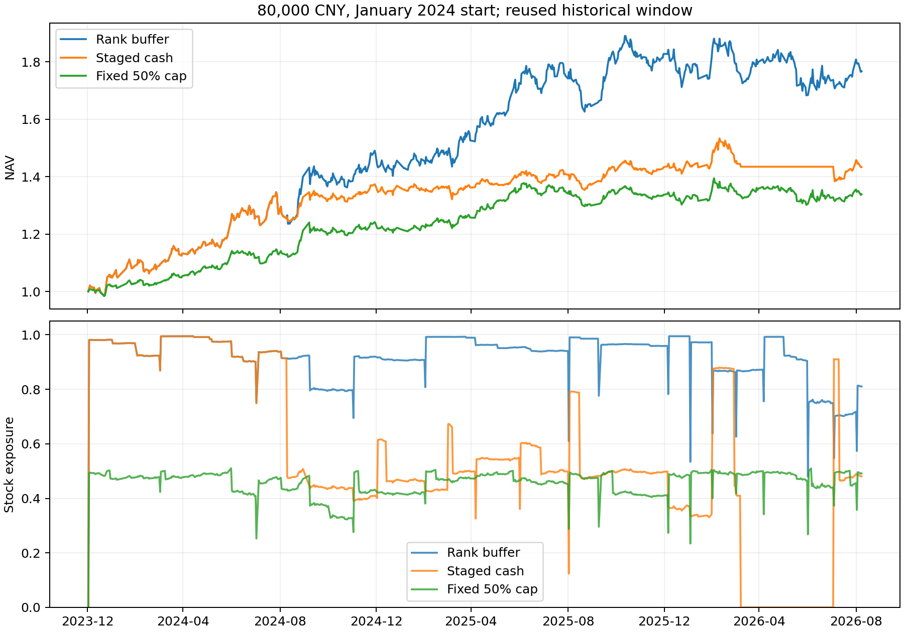
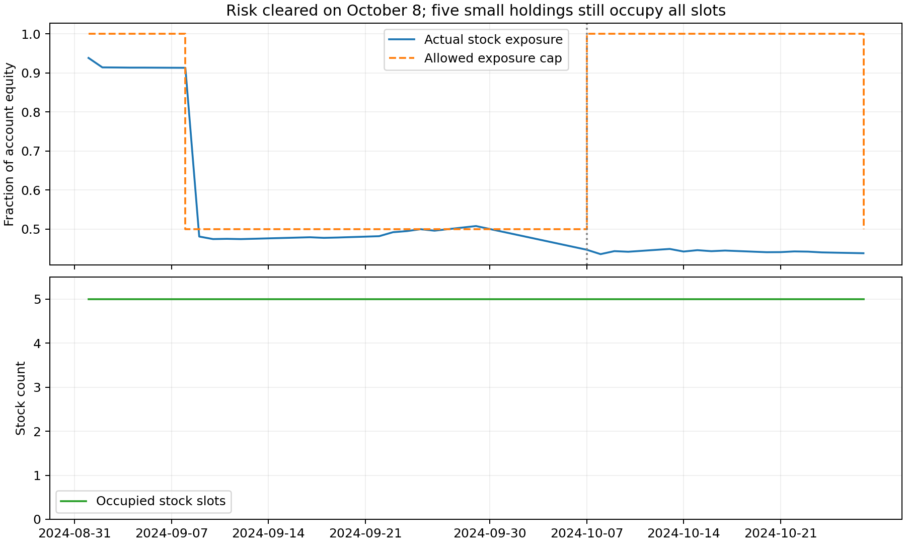

# 组合降仓、空仓与恢复机制验证

日期：2026-09-14。研究本金8万元、最多5股，数据截止2026-09-08。未改变实盘配置或真实账户。

## 本轮裁决

本轮分级现金方案不通过实盘升级。提前削减仓位确实减少了部分回撤，但收益损失过大；直接空仓甚至在多数账户中扩大最大回撤。不能把这解释为主动空仓本身无效：过程审计发现，本轮沿用的“旧仓不补足”契约使退出和恢复不对称，恢复新买权限并不等于恢复仓位。

主实验：`outputs/portfolio_cash/20260914T075010_199292Z/`，96账户、10,789笔成交。
后续单变量消融：`outputs/cash_reentry_ablation/20260914T075408_339162Z/`，16个提前重入账户及2个一致性对照。以两目录封存回执和源码为准，不单独信任本文数字。

## 固定规则与对照

周首交易日收盘，按实际持仓的股票市值权重观察各股60日高点回撤和20日均线。至少60%权重低于均线、加权个股回撤达到5%时触发风险；分级方案先将总股票仓位上限降至50%，回撤达到10%时请求全退。该指标是**加权个股回撤，不是组合净值回撤**，也不是相关性估计。

触发时冻结原篮子代码及权重；部分卖出或空仓不会替换风险篮子。弱势权重降至40%以下且加权20日收益为正，连续两个周度检查成立后解除限制。缺失证据打断恢复确认。减仓在周度或原月度复核时请求，未成交单按原规则跨日重试；所有决定在收盘后作出，次日按真实现金、限价、整手与T+1约束执行。

对照包括原版、排名缓冲原版、只暂停买入、只降至半仓、5%触发即全退、5%/10%分级、固定50%总仓位上限，以及原版叠加分级。另固定4%/8%、6%/12%两个邻域。每组覆盖2022连续和2024现金启动、1/8/15/22日四个月度日历；排名缓冲与主分级方案另加每边30基点成本压力。

半仓为复核时目标，价格变化、整手和无法成交可能造成期间偏离。原旧仓不补足、恢复后仅原月度窗口/到账补位的契约保持不变。固定半仓也会改变整手数量、席位和持仓路径，因此不是纯粹把原净值线乘0.5。

## 全部方案结果

以下是相对同起点、同日历排名缓冲原版的配对中位差。回撤改善列为最大回撤绝对幅度减少，正数较好。8个账户窗口重叠，不是独立样本外。

| 方案 | 年化收益差（百分点） | 回撤改善（百分点） | 回撤改善账户 | 成交笔数变化 |
|---|---:|---:|---:|---:|
| 只暂停买入 | −3.30 | +0.61 | 4/8 | −23.0% |
| 只降至半仓 | −8.65 | +4.89 | 7/8 | +22.0% |
| 触发即全退 | −14.98 | **−2.51** | 2/8 | +50.6% |
| 5%/10%分级 | −12.28 | +2.23 | 6/8 | +50.7% |
| 固定半仓 | −9.20 | +4.18 | 8/8 | +54.7% |
| 4%/8%分级 | −13.38 | +1.99 | 5/8 | +58.4% |
| 6%/12%分级 | −8.22 | +5.28 | 7/8 | +24.3% |

原版叠加分级，相对原版年化差−11.19个百分点，回撤改善2.55个百分点，改善5/8账户。主分级加每边30基点后，相对同成本排名缓冲年化差−12.40个百分点，回撤仅改善4/8账户。所有风险方案均未同时满足收益保留、回撤一致性和换手筛查。

2024月初启动实例：排名缓冲累计+76.68%、年化23.78%、最大回撤10.98%；分级累计+43.30%、年化14.44%、最大回撤9.77%。其中2025年收益由23.61%降至4.70%；2026年至9月8日由−3.32%变为约+0.01%。不能只展示2026避险而略去此前收益损失。



## 核心状态发现：解除限制不等于恢复资金配置

主分级零额外成本组共有99个观察到解除风险的账户事件，其中29个事件同时满足“5个席位仍占满、股票仓位不足60%”。这些是账户事件，不是99次独立市场事件。

例如2024月初启动账户，在2024-10-08解除风险时仍持有5股，股票仓位44.70%、现金59,537.94元。10月8日至25日共14个交易日持续占满5个席位，股票仓位仅43.57%—44.90%，没有新买入。

原因在代码：`selection_first.py`固定保留旧仓并关闭旧仓买入；现金引擎只将不在持仓中的候选交给新买规划器。减仓只减少股数，未释放席位。解除风险仅取消新买限制，既不会补回原股数，也不会主动替换这些小仓位。因而本轮分级收益损失混合了风险误判、现金持有以及这一恢复限制，不能全部归因于择时信号。



## 追加消融：只提前新仓重入仍然失败

观察首轮收益损失后另登记单变量实验：风险恢复当天允许冻结一次次日买单，沿用最新已知月度候选及风险预算；不改退出规则、不补足已有股票。该实验是后续机制诊断，不是事前留出验证。

相对原分级方案，零额外成本8账户年化全部下降，配对差中位数−2.29个百分点、最大回撤进一步扩大3.30个百分点；额外每边30基点下，年化差−2.65个百分点、回撤扩大5.64个百分点。提前允许新仓不是解决办法，也没有检验到“恢复减掉旧仓”的效果。

## 警报误伤与有效防守需分别保留

主分级100个账户警报中，98个具有完整后续20交易日报价；冻结原股票权重的复权价格代理有67个最终上涨，中位数+2.63%，期间最差路径中位数−1.49%。这只是原篮子的事后价格诊断，不含执行费用、不等于真实可得收益，也不能将重叠警报视为独立样本。

2024月初账户的2024-09-09警报后，原篮子20日代理收益+13.66%，期间最差约−1.60%；2025-04-07警报后20日+8.66%。这类触发会误伤回调后的反弹。但2026-03-30警报后的原篮子60日代理收益−12.51%，说明也存在正确的风险识别。需要区分这些过程，而不是继续按全期收益挑阈值。

## 检查与实盘边界

- 主分支31项测试、提前重入分支32项测试通过，两套有重叠，不将它们宣称为63项独立测试。覆盖次日成交、无未来开盘输入、冻结篮子、未知数据打断确认、总预算和一次重入。
- 主实验16个原账户四账本精确复现，3个特征前缀及3个账户/风险状态截断通过；所有10,789笔成交重新对账，4,303个现金减仓请求均落在周度或月度复核日。
- 提前重入分支2个不启用功能的对照与主分级四账本完全一致，另有2个真实账户截断检验。所有账户坚持最多5股、整手买入、不得预支卖款。
- 仍为已观察历史，含税现金分红，日线穿价与足量成交是假设；没有真实账户前向结果，未改生产、未发送邮件。

下一项应检验有明确资金目标的恢复：只对本次组合风控实际减掉、且恢复时仍符合持有与风险约束的旧仓，按整手和真实现金有限补回；与不恢复及固定低仓位同时对照。必须记录恢复目标、实际填补、未填原因与再度转弱后的损失。历史上一般加仓恢复效果不佳，不能据此默认这项定向恢复会有效，仍须通过独立的资金路径回放。

## 复现

```bash
cd /root/autodl-tmp/alpha_lab
python scripts/research_portfolio_cash.py
python scripts/analyze_portfolio_cash.py --run outputs/portfolio_cash/<新目录>
python scripts/verify_portfolio_cash.py --run outputs/portfolio_cash/<新目录>
python scripts/research_cash_reentry.py --parent outputs/portfolio_cash/<新目录>
python scripts/verify_cash_reentry.py --run outputs/cash_reentry_ablation/<新目录>
python scripts/plot_portfolio_cash.py --run outputs/portfolio_cash/<新目录>
```

测试命令和完整输出保存在封存目录的测试日志及`run_tests.py`，两份研究引擎与冻结原版的差异随源码保存。不会覆盖AGENTS.md或历史研究目录。
