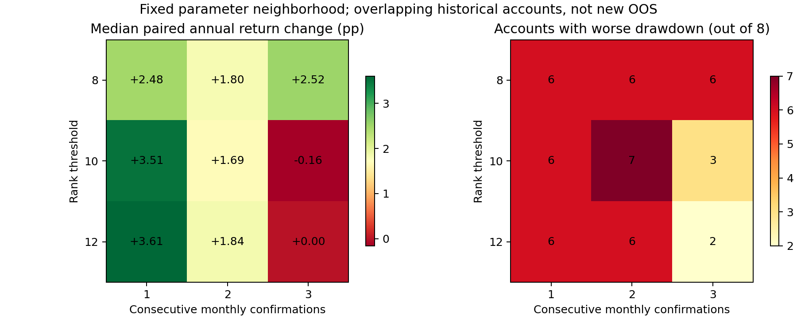

# 排名缓冲的实盘应用验证（2026-09-14）

## 结论

排名缓冲有跨参数的收益改善迹象，但不足以升级为实盘策略。主要瓶颈是共同风险下的高仓位和人工漏单后的持仓路径；本轮不更换生产配置、不生成真实委托、不发送邮件。

研究目录：`outputs/rank_live_validation/20260914T073733_065007Z/`。最终状态、源码和产物哈希以该目录 `completion.json` 为准，本文不能替代复现。

## 固定检验范围

- 8万元、最多5股、买入100股整手；保留原Hybrid退出、逐股风险预算及真实现金约束。
- 排名门槛8/10/12，连续确认1/2/3个月；2个起点（2022、2024）×4个月度日历（1/8/15/22日）。数据截止2026-09-08。
- 80个基本账户，加32个额外成本账户，共112个账户、9,811笔成交。成本压力对原版和10/2同时施加，每边额外10或30基点。
- 复用上轮校正后的中煤能源分红及474股执行数据；先取原始Top20再撤回排名退出股票的入选许可，禁止递补扩池。
- 这些年份和日历已经用于研究，账户高度重叠；不是新增样本外，不将8账户当成8次独立试验，不选择本轮收益最高参数上线。

## 参数灵敏性与成本

下表为相对同起点、同日历原版的年化收益差中位数；最后一列是8账户中最大回撤恶化的个数。

| 排名门槛 | 连续确认月数 | 年化差（百分点） | 回撤恶化账户 |
|---|---:|---:|---:|
| 8 | 1 | +2.48 | 6/8 |
| 8 | 2 | +1.80 | 6/8 |
| 8 | 3 | +2.52 | 6/8 |
| 10 | 1 | +3.51 | 6/8 |
| 10 | 2 | +1.69 | 7/8 |
| 10 | 3 | −0.16 | 3/8 |
| 12 | 1 | +3.61 | 6/8 |
| 12 | 2 | +1.84 | 6/8 |
| 12 | 3 | 0.00 | 2/8 |

9组中7组年化差为正，说明10/2不是孤立高点；但这7组均有至少6/8账户回撤扩大。延长确认到3个月也不普遍有效：10/3收益优势消失，8/3仍扩大多数账户回撤。

10/2的配对年化差中位数在原费用、额外10基点、额外30基点下分别为+1.69、+1.80、+1.59个百分点。较高费用改变整手数量和后续持仓路径，所以结果不一定严格单调。这是额外现金成本压力，**没有模拟迟一天买入、漏单或排队成交**。



## 回撤过程揭示的瓶颈

原版与10/2共16个零额外成本账户，在各自最大回撤区间均未出现整日全空仓。相对排名可以决定换谁，不能直接回答整个组合是否值得继续暴露于风险。

例如2024月初启动的10/2账户，净值从2025-11-12高点至2026-06-30下降10.98%，历时152个交易日，期间平均股票仓位92.93%，最低53.39%。高点时农行、工行和中国人寿合计占资产59.35%；低点时中行和中信银行仍占46.18%。区间逐股损益已与净值变化核对：农行−7,984.55元，中信银行−4,976.95元，中国人寿−3,554.50元，工行−2,849.33元，中行−2,491.83元；桂冠电力等盈利抵消了部分损失。

此例只描述该账户的回撤路径。原版自身最大回撤发生于不同起点，不能直接用两个峰值区间推断因果。逐股详情及各账户起止时间见 `analysis/drawdown_episodes.csv`、`drawdown_asset_pnl.csv`、`drawdown_holdings.csv`。

2022月初启动账户在2026年至9月8日，原版收益−1.59%，10/2为−3.32%。排名缓冲的长期收益改进不能表述为近期防守改善。当前风险折扣主要作用于单股上限，还缺少经过验证的组合共同风险退出机制。

## 人工执行闭环与税款

新增5项跨日场景，连同既有计划、输入、邮件、逐股检查共57项测试通过；信号、整手和风险相关22项测试通过。合成凭据验证不能冒充真实券商成交。

- 买单未提交：不记成交，次日无卖出到账时不自动追买；可能等到下一次复核。这是操作限制，需要单独检验有限期补执行规则，不能直接沿用过期邮件。
- 卖单未提交：待卖意图跨重启保留，资金和席位保持占用。
- 部分卖出：仅已成交款可用于补位，余量继续待卖；不会拿尚未卖出的股票当现金。
- 未终结委托阻止次日快照核对；实际补税通过带凭据的独立流水入账并去重。

现金分红仍按含税金额回测。[财税〔2015〕101号](https://www.chinatax.gov.cn/n810341/n810755/c1797427/content.html)规定，个人相应持有期税负为20%、10%或超过一年暂免，短期持股分红可在转让后扣收。因此交易手续费不是个人红利税的替代项。

2024月初账户已计现金分红，原版9,712.76元、10/2为11,616.53元；机械按全部20%估算的直接税额上限分别1,942.55元、2,323.31元。**这只是既定路径现金分红的税额范围，不是精确税款、税后回测或总收益误差上界**，没有计算扣税改变整手买入与再投资的反馈。

16个零额外成本对照共1,358笔成交，1,355笔模型按开盘价成交，3笔依赖日内严格穿价。两种日线匹配都不能证明真实订单足量成交。

## 验证与后续优先级

逐账户验证资金/股数守恒、最多5股、整手买入、决策早于成交、买款不超过前日现金；16个原账户四账本精确复现。144个规则截断前缀及3个完整账户截断回放的最终结果见 `verification.json`。根目录AGENTS.md与冻结生产源文件未改。

本轮工程筛查中，参数邻域和成本项通过，收益一致性与防守项未通过。筛查阈值是研究判断标准，不是独立统计检验。

下一步应冻结10/2作为对照，优先验证组合共同风险识别、低频降仓/空仓及重新进入，再检验人工错过执行窗口后的有限期重算。记录日度仓位、共同风险暴露、现金持续天数、退出损失和重入踏空；收益、回撤和换手同时评估。不能靠继续改变排名门槛，或机械限制高价股来替代这项工作。

复现（新建输出目录）：

```bash
cd /root/autodl-tmp/alpha_lab
python scripts/validate_rank_live.py
python scripts/analyze_rank_live.py --run outputs/rank_live_validation/<新运行目录>
python scripts/verify_rank_live.py --run outputs/rank_live_validation/<新运行目录>
PYTHONPATH=src:tests python -m unittest test_manual_continuation test_manual_execution test_shadow_execution test_shadow_inputs test_execution_metadata test_mail_outbox
PYTHONPATH=src:scripts:tests python -m unittest test_selection_stability test_rank_entry_alignment test_selection_scope test_startup_timing test_risk_budget
```
