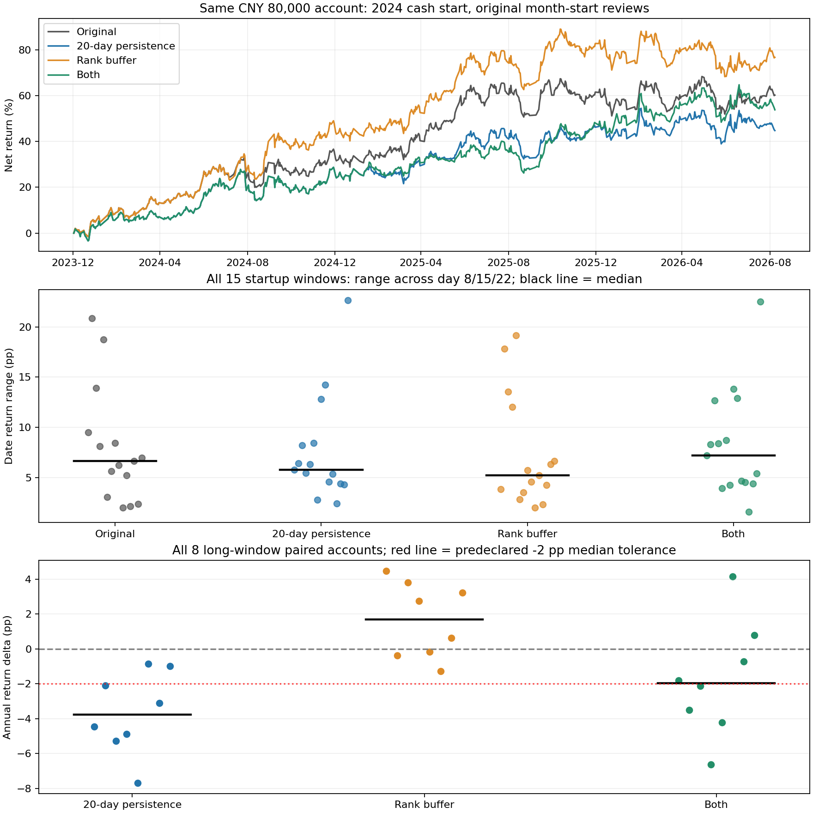

# 选择持续性与排名缓冲：完整研究报告

日期：2026-09-14。冻结行情终点：2026-09-08。账户：8万元、最多5只、买入100股整手，沿用Hybrid + full_risk。

## 结论

**排名缓冲可以保留为下一轮候选；20日持续性平滑及其组合不替换原版。** 排名缓冲将启动日期收益极差的中位数从6.67降到5.23个百分点，降低21.7%；8个长期配对的年化收益差中位数为+1.69个百分点，成交次数增幅中位数为5.95%。

但日期敏感度仍然不小：最大收益极差还有19.16个百分点；长期8组中7组最大回撤变差。排名缓冲通过的是本轮预定研究门槛，不能解释成防守升级、统计显著或实盘准入。原策略与实际账户均未改变。

本轮完成183个新账户、45个封存启动对照，共228个分析账户；新账户最终账本含7,313笔成交。初次回放后修复一处分红遗漏和候选过滤顺序问题，两个失败账户及106个受过滤顺序影响的账户均已重跑，临时结果与失败记录保留。

## 方案及固定实验

目录：[`20260914T070228_976007Z`](../outputs/selection_stability/20260914T070228_976007Z)。参数：[`selection_stability_research.yaml`](../configs/selection_stability_research.yaml)。

原版已经使用60日平均换手率排序，并非直接按一天换手率交易；不稳定性发生在某一复核日的资格和名次如何分配五个席位。候选收益预测仍为同一正常数，名次差不是预测收益率差。

| 政策 | 改动 |
|---|---|
| baseline | 原单日复核排名、Hybrid持有和风险折扣 |
| smooth20 | 每日原分位分数平移到[0,1]，无资格/未知日记0，取最近20个交易日均值；当前日仍须合格 |
| rank_buffer | 仍有入场资格、但连续两次正常月度复核排名在第10名之后时，撤销旧仓保留许可 |
| combined | 同时采用上述持续性分数与排名缓冲 |

排名缓冲不是每月强制重置Top5。未知或无入场资格时打断相对排名计数，由原Hybrid继续处理趋势退出；并列取最优名次，原退出和未知不被改为持有。先按完整截面排序固定原Top20，再禁止当期确认排名退出的股票重新买入，留空不向后扩池。卖出后只能用实际到账现金补位，不预支卖款。

月度复核频率不变，卖出和之后的补位可能分两天执行。首次月中建仓不额外累计或清零下一月的排名确认。

买入与继续持有使用不同门槛，参考Novy-Marx、Velikov对交易成本和买入/持有缓冲的研究；论文不证明本项目的“10名、两次”最优，也不保证相对当前无限期保留旧仓的基线降低换手。[NBER原文](https://www.nber.org/papers/w20721)。

实验包括：

- 启动组：沿用上轮15个季度窗口×8/15/22日，统一从8日对应交易日起计244日收益，含现金等待；每组随后回原月初。45个原版账户作对照，新增3政策×45=135个账户。
- 长期组：2022/2024空仓起始×1/8/15/22日历×四政策，共32个账户，统一到2026-09-08。
- 平滑邻域：10日和40日各跑上述8个长期账户，共16个。没有据此重新挑选平滑参数。
- 排名缓冲的8/12名或不同确认次数邻域尚未检验，本轮不宣称该参数已普遍稳健。

## 日期敏感度与收益代价

收益极差是同一窗口8/15/22日三账户最大累计收益减最小累计收益，先逐窗口计算，再汇总15个窗口。下表均为百分点。

| 政策 | 收益极差中位数 | 最大收益极差 | 回撤极差中位数 | 最大回撤极差 |
|---|---:|---:|---:|---:|
| 原版 | 6.67 | 20.88 | 1.11 | 5.34 |
| 20日持续性 | 5.78 | 22.67 | 1.29 | 7.67 |
| 排名缓冲 | **5.23** | **19.16** | **0.81** | **3.19** |
| 两者组合 | 7.19 | 22.54 | 0.51 | 5.89 |

排名缓冲有9/15个窗口的收益极差下降，2组相同、4组增加；45个启动配对的收益差中位数约为0，成交数中位数增加2笔。初始成交45/45组与原版完全相同，改善来自之后的持仓路径，而非重新挑了更好的首批股票。

下表在8个长期账户中先与各自原版配对，再取差值中位数。回撤“恶化”表示跌幅加深；它与分别计算两组指标中位数再相减不是同一统计量。

| 政策 | 年化收益变化 | 最大回撤变化 | Sharpe变化 | 成交次数变化 |
|---|---:|---:|---:|---:|
| 20日持续性 | −3.78个百分点 | 恶化0.72个百分点 | −0.22 | +4.61% |
| 排名缓冲 | **+1.69个百分点** | **恶化0.47个百分点** | **+0.08** | **+5.95%** |
| 两者组合 | −1.97个百分点 | 恶化1.21个百分点 | −0.10 | +18.04% |

排名缓冲长期收益5/8组提高，回撤只有1/8组改善。其余3组年化分别下降约0.16、0.38和1.27个百分点，不能只展示2024月初的优势。

事前门槛为：启动收益极差中位数至少下降20%；长期年化配对中位损失不超过2个百分点、回撤恶化不超过1个百分点、成交数增幅不超过25%。排名缓冲通过四项；20日持续性未通过日期和收益项；组合未通过日期和回撤项。这些是研究筛选条件，不是实盘收益承诺。



完整数据：[228账户](../outputs/selection_stability/20260914T070228_976007Z/analysis/all_accounts.csv)、[配对结果](../outputs/selection_stability/20260914T070228_976007Z/analysis/paired_results.csv)、[15窗口日期极差](../outputs/selection_stability/20260914T070228_976007Z/analysis/startup_ranges.csv)、[预设门槛](../outputs/selection_stability/20260914T070228_976007Z/analysis/acceptance.json)。

## 过程一：名单更稳定，为什么收益反而下降

1,134对相邻交易日中，前五名完全相同的比例由原版52.6%升到20日平滑的74.0%；每日平均换入名单数从0.632降到0.310。信号层确实更平稳，但启动日期收益极差只下降13.4%，长期收益反而全部8组下降。

原因之一是这里的持续性不仅平滑排名，还会较强地惩罚刚恢复入场资格的股票。取最近完整窗口的22日启动为过程例证（统一观察2025-07-08至2026-07-09）：

- 2025-07-22中国石化原排名第5，过去20日仅1日满足资格，平滑后降到第1,974；中国石油原排名第2，资格11/20日，平滑后第619。
- 浦发银行原排名第17、中国人保原排名第22，均为20/20日合格，平滑后升到第4、第5。
- 原版买入两家银行、两家石油公司和中国人寿；平滑版买入四家银行和中国人保。银行首批买入金额占初始资金从34.98%升到73.74%。这不是普遍行业结论，而是本窗口明确发生的暴露变化。
- 同窗收益原版+3.42%、回撤9.66%；20日持续性−9.48%、回撤17.19%。

因此，多日持续性会改变参与哪一阶段、哪一类股票，而不仅仅削弱日期噪声。10日邻域的长期年化配对中位差为−0.78个百分点，回撤改善1.32个百分点；40日则年化−5.71个百分点、回撤恶化2.71个百分点。不能据此泛化所有平滑方法无效；10日尚未做45组启动日期对照。

证据：[逐日名单变化](../outputs/selection_stability/20260914T070228_976007Z/adjacent_day_summary.csv)、[最近窗口资格和名次](../outputs/selection_stability/20260914T070228_976007Z/analysis/recent_example_score_states.csv)、[首批成交](../outputs/selection_stability/20260914T070228_976007Z/analysis/recent_example_initial_fills.csv)。

## 过程二：排名缓冲改善了什么

| 原月初日历、8万元 | 累计收益 | 年化 | 最大回撤 | Sharpe | 成交笔数 |
|---|---:|---:|---:|---:|---:|
| 2024起原版 | 60.20% | 19.32% | 9.74% | 1.15 | 63 |
| 2024起排名缓冲 | **76.68%** | **23.78%** | 10.98% | **1.37** | 63 |
| 2022起原版 | 141.16% | 20.83% | 10.03% | 1.29 | 102 |
| 2022起排名缓冲 | 139.72% | 20.68% | 11.38% | 1.25 | 117 |

2024月初账户有4次新增排名退出。第一次在2024-08-01撤销桂冠电力的保留许可，卖出后8月5日买入中国人寿600股、成交价31.50元；原版直到11月5日才买入200股、42.70元。之后的持仓股数和风险减仓路径也不同。

两账户总收益差13,183.867元，其中中国人寿的完整路径净损益差为6,584.694元，约占一半。浦发银行等贡献增加，中信银行的贡献减少。改进主要体现为席位释放后参与机会的时点变化，不能把整个增益归因于卖出动作或节省费用。

长期账户按政策/股票/实际卖出日去重后，排名缓冲退出的35个完整60日价格观察中，23个随后仍上涨，中位涨幅3.00%。这是退出日收盘至随后复权收盘的诊断，非可实现交易收益，也不能单独据此判定卖错；它说明排名退出并非精准识别未来下跌。新旧机会的相对比较仍需加强。

日期不同账户的期末股票集合平均Jaccard由0.903升到0.963，说明持仓集合更容易趋同；收益路径差异不会因此归零。

## 数据和实现修复，及最终验证

### 中煤能源分红遗漏

两个长期平滑账户在2024-08-20被除权参考价校验拦截。原缓存仅有每股0.113元特别分红，遗漏0.442元年度分红。发行人2024-029号实施公告第1、2页确认合计0.555元、登记日8月19日、除息及支付日8月20日。[公司原始公告](https://www.chinacoalenergy.com/cms_files/jcms1/web2/site/attach/0/5c706ac8437542fc8b925e9dc0c84260.pdf)。

只修正本轮派生输入对应单元格，公告可知日保持8月13日。其他181个成功账户及45个旧对照在登记日均无该股权益；两失败账户保留原件后重跑完成。原始缓存、父实验和行情不改，后续复用数据应继承本轮校正输入。

### 候选过滤顺序

最终检查发现，初版新增入场禁止先置空信号、再由引擎取前20，隐式扩池，其中406只候选不在准备的执行并集。它们被旧引擎记录为无已知报价跳过，不能据此断言数据充分。该问题属于本轮实现错误。

现按原排序先定Top20，再施加入场禁止，并新增“整只候选无行情/无风险覆盖即停止”的硬检查。106个受影响账户全部作废重跑；修正前账本和统计保存在`attempts/implicit_candidate_expansion/`。重跑后106组净值、成交、持仓完全一致，事件记录全部改变；最终报告使用重跑结果。

### 完成的检查

- 2,479个父实验封存文件核验；四日历旧信号逐格复现；三个父启动账户四账本精确重放，分红校正后再验。
- 9类完整特征前缀、10/20/40日持续性前缀一致；年度风险模型不重训，原风险复算最大误差1.11e−16后旧代码继续使用原浮点真值。
- 47项测试通过：8项持续性、1项退出与入场一致性、2项候选缺数硬检查、5项启动拼接、6项风险、25项因果执行对抗测试。
- 183新账户的7,313笔成交完成资金/股数/委托约束检查；228分析账户逐股损益与净资产对账，最大现金误差9.46e−11元、股数误差0。
- 三个真实账户截断前缀完全一致；452个日期/政策的Top20范围检查、284个排名退出当期禁止补买检查、1,517笔买单信号来源检查通过。
- 45组排名缓冲首批成交与原版完全一致；106组范围修正完整重跑。
- 校正输入复制到空目录，另选一个完整账户重放，四账本一致。没有把复制旧结果当成重新回测。

## 边界与下一步

本轮全部是已观察历史，15个窗口重叠，不能当独立随机试验或全新样本外。通过中位数门槛不保证尾部风险：排名缓冲7/8长期回撤恶化，最大日期收益差仍19.16个百分点。其邻域和新时期验证尚未完成，保留研究候选，不自动接入实盘。

收益扣除冻结的交易费用；股息按含税金额记账，本轮未新增按个人持有期递延扣缴的股息税模型。DAY日线限价仍是成交假设，不保证实盘足额成交。没有新增市场级主动空仓规则。

下一步应验证排名缓冲的参数邻域，并重点研究“旧仓与新机会的可比价值”，同时保留回撤和换手约束。当前收益常数不能提供两只股票之间的预测收益差，单靠排名替换仍可能牺牲盈利趋势。

## 从正确输入复现

以下路径会创建空结果目录，不覆盖封存原件；183账户和三个父对照会实际重跑。校正原始数据的历史过程、错误实现及修正证据均保留在源目录，无需为复现而重演错误。

```bash
cd /root/autodl-tmp/alpha_lab
python scripts/prepare_selection_stability_replay.py \
  --source outputs/selection_stability/20260914T070228_976007Z \
  --output outputs/selection_stability/replay_new
python scripts/run_selection_stability.py --run outputs/selection_stability/replay_new
python scripts/analyze_selection_stability.py --run outputs/selection_stability/replay_new
python scripts/verify_selection_stability.py --run outputs/selection_stability/replay_new
python scripts/explain_selection_stability.py --run outputs/selection_stability/replay_new
python scripts/plot_selection_stability.py --run outputs/selection_stability/replay_new
```
