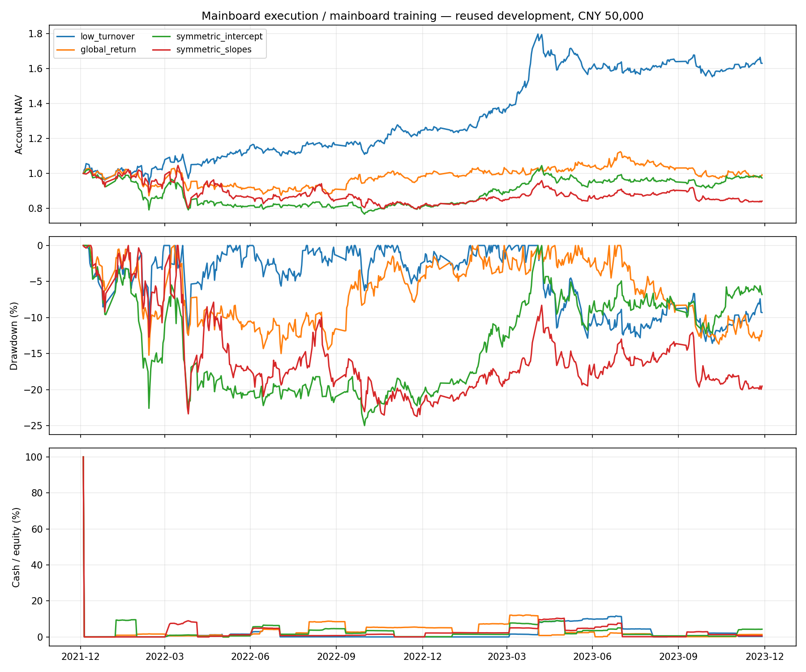

# 对称阶段分治、持有证据与入场过程检验

日期：2026-09-13。状态：**P0/P1全部登记检验完成；策略未准入。**

本轮没有找到优于低换手基线的稳定分治策略。更具体的问题是：阶段模型仍高估最终入选股票，旧窗口的阶段内优势在2022—2023年同期限机会中已经消失；实际买入进一步集中于涨速放缓阶段。不能把失败主要归咎于整手分配或持仓过久，也不应继续增加专家容量。

所有数字来自本轮保存的CSV及独立复核，不引用旧文档收益作证据。2019—2021与2022—2023均为反复使用的开发窗口，**不是新样本外验证**。未读取2024+行情行，未修改生产。

## 1. 实验范围与可比口径

产物目录：[`outputs/symmetric_phase/20260913T061312_007478Z/`](../outputs/symmetric_phase/20260913T061312_007478Z/)，以下简称run。配置见 [`configs/symmetric_phase_research.yaml`](../configs/symmetric_phase_research.yaml)。

- 0—5只、月度复核；旧仓趋势许可有效时继续持有，按合法整手配仓，不强求等额、不设置任意股价过滤。每只股票25%上限按复核价格约束，价格上涨或锁定可使盘中/期末标记权重超限。
- 主实验明确为沪深主板训练、主板执行情景；另设全A训练→主板执行迁移对照。并不推定用户实际板块权限。特征仍使用原全A可用池的PIT截面排名，未偷偷改成主板内排名。
- 共同9个特征、60日目标、正则强度1、100次日期块bootstrap均固定。2014—2018成熟标签拟合用于2019—2021诊断；执行前用截至2021年底的成熟标签重新拟合，2022—2023不滚动挑模型。
- 四条策略：低换手排序＋常数收益/风险估计、全局线性、全局斜率＋对称阶段截距、再加对称阶段斜率。阶段为恢复、加速、放缓。
- 三个阶段均用中心化指示变量并受相同惩罚，取消参考组待遇差异。设计矩阵12/39列存在冗余，不能说成12/39个独立自由度。它改善参数表达的一致性，不保证收益改善。
- 新仓门槛仍是预测收益>0.5%、预计不利波动≤15%；费用由真实执行层扣除。没有把排名或bootstrap稳定性当预期收益，也没有新增空仓阈值。

**21案例预登记：**4策略×2万/5万/10万元共12组，5万元倒序4组，全A训练迁移4组，5万元低换手证据记忆变体1组。全部保留，没有删除负收益案例。后文同窗口入场桥接是看到部分结果后追加的解释性分析，明确标记`posthoc_not_selection`，不改变上述方案。

## 2. 真实账户结果

2022—2023共484个账本交易日。下表为5万元主板训练、主板执行；年化按244日，Sharpe来自每日账户收益，费用已计入。

| 策略 | 累计收益 | 年化收益 | 最大回撤 | Sharpe | 买卖成交笔数 |
|---|---:|---:|---:|---:|---:|
| 低换手 | +62.93% | +27.90% | −13.57% | 1.33 | 29 |
| 全局线性 | −0.89% | −0.45% | −15.21% | 0.07 | 70 |
| 对称截距 | −2.63% | −1.34% | −24.97% | 0.02 | 68 |
| 对称斜率 | −15.84% | −8.33% | −23.71% | −0.28 | 73 |

不同本金的累计收益，体现整手约束后真实组合差异：

| 策略 | 2万元 | 5万元 | 10万元 |
|---|---:|---:|---:|
| 低换手 | +52.85% | +62.93% | +58.86% |
| 全局线性 | −9.20% | −0.89% | +0.86% |
| 对称截距 | −0.05% | −2.63% | −1.41% |
| 对称斜率 | −12.44% | −15.84% | −11.52% |

全A训练→主板执行的5万元累计收益依次为**+62.65%、+7.04%、+18.95%、+8.12%**，最大回撤依次13.01%、17.32%、17.98%、23.35%。扩大训练池会改变结果，不能只选迁移截距的正收益作为分治成功；它仍弱于低换手，且与主板训练反差明显。上一轮含其他板块的账户也不能直接与本表作单变量比较。



完整资金表：[capital_comparison.csv](../outputs/symmetric_phase/20260913T061312_007478Z/capital_comparison.csv)。

## 3. 从入选到持有：优势在哪一步消失

### 相同60日机会定义已经跨窗口退化

每月按冻结分数及代码取Top5，先选股再观察收益；不是每月换仓的账户回测。旧窗口33个成熟月份，新窗口21个成熟月份，末尾3个月保留为未成熟，不用2024数据补标签。

| 策略 | 2019—2021实际60日均值 | 2022—2023实际60日均值 | 新窗口预测均值 | 新窗口高估幅度 |
|---|---:|---:|---:|---:|
| 低换手 | +3.78% | +4.97% | +3.11% | −1.86个百分点 |
| 全局线性 | +2.84% | −1.09% | +7.34% | +8.44个百分点 |
| 对称截距 | +4.38% | −1.97% | +8.68% | +10.65个百分点 |
| 对称斜率 | +7.76% | −3.10% | +9.67% | +12.77个百分点 |

同期全趋势机会池为−1.52%。对称斜率在2022、2023成熟子窗分别为−2.01%、−4.55%，并非只有一个坏月。其阶段内选择贡献为−1.52个百分点，阶段配置贡献约−0.06个百分点；相比同阶段机会均值仍差，不能只归因于大盘下跌。

旧窗口中，对称斜率相对同日期、同阶段、规模/换手/动量近邻的差额为+2.16个百分点，Top5高估仍有3.09个百分点；全池收益MSE也未胜常数模型。旧窗口局部改善没有跨到执行窗口。近邻只是描述参照，不是可交易组合或因果控制；新窗口桥接未追加匹配选型。

这项桥接把持有政策保持在比较之外，足以说明机会层已存在问题，但**不能分离市场环境变化与训练截止变化的影响**。60日窗口重叠、同股重复，不可把105个股票机会当105个独立样本。

### 真正买入的是候选中有空余仓位时的子集

5万元实际新增持仓对应的60日信号标签均值：低换手+3.02%（13成熟/2未成熟），全局−1.22%（28/5），截距−5.93%（27/3），斜率−4.95%（29/4）。这是按入场次数等权的**信号标签代理**；另存日期等权与相同入场日期的Top5参照，不能与前表混作同权重比较。例如低换手改为入场信号日期等权仅+0.69%，相同日期纸面Top5为+2.26%，说明入场机会的时间分布也影响均值。

21组实际入场全部落在当月纸面Top5中，实际成交日期也均为信号次日。成熟路径没有缺入场、终点沿用估值或缺标记事件。但后复权60日代理仍不等于原价成交、分红、费用及最终持有政策净收益。

对称截距的30段实际持仓、斜率的33段**全部从放缓阶段进入**，各自阶段损益就是账户全部净亏损。模型虽有三个分支，最终精选并未形成跨阶段组合。低换手15段分布为加速4、放缓7、恢复4，损益分别+19,332、+2,467、+9,665元；这些是入场阶段固定归因，不是该阶段的因果alpha。

主板执行Top5 bootstrap平均重选频率为全局25.6%、截距31.7%、斜率34.2%。其含义只是固定准入池内的估计稳定性，不能解释为赚钱概率。低换手分数固定，重选率100%是构造结果。

详细覆盖、分解和逐笔映射见 [入场桥接报告](../outputs/symmetric_phase/20260913T061312_007478Z/entry_bridge/REPORT.md)。

### 低换手优势暂时保留，但还不等于实战策略

本轮5万元低换手10段已结束持仓的中位标记时长127.5日，另5段期末未结束；全局/截距/斜率已结束段中位数为43.5/41/42日。它们入场股票不同，不能据此推导“强制持有127天更好”。

低换手截至2023年10月底已累计+57.20%，最后两个月仅增加2,864元；本轮优势不是上一轮分治所呈现的年末北交所集中贡献。最大盈利股票贡献全部正向逐股利润的25.7%，集中风险仍需保留。

所有21组平均约4.99只、最大5只；5万元主实验平均股票仓位96.99%—97.85%。零持股只有初始化一天，**本轮仍没有主动全空仓事件**。因此本轮不能宣称解决了用户要求的风险感知退出。

## 4. 持有证据审计：规则变化不等于收益改善

用2014—2023已有三列行情重建原持有日历，24×5502格完全复现。资格过滤后的PIT表缺少2346个原可知状态，不能直接拿缺失值猜测原趋势。

单独变体仅让未知状态保留既有失败计数；有效趋势清零，失败累积到原阈值2，未知本身仍未知。完整120日滚动窗口、月度复核、已请求退出不可撤销等语义不变，未引入未知期限强制退出。这是策略变体，原“未知打断确认”规则并非已证实的代码错误。

变体改变199格、190只股票，均为原许可1变为0；无未知数据股票保持一致。原15个基线的已持有股票与这些变化格交集为零。**本轮第21组真实回放也与低换手基线全部15类CSV精确一致**，所有实际持仓未知复核次数为零。结论限于未触发路径，不是否定该语义在其他股票上的作用。

三个时钟分别保留：首次可观察失败、政策退出请求、实际成交。原15基线共446段：371段闭合、75段期末行政删失；闭合原因为367次趋势退出、1次ST、3次单股上限将仅有100股整手卖光。后者不能归为趋势失败。唯一ST退出等待6个交易间隔，其他趋势请求在记录请求的执行日完成。跨资金重复段不能当独立样本。

细节与状态轨迹：[P0持有证据报告](../outputs/symmetric_phase/20260913T061312_007478Z/holding_evidence/REPORT.md)。

## 5. 完整验证与边界

- 16个模型独立日期等权复算，系数最大误差1.17e−14；预测完整复现。正交对比表达、全部阶段顺序置换、行乱序、标签成熟边界、bootstrap阶段系数和均通过；528条Top1/5分解通过。
- 追加桥接69,855条标签与原`marked_paths`独立复算一致，21案例539次实际入场映射、权重、同日期参照及成交时滞通过；不成熟月份恰为2023年10—12月。
- 21个账户逐股独立现金、权益、股数、阶段损益核验全部通过，现金误差最大7.73e−12元；没有缺失涨跌停、陈旧持仓估值警报。缺失缓存39只补全，候选共528只。
- 四组倒序独立进程×15类CSV，共60份精确一致；持有变体另15份一致。输入、配置及核心源码在执行前后核对哈希。
- **完整199项测试通过**，含9项对称模型、4项持有证据、3项执行矩阵/漂移测试；状态测试包含243条三态路径。日志见run的`execution/full_test_suite.log`。
- 仍存在研究限制：重复开发选型、重叠标签、训练池迁移敏感性；开盘价同时用于配仓和成交仍是撮合近似。此次没有重做全部费用/滑点压力矩阵，也没有证明实时数据与前向交易闭环。

## 6. 判断与下一步边界

P0/P1已完成，**不准入分治策略，不继续增加专家容量，不从旧收益外推**。保留低换手作为开发对照；当前证据也不足以将它升级实盘。

原研究顺序中的P2统一政策路径目标与P3禁新仓/清旧仓分离仍未实施。本轮降低了“仅仅期限错配造成亏损”的可信度；P2只能作为有停止条件的独立假设检验，不能预设换目标就能救回分治。P3必须记录保护收益、错退、重入和成交受阻，不能用准入名单缩小冒充主动空仓。

## 7. 复核入口

在`alpha_lab/`运行，下列命令针对已有冻结产物，不重新选型：

```bash
python scripts/verify_symmetric_phase_research.py --run outputs/symmetric_phase/20260913T061312_007478Z
python scripts/run_symmetric_phase_execution.py --run outputs/symmetric_phase/20260913T061312_007478Z --verify-only
python scripts/summarize_symmetric_phase.py --run outputs/symmetric_phase/20260913T061312_007478Z
python -m unittest discover -s tests -p 'test_*.py'
```

模型生成入口为`run_symmetric_phase_research.py`；原持有日历重建入口为`audit_holding_evidence.py`；追加机会桥接入口为`diagnose_symmetric_entry_bridge.py`。所有配置、输入哈希、源码快照、完整正负案例及追加诊断性质均保存在run各层manifest中。台账事件数不充当独立试验数，DSR仍未评估。
