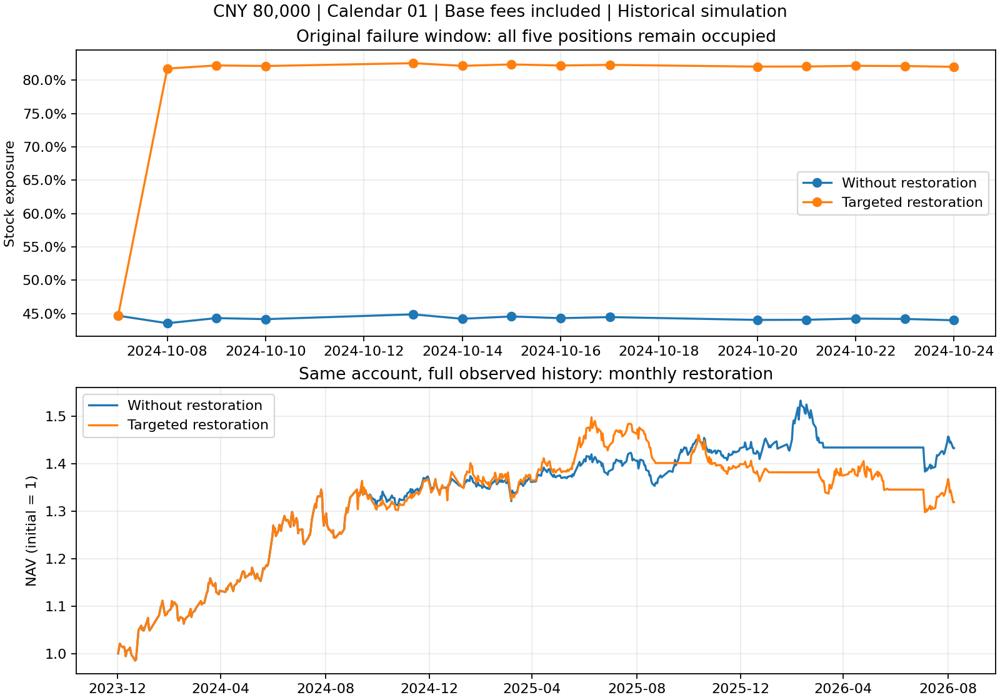

# 五席位旧仓定向恢复：修复、完整回放与独立实盘化审查

**结论：原结构性故障已修复，策略升级仍未通过。** 风控减仓后五只旧仓占满席位，现在可以按实际减仓额度补回；但32个启用恢复的账户，年化收益全部低于同日期、同费用的原排名缓冲策略。独立子智能体从逐日资产和成交账本复算，得到相同结论。未切换实盘、发送邮件、下单或初始化真实持仓。

## 修复内容与独立发现

新增 `src/targeted_restore_engine.py` 与 `src/restore_quota.py`，冻结旧引擎不改。恢复额度只来自本轮组合风控**已撮合成交**的卖出量；卖出计划不产生额度。恢复实际成交才消耗额度，重复成交标识幂等；新风险轮次、全退出及股数公司行动使旧额度失效。真实券商接入尚未完成，本文成交均指历史回测成交。

恢复仅针对仍持有、最近月度持有许可有效、当日个股恢复证据完整且20日收益为正的股票。在月度复核或风险解除后的提前机会规划，不做日频无条件追买。买入同时受剩余额度、100股整手、现有现金、单股风险预算、组合总仓位、成交量与费用约束；预留恢复资金后，才为新仓分配剩余现金。新买数量单独锁定T+1。

两名独立审查者发现并复测了四个问题：

1. **正式退出被待减仓遮蔽**：月度不再允许持有时，正式退出现在优先覆盖风控减仓，风险解除不能撤销正式退出。
2. **恢复缺少组合总仓位预算**：增加总股票市值上限，不能只检查单股和现金。
3. **缺失收益误判恢复**：NaN、未知持有许可或不足的个股证据明确阻断。
4. **重启状态可凭空携带额度**：反序列化校验当前轮次成交凭据余额，拒绝无卖出支持的额度。该校验不是券商凭据认证，实盘仍需事务接入。

## 直接验证原故障

固定原故障案例：8万元、2024年启动、1日历、基础费用，2024-10-08—25。

| 过程指标 | 不恢复旧仓 | 定向恢复 |
|---|---:|---:|
| 决策时持仓数 | 5 | 5 |
| 窗口内旧仓恢复计划／成交 | 0／0 | 5／5 |
| 窗口平均股票仓位 | 44.28% | 79.47% |

10月8日收盘规划，10月9日五笔恢复全部撮合，股票仓位升至81.73%；不需要先腾出席位。全32个恢复账户924笔恢复计划中，643笔规划时已有五只持仓，923笔最终成交。主审独立重建轮次与实际减仓额度，逐笔核对全部计划和成交。



该月度单账户完整窗口累计收益反而由43.30%降至31.91%，最大回撤由−9.77%扩大至−13.37%。能恢复仓位不等于恢复时点有利。

## 64账户的经济性结果

固定2个起始窗口（2022／2024起至2026-09-08）×4个日历偏移（1／8／15／22）×2档费用×4种机制，共64账户。两种恢复频率分别有开／关控制；32个关闭账户与封存父版本四账本完全一致。起始窗口重叠，不能视为64份独立市场样本，也不是新增样本外。

以下为每组8个**同日期、同费用配对差的中位数**。对照为原排名缓冲策略，不是有结构缺陷的现金减仓版本。回撤改善为正表示最大回撤减轻；0额外成本仍收基础费用。

| 恢复方式 | 每边额外成本 | 年化收益差 | 最大回撤改善 | 成交笔数增幅 |
|---|---:|---:|---:|---:|
| 月度 | 0 bp | −11.30个百分点 | +1.51个百分点 | +87.75% |
| 风险解除后提前 | 0 bp | −10.59个百分点 | −0.14个百分点 | +124.04% |
| 月度 | 30 bp | −11.40个百分点 | +3.58个百分点 | +67.07% |
| 风险解除后提前 | 30 bp | −13.73个百分点 | −1.75个百分点 | +126.36% |

零额外成本下，月度／提前恢复的夏普分别在7/8、8/8账户更差。按逐笔成交额／当日净资产求和并年化的双边成交活跃度，分别增加55.73%、81.34%，增加的不只是小额成交笔数。

若只与同频率但不补旧仓的残缺版本比较，零额外成本的月度／提前恢复年化差中位数为+1.93／+4.23个百分点；该局部改善不足以通过整体升级标准。两种恢复方式均未达到协议的年化损失不超过2个百分点、成交增加不超过25%的筛选条件。

## 完整检验与实盘裁定

- 64账户、10,127笔总成交：现金、股数、损益对账通过；100股买入、最多五只、先决策后成交检查通过。
- 32关闭控制的四账本精确复现；3个真实账户截断前缀四账本精确一致。
- 主审6项测试；因果审查独立15项对抗测试及25项既有因果测试通过；执行审查独立9项测试及30项既有人工／影子测试通过。测试套件有重叠，不合并宣称独立总数。
- 独立效用审查重算64账户与16个原排名缓冲账户的收益、244交易日年化、含初始资本的最大回撤、夏普、费用和成交数，全部一致。

**实盘阻断有两类，不能混为一个工程问题。** 第一，风险退出／重入规则的收益损失和交易负担仍过大，不能以结构修复作为部署理由。第二，现有人工入口只支持冻结策略，尚未接入冻结风险篮子、恢复计数、轮次及真实成交额度的原子事务；股数公司行动涉及待减仓时仍需带凭据的人工例外入口。现有8万元空仓登记不是已核对的券商收盘快照。

该候选保持研究用途，不接入生产。下一轮应直接分解退出后避开了多少下跌、确认滞后错过了多少上涨、恢复后承担了多少再跌，以及交易费用和路径改变各自的贡献；先检验风险规则的净效用，再决定是否值得做影子适配。原排名缓冲候选也不因本版失败而自动获准实盘。

剩余证据边界：无新时期样本外／券商前向业绩；股息采用税前现金口径，未完整模拟个人递延股息税；日线成交模型不能证明真实排队和足额成交。历史额度没有触发股数公司行动失效分支，该分支依据合成对抗测试而非本批历史样本验证。

## 复现与材料

在 `alpha_lab/` 执行（研究命令新建输出目录，不覆盖本次封存）：

```bash
python scripts/research_targeted_restore.py --run outputs/targeted_restore/new_run
python scripts/analyze_targeted_restore.py --run outputs/targeted_restore/new_run
python scripts/verify_targeted_restore.py --run outputs/targeted_restore/new_run
PYTHONPATH=src:tests python -m unittest discover -s tests -p test_targeted_restore.py
```

封存目录：[完整账本与回执](../outputs/targeted_restore/20260914T081149_007200Z/)。`protocol.json` 固定案例与源码哈希，`verification.json` 记录前缀与额度重建，`independent_audits/` 保存独立脚本、首次失败及修复后日志，`completion.json` 校验产物完整性；哈希不等于数据真实性认证。

独立报告：[因果与未来信息审查](INDEPENDENT_TARGETED_RESTORE_CAUSAL_20260914.md)、[执行正确性审查](INDEPENDENT_TARGETED_RESTORE_LIVE_20260914.md)、[完整经济性与实盘化裁定](INDEPENDENT_TARGETED_RESTORE_READINESS_20260914.md)。根目录已有 `AGENTS.md` 保持原哈希，未修改。
