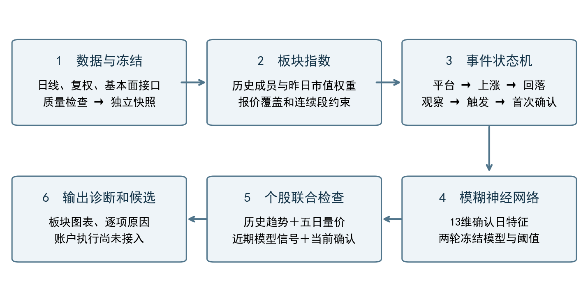
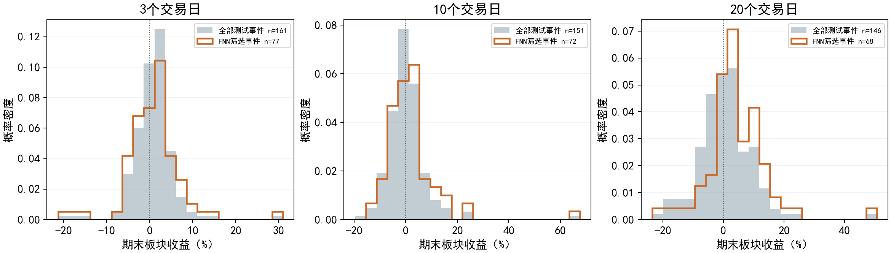

# 板块左侧事件筛选与模糊神经网络策略技术报告

**版本：2026-10-13｜最新行情：2026-10-12收盘｜历史训练与评价截止：2026-09-08**

本报告描述当前实际运行的策略，依据源码、冻结配置和本次重新核验的数据编写。报告编制不改变策略、门槛或模型，也不重新训练。文中“收益”如无特别说明，均为自算板块指数的事件观察收益，不是账户回测或实盘收益。

## 1. 策略定位与实现边界

策略试图捕捉这样的板块阶段：前期平台整理后形成明确上行，随后快速回落，价格重新接近同轮平台及上涨初期的参照区；在近期跌破峰前支撑、当前下跌速度放缓时产生确认。模糊神经网络进一步筛选确认事件，个股层检查历史上行、先涨后落和最近五日的换手与价格变化。

当前已实现的是**收盘数据驱动的机会筛选系统**。它能构建板块指数、识别事件、对新确认评分、输出个股诊断和候选。完整的资金分配、真实成交、持仓管理、移动止盈及账户回撤控制尚未接入这条实时流程。

| 主观交易概念 | 当前量化实现 | 边界 |
|---|---|---|
| 价值与历史状态比较 | 同一轮平台低点、平台高点及上涨初期价格参照 | 是历史价格代理，不是内在价值估计；没有盈利预测或财务估值模型 |
| 板块整体走势 | 自算申万二级板块指数及平台—上涨—回落状态机 | 仍使用申万二级，尚未切换为完整东财细分板块体系 |
| 市场情绪、涨跌比 | 上涨占比、广度变化、换手率及波动率 | 广度等进入模型，不是统一的独立择时开关 |
| 历史龙头 | 同一上涨阶段的个股涨幅及板块内排名 | 仅用于候选排序；不要求等待龙头先确认 |
| 五日换手与K线判断 | 前三日放量下跌、后两日缩量和负收益收窄 | 主要使用收盘收益与换手，未实现完整蜡烛图形态分类 |
| 市值大小、主力成本 | 输出市值和换手诊断 | 没有实际主力持仓成本模型、筹码峰模型或市值筛选阈值 |
| 支撑止损、日线移动止盈 | 输出近五日低价参考；旧配置含退出参数 | 当前扫描器不执行止损、止盈或订单 |
| 10万元、最大回撤30% | 配置中保留资金和回撤目标 | 尚未成为当前流程的有效账户约束，不能据此宣称回撤受控 |

板块层的“价值选择”目前更准确的名称是**历史价格参照下的左侧回落筛选**。它保留了主观策略的结构顺序，但并未完整复制主观估值和筹码判断。

## 2. 当前处理流程



原始日线及配套数据先通过质量检查，生成独立冻结快照，再构建板块指数。板块事件依次进入观察、价格触发和确认阶段；五组平台窗口的首次确认合并去重后，才进入模糊神经网络评分。

实时个股筛选同时检查板块当前状态、最近五个交易日的模型通过事件、个股趋势和五日量价。没有新确认事件时，网络不会对全部板块重新打分来补足候选。这也意味着：**当前神经网络只能筛掉已有硬规则候选，不能绕过硬条件发现被排除的板块。**

## 3. 数据、板块构建及时间口径

### 3.1 数据来源与冻结方式

当前行情通过已配置的Tushare代理取得。四个按日接口为 `daily`、`adj_factor`、`daily_basic`、`moneyflow`；另使用 `stock_basic` 刷新证券主档，使用 `index_member_all` 核对观察板块当前成员。资金流虽已下载，但不是当前13维网络特征之一。

更新流程检查交易日期、股票—日期唯一键、正价和OHLC边界、非负成交量额、正复权因子，以及市值和流通股本覆盖。开高低全零且成交量额为零的占位记录单独隔离；其他异常价格会阻止更新。价格不前向填充。成交量统一到股、成交额和市值统一到元，复权价格由原价乘复权因子得到。

每次通过检查后创建新行情快照，再生成新的板块版本。旧研究快照和旧报告保留；板块扫描逐项比较旧日期范围的数据和旧确认事件。10月13日盘中运行只补齐10月12日，未将当日未完成日线当作收盘输入。更新器还对当日更新设置北京时间17时的保守检查门槛；时钟门槛本身不代替数据完整性验证。

### 3.2 板块成员与指数

历史成员区间按 `[in_date, out_date)` 使用，2021-12-13前后分别采用SW2014、SW2021分类。未知或冲突分类不强行归属；证券存续使用上市、退市日期约束，而不是直接按当前在市状态过滤全部历史。

对于板块s，当日指数使用**昨日成员、昨日总市值权重**。在可取得连续复权OHLC的成员中，权重按总市值比例分配，并反复封顶、重分配，使单股权重不超过20%。这不是流通市值加权，也不是官方行业指数。

```
r[s,t] = Σ w[i,t-1] × (复权收盘[i,t] / 复权收盘[i,t-1] − 1)
I[s,t] = I[s,t-1] × (1 + r[s,t])
```

至少需要5只有效成员，且有效报价成员占昨日已知成员比例不低于80%。连续性中断或分类版本切换后重启指数段，新段首日收盘基点为1000，不跨段识别趋势、计算事件收益。缺失报价下，对可用成员重新归一化权重，因此指数仍有缺失样本选择风险。

板块换手率为有效成员成交股数之和除以流通股数之和，再乘100；不是个股换手率的简单平均。上涨占比为上涨股票数除以涨、跌、平且收益可观测的股票总数。指数使用昨日成员，而当日广度和换手使用当日成员，二者在成分调整日不完全同口径。

指数高低边界由分量高低价聚合，成分股极值不一定同时发生。这些边界不能当作可成交的板块盘中最高价、最低价。

### 3.3 当前覆盖与限制

截至2026-10-12，构建输入覆盖2014-01-02以来3,103个交易日、12,380,241条股票日记录、5,834只出现过报价的证券。目录跨分类版本共有170个板块编号，历史曾有效的板块131个，当日有效103个；这些数字不是同一个统计口径。

当日可用个股行情的行业分配覆盖约79.41%。历史成员补充资料有27个失败请求，尚未取得完整性与发布时间PIT认证。东财目录虽然已保存，但其完整成员数据集未建成。103个有效板块不能解释为覆盖所有行业和概念主题。

## 4. 板块事件状态机

### 4.1 同一轮平台、上涨和峰值

五组平台长度按固定优先级使用：**15、10、20、30、40个交易日**。突破日之前的完整窗口构成平台，不包含突破当天。平台识别及上涨参数如下。

| 参数 | 当前生效值 | 实际口径 |
|---|---:|---|
| 平台振幅上限 | 20% | 窗口最高收盘 / 最低收盘 − 1 |
| 平台首尾绝对收益上限 | 10% | 首尾收盘收益的绝对值 |
| 突破幅度 | 1% | 当日收盘至少高于平台最高收盘1% |
| 上涨初期长度 | 5日 | 从突破当天起取前5个交易日最高收盘，之后冻结参照上沿 |
| 最低前期涨幅 | 15% | 已观察到的峰值 / 平台最高收盘 − 1 |
| 最短上涨时间 | 5个交易日间隔 | 峰值位置减突破位置至少为5，不是连续上涨5天 |
| 趋势窗口 | 60日 | 在峰值处计算60日收益，要求至少5% |
| 趋势均线 | 40日 | 峰值收盘高于MA40，且MA40较10日前上升 |

峰值只随已发生的更高收盘更新；趋势、峰前支撑和下跌证据随峰值重置。均线条件评价的是峰值时的上行状态，不要求买入候选日重新站上均线，保留左侧性质。

同轮参照区下沿为平台最低收盘的80%，上沿为上涨初期最高收盘的105%。前5日未完成前不开放完整参照判断。所有“价值区”条件均绑定这轮事件，不能任意寻找事后有利的平台。

### 4.2 回落、快速下跌、减速与支撑

令P为已观察到的同轮峰值，t为当前交易日，p为峰值位置，I为板块收盘指数。

| 条件 | 判定 |
|---|---|
| 回落幅度 | `I[t] / P − 1 ≤ −10%` |
| 回落时间 | 峰值后2至40个交易日 |
| 快速下跌证据 | 曾出现 `I[t] / I[max(p,t−10)] − 1 ≤ −7%`；新峰出现时清空旧证据 |
| 峰前支撑 | 峰值前最多20个交易日的最低收盘，不包含峰值当天 |
| 跌破支撑 | 当日收盘严格低于上述支撑 |
| 当前减速 | 最近2日平均负收益幅度不超过此前3日的65%，且此前平均负收益幅度大于0 |

减速计算先令 `loss[t] = max(−日收益[t], 0)`，然后比较两个不重叠窗口。上涨日贡献0。它不要求当天出现阳线，也不等于“跌速逐日下降”；单日反弹仍可能使两日窗口不通过。

状态最长持续180个交易日间隔；突破后超过60个交易日仍未确认上涨、或峰值后超过40个交易日，也会结束该轮状态。结束后可重新寻找平台。时间上限会影响事件数量，不只是价格门槛在起作用。

### 4.3 观察、触发和确认

定义G为满足前期上涨、峰值趋势、回落幅度及年龄的结构条件，F为曾快速下跌，V为当前处于参照区，B为跌破峰前支撑，L为当前减速。

```
观察 watch[t]    = G[t] AND F[t]
触发 trigger[t]  = watch[t] AND V[t]
确认 confirm[t]  = G[t] AND V[t]
                  AND 最近5日曾trigger
                  AND 最近5日曾B
                  AND L[t]
```

最近5日含当天，且证据仅在同一事件、同一峰值内累计。这允许破支撑和减速发生在不同日期，但当前仍必须处于参照区、满足结构与减速。当前价格可以已收回支撑上方；只要近期破位证据仍在记忆内，就不必当天再次破位。

`first_confirmed` 只记录同一窗口事件中的第一次确认。跨窗口按日期、固定窗口优先级处理；同板块、同指数段的下一次独立事件，要求新峰值日期晚于上一已接受确认日期。否则归并为上一事件，避免多窗口重复计数。

当前板块状态的代表窗口按“确认、触发、观察、窗口优先级”选择。因此代表窗口会随日期切换；某个板块前期涨幅改变，可能来自平台窗口切换，而不是历史数据修改。

## 5. 模糊神经网络

### 5.1 模型解决什么问题

模型在已通过硬规则的首次确认事件中，拟合后续20个交易日板块收盘收益，以固定分数阈值保留一部分事件。它不是预测全部股票的模型，不直接优化账户收益、最大回撤或交易成本，也不是从空白策略空间自主生成买卖规则。

训练时另有固定模糊规则、岭回归对照；当前实时使用的是两轮模糊神经网络。固定模糊打分不与网络分数再次加权混合。

### 5.2 13维输入

| 特征 | 定义 |
|---|---|
| rally | 同轮峰值相对平台最高收盘的涨幅 |
| pullback | 当前相对峰值回落幅度的正数形式 |
| reference_distance | 当前指数 / 上涨初期参照上沿 − 1 |
| slowdown | 最近2日平均负收益幅度 / 此前3日平均负收益幅度 |
| log_turnover | 当前板块换手率 / 前20日平均换手率的自然对数；基准不含当天 |
| up_share | 当日有效广度成员中的上涨占比 |
| breadth_change | 上涨占比最近2日平均减此前3日平均 |
| peak_age | 距已观察峰值的交易日数 |
| platform_range | 平台最高收盘 / 最低收盘 − 1 |
| trend_return | 峰值处的60日收益 |
| trend_slope | 峰值处MA40相对10日前的涨幅 |
| volatility | 最近20个交易日板块日收益标准差 |
| quote_coverage | 指数有效报价成员占昨日已知成员比例 |

广度可观测成员不足已知成员80%时，相关广度输入设为缺失。预处理只用本轮训练集：以训练中位数填补缺失，全部缺失列退回0；按训练均值、标准差标准化，标准差下限0.001，最后截断至−5到+5。新数据沿用保存的预处理参数。

### 5.3 网络结构与目标

网络为一阶Takagi–Sugeno形式：每条规则具有可学习高斯中心和宽度，以及一个局部线性输出。

```
a[k](x) = −0.5 × Σj ((x[j]−center[k,j]) / width[k,j])²
weight[k] = softmax(a)[k]
local[k] = β[k,0] + Σj β[k,j] × x[j]
score(x) = Σk weight[k] × local[k]
width = softplus(raw_width) + 0.1
```

中心以训练样本KMeans初始化，初始宽度1.5，局部线性系数初始为0。13维输入下，每条规则含40个可学习参数，4条、8条规则分别约160、320个参数。

标签为确认日收盘至第20交易日收盘的板块收益，训练时除以0.1。损失是按样本权重平均的Smooth L1；同一天多个事件按日期内数量倒数降权，然后统一归一化。优化器为Adam，权重衰减0.01，梯度范数裁剪5。**当前随机实验没有时间衰减权重，也没有滚动训练窗口或定期再训练机制。**

### 5.4 训练、验证和测试的实际划分

按用户指定，330个事件以固定种子2026092301随机分成两个165事件半区。第一轮用A训练，将B再分为82验证、83测试；第二轮交换半区，使用B训练、A中的82验证和83测试。划分只使用事件ID，先落盘，再读取收益标签。

| 轮次 | 指派训练/验证/测试 | 具有完整20日标签的训练/验证/测试 |
|---|---|---|
| 1 | 165 / 82 / 83 | 146 / 69 / 73 |
| 2 | 165 / 82 / 83 | 142 / 73 / 73 |

最终模型仍只拟合各轮训练半区；验证集不并入最终训练。两轮合计有166个不同测试事件，另164个事件只曾作为某一轮验证，不能计入测试业绩。两个半区互换不构成两次完全独立实验：同一事件可在另一轮作为训练样本。

超参数搜索为规则数4/8、学习率0.003/0.01，各组合以种子17、43评估。每10轮检查验证损失，最多1500轮，最早从100轮开始选取最佳状态，150轮无改善则停止；每轮选择两个种子的平均验证损失最小组合，训练轮数取其最佳轮数中位数。之后以17、43、101三个种子按固定轮数重新拟合训练集，预测取均值。

| 冻结模型 | 规则数 | 学习率 | 最终训练轮数 | 50%训练分位阈值 |
|---|---:|---:|---:|---:|
| 第一轮三种子平均 | 4 | 0.003 | 100 | 0.0092378901 |
| 第二轮三种子平均 | 8 | 0.003 | 100 | −0.0067693687 |

两轮实际最终训练均为100轮，不能把“最多1500轮”写成实际训练量，也不能仅因训练结束就宣称已经充分收敛。最佳点落在允许选取的最早轮数，是需要结合训练曲线解释的结果。

阈值是本轮训练事件分数的中位数，固定后用于验证、测试及新事件。它不是每天截取新候选的前50%，实际测试保留率也不必等于50%。分数恢复到收益量纲，但仍不是校准后的收益承诺。

### 5.5 随机验证的解释范围

同轮训练、验证、测试的事件ID互斥，测试标签不进入拟合接口；但随机划分允许较晚事件训练较早测试事件，且共享市场环境。两个测试集合各83事件中，与本轮训练日期相同的分别40、43个，收益观察窗口重叠的分别78、77个。没有同板块观察窗口重叠，不代表消除了跨板块共同市场冲击。

因此这是固定历史事件池上的随机留出实验，**不是按时间推进的样本外交易验证**。此外，事件规则和总体历史分布在划分前已经研究过，保留该划分不消除研究选择偏差。

## 6. 个股趋势与五日量价

### 6.1 趋势和先涨后落

个股使用复权收盘，在当前日前60个交易日内找最高收盘，同高取最近一次；在该峰值前40日找最低收盘，同低取最近一次。要求窗口行情完整。

在峰值日，120日收益至少5%、收盘高于MA60、MA60较20日前上升。上涨起点至峰值至少5个交易日、涨幅至少15%；峰值至当前2至20个交易日，回落至少4%。当前不必位于均线上方。

这套个股趋势参数来自 `left_side_trend_v2.yaml` 的stock/trend部分。当前板块状态机使用第4节的展开配置；该旧YAML内的sector参数并不是实时板块事件参数。

### 6.2 五日形态

五日收益对应最近5个日收益区间，拆成早期3日和最近2日。换手基准为形态开始前20日平均，避免把形态内的放量混进基准。

| 条件 | 阈值 |
|---|---:|
| 早期3日累计收益 | ≤ −1% |
| 早期3日平均换手 / 前置20日换手基准 | ≥ 1.4 |
| 最近2日平均换手 / 早期3日平均换手 | ≤ 0.7 |
| 最近2日平均负收益幅度 / 早期3日平均负收益幅度 | ≤ 0.65 |
| 最近2日累计收益 | ≤ +2% |
| 当日日收益 | ≥ −2% |

所有条件同时满足。没有早期负收益或有效换手基准时，不把缺失比值当作通过。当前实现并不直接约束上下影线、跳空缺口或筹码集中程度。

### 6.3 历史龙头、资格与联合候选

同轮平台结束日至板块峰值日的个股复权涨幅，用于板块内百分位排名；它是当前观察成员中的历史表现排序，不是当时可交易龙头名单的完整PIT复原。当前股价为正、成交量大于0，且名称不含ST或退市标识，才通过基本报价资格；它不是涨跌停可成交性、容量或上市板权限检查。

实时联合候选为：

```
有效报价且非ST/退市名称
AND 个股历史趋势与先涨后落通过
AND 个股五日量价通过
AND 板块当前代表窗口确认
AND 近5个交易日同板块有首次确认，且至少一个冻结模型分数过阈值
```

当前代码按板块匹配近期模型通过事件，未强制其与“当前代表窗口”的事件ID、窗口完全一致。这是接入边界，不应写成严格同一窗口的端到端规则；在未来产生候选时，需要核验事件对应关系。本次没有候选，不影响本次空结果。

个股最终按候选标识、个股完整规则、历史龙头排名排序。旧配置中的top_n=5、leader_weight、shape_weight不在当前扫描器中构成截断或综合分数；市值只是诊断列。近5日复权低价除以当日复权因子得到低价参考，但并未据此生成止损单。

## 7. 历史收益：本次重算结果

### 7.1 收益口径

历史训练和评价资料截止2026-09-08。本次报告从该冻结板块日线重新计算910个完整的3/10/20日观察窗口，未用后来新行情补齐当时尚未成熟的标签。

```
期末收益 R[h] = I[t+h] / I[t] − 1
期间最高收盘收益 = max(I[t+k] / I[t] − 1), k=1…h
期间最低收盘收益 = min(I[t+k] / I[t] − 1), k=1…h
```

窗口须拥有从确认日至末日的全部有效价格，并处于同一指数连续段。极值不含第0日，也不是盘中最高低价。信号使用确认日收盘数据，不能假定以同一收盘无摩擦成交；这些指标还没有扣除下一开盘价差、费用、滑点或个股执行成本。

### 7.2 原始测试事件与FNN筛选事件

“全部测试事件”指两轮模型各自未参与训练与调参的测试事件，并非全部330个研究事件。共166个测试事件，固定阈值合计选中82个；由于观察窗口完整性不同，各期限可评价数量不同。

| 期限 | 完整事件数：全池/筛选 | 平均收益：全池→筛选 | 中位数：全池→筛选 | 10%分位：全池→筛选 | 正收益比例：全池→筛选 |
|---|---:|---:|---:|---:|---:|
| 3日 | 161 / 77 | 0.68% → 0.72% | 1.06% → 0.94% | −3.96% → −5.02% | 59.63% → 57.14% |
| 10日 | 151 / 72 | 0.53% → 2.05% | 0.04% → 0.96% | −7.12% → −7.09% | 50.33% → 52.78% |
| 20日 | 146 / 68 | 0.85% → 4.26% | 0.42% → 3.38% | −8.40% → −5.00% | 52.05% → 70.59% |



图中同一期限使用相同分箱，纵轴为各组独立归一化的概率密度，以便比较数量不同的两组。筛选组是全池的子集，不能把两组当作独立样本。

20日有明显的描述性改善；10日平均值改善而左尾几乎不变；3日平均只增约0.04个百分点，中位数、左尾和正收益比例反而下降。因此不能把20日结果推导为3日短线选股有效。

| 期限 | 平均期间最高收盘收益：全池→筛选 | 平均期间最低收盘收益：全池→筛选 | 筛选事件期末收益最小 / 最大 |
|---|---:|---:|---:|
| 3日 | 1.91% → 2.25% | −1.13% → −1.18% | −21.26% / +30.92% |
| 10日 | 4.28% → 5.56% | −3.09% → −2.95% | −15.33% / +67.50% |
| 20日 | 6.11% → 8.49% | −5.06% → −4.52% | −23.48% / +50.76% |

“平均期间最低”是每个事件相对其确认日价格的最差未来收盘收益再平均；既不是事件内峰谷最大回撤，也不是组合最大回撤。“期间最高”不能直接当作可实现止盈收益。

20日均值增量为+3.41个百分点；按原行情簇、固定模型重采样2,000次，本次重算的95%描述区间约为+1.01至+5.67个百分点。中位数增量区间约+0.14至+6.26个百分点；10%分位增量区间约−1.98至+8.89个百分点，包含0。因此原预设的“均值、中位数、左尾增量区间下界全部大于0”标准未通过。

这些区间未包含重新抽样训练、反复研究择优或多重比较的不确定性，不能作为真实交易优势已经确立的证据。完整精度结果保存在同目录CSV和JSON文件中。

## 8. 最新运行状态及事件稀疏性

最新运行请求时间为2026-10-13盘中，数据截至10月12日：新增5,561条有效日线；103个有效板块中观察4个、价格触发3个、当前确认0个；相较10月9日没有新增独立确认事件，因此没有新的网络评分输入。

| 板块 | 当前代表窗口 | 从峰值回落 | 当前尚缺的主要条件 |
|---|---:|---:|---|
| 农产品加工 801012.SI | 40日 | −12.91% | 近5日破峰前支撑、当前下跌减速 |
| 渔业 801015.SI | 15日 | −13.81% | 价格参照区、近期触发、破支撑、减速 |
| 贵金属 801053.SI | 15日 | −22.24% | 近5日破峰前支撑、当前下跌减速 |
| 酒店餐饮 801219.SI | 15日 | −14.12% | 当前下跌减速 |

农产品加工重回价格触发层，但仅在40日平台参照下高于上沿约4.9992%，接近5%容差边界；应视为边界触发，而不是稳定的宽裕满足。

上述板块共检查52只当前诊断股票：农产品加工26、渔业6、贵金属11、酒店餐饮9。共10只通过趋势条件，0只通过完整五日量价条件，最终联合候选0只。

当前无候选有两个独立的上游原因：板块未确认、个股五日量价未通过。不能归因于神经网络“把机会全部过滤掉”，因为本次还未到网络筛选新事件的阶段。最初研究集为330个事件；随后增加过9月17日酒店餐饮确认，两个模型均拒绝，至10月12日累积接受的结构确认事件仍为331个。

## 9. 超参数、非单调性与模型更新

板块阈值、平台窗口、事件超时、多尺度去重、个股量价阈值和网络超参数属于不同层次。当前网络只在既定的小网格上按验证损失选参；并没有对整条交易流程联合寻优。

不能假定降低回落阈值、延长平台或放宽参照带会单调提高收益。阈值改变可能改变突破时点、峰值、参照区、事件存续和跨窗口去重，进而使样本身份改变，而不只是给旧样本集“增加几条”。多项个股条件交集也会产生非线性交互。网络训练损失更小不等于筛选收益或账户回撤更优。

当前两轮网络是冻结模型；新增市场日只用于生成新特征和新事件，不自动训练、不移动阈值。此前讨论过的“衰减周期—迭代次数—训练窗口”平衡，尚未在当前随机事件模型中实现：没有时间衰减权重、定期滚动再训练或模型失效半衰期估计。技术报告不把旧实验目标写成已完成能力。

## 10. 已核验内容与仍未证明的能力

本次为报告重新执行模型审计：36个原训练产物哈希通过；重放3,960行评分与选择结果；训练预处理、验证选参、角色划分和阈值均与保存结果一致。另从原冻结板块日线重算910个完整收益窗口，并重算测试收益汇总及20日行情簇区间。最新市场和板块版本的历史前缀与旧确认事件一致性，来自本次更新流程的实际断言检查。

| 已核验或已实现 | 尚未证明或尚未接入 |
|---|---|
| 事件输入只使用确认日及之前数据；保存模型可重放 | 行业历史资料完整的发布时间PIT性质 |
| 同轮训练/验证/测试事件ID互斥，测试标签不进入拟合接口 | 随机留出结果能外推到未来市场 |
| 平台、峰值、支撑及参照绑定同一过程，多窗口因果去重 | 硬门槛下的事件稀疏性符合实际机会需求 |
| 原历史池内20日事件分布的描述性改善 | 个股选股增强、相对市场超额或实际净收益 |
| 最新板块和股票诊断文件可以追溯 | 当前板块确认与近期模型事件严格同ID匹配 |
| 当前成员在线核对，不回填冻结历史指数 | 开盘成交、涨跌停、停牌、T+1、交易单位及容量的完整交易仿真 |
| 资金与回撤目标记录在配置中 | 10万元组合建仓、集中度、移动止盈、支撑止损和30%账户回撤控制 |

在已有仓位的前提下，“当天无新候选”不能自动推出卖出、清仓或继续持有，因为当前扫描器没有持仓状态与退出决策。日线确认策略如进入执行层，应明确收盘后生成信号、下一可执行时点成交；不能直接把事件统计的确认日收盘当作已成交价。

## 11. 文件索引与复现

下列路径均相对于 `/root/autodl-tmp`。本报告文件夹另保存验证脚本、核验结果和图表；没有包含任何接口凭据。

| 内容 | 路径 |
|---|---|
| 最新运行参数 | `alpha_lab/experiments/sector_live_v1/config_20261013.yaml` |
| 最新板块构建参数 | `alpha_lab/experiments/sector_live_v1/dataset_config_20261013.yaml` |
| 数据更新、板块扫描、个股扫描 | 同目录 `update_market.py`、`scan_sectors.py`、`scan_stocks.py` |
| 板块指数与成员构建 | `alpha_lab/src/sector_dataset.py` |
| 事件识别、确认和去重 | `alpha_lab/src/sector_shape_events.py`、`sector_shape_expansion.py`、`sector_multiscale_events.py` |
| 个股趋势与形态 | `alpha_lab/src/left_side_trend.py`、`left_side_rules.py` |
| 网络、随机划分与训练 | `alpha_lab/experiments/sector_fuzzy_v1/model.py`、`random_split.py`、`run_random.py` |
| 冻结模型及原训练结果 | `alpha_lab/outputs/sector_fuzzy_random_halves/20260923T111853_561924Z/` |
| 原事件收益文件 | `alpha_lab/outputs/sector_confirmation_returns_multiscale/20260923T081158_848823Z/` |
| 本次模型重放审计 | `alpha_lab/outputs/sector_fuzzy_random_audit/20261013T054725_005561Z/audit.json` |
| 最新行情快照 | `datahub/releases/selection_live_20261013/` |
| 最新板块数据 | `alpha_lab/data/sector_live_datasets/sw_l2_v1_20261013T053143_382413Z/` |
| 最新板块结果 | `alpha_lab/outputs/sector_live_scan/20261013T053630_999606Z/` |
| 最新个股结果及观察图 | `alpha_lab/outputs/sector_live_candidates/20261013T054152_793466Z/` |

最新行情快照内容标识为：

`ece899fb1a17027555e39a38af8b14cfb4fb20de1892eed13f192c43d5ef1acb`

仅重算报告数字，不训练模型：

```bash
python alpha_lab/docs/current_strategy_20261013/verify_report.py
```

重放冻结模型、预处理和阈值，不训练：

```bash
OPENBLAS_NUM_THREADS=1 OMP_NUM_THREADS=1 MKL_NUM_THREADS=1 \
PYTHONPATH=datahub/src:alpha_lab/src \
python alpha_lab/experiments/sector_fuzzy_v1/audit_random.py \
  alpha_lab/outputs/sector_fuzzy_random_halves/20260923T111853_561924Z
```

使用已有快照重新扫描板块：

```bash
OPENBLAS_NUM_THREADS=1 OMP_NUM_THREADS=1 MKL_NUM_THREADS=1 \
python datahub/scripts/frozen_research.py run \
  --release datahub/releases/selection_live_20261013 \
  alpha_lab/experiments/sector_live_v1/scan_sectors.py \
  --config alpha_lab/experiments/sector_live_v1/config_20261013.yaml \
  --dataset alpha_lab/data/sector_live_datasets/sw_l2_v1_20261013T053143_382413Z
```

复现已有个股结果时，可指定保存的成员缓存，避免实时成员接口在未来变化：

```bash
OPENBLAS_NUM_THREADS=1 OMP_NUM_THREADS=1 MKL_NUM_THREADS=1 \
python datahub/scripts/frozen_research.py run \
  --release datahub/releases/selection_live_20261013 \
  alpha_lab/experiments/sector_live_v1/scan_stocks.py \
  --config alpha_lab/experiments/sector_live_v1/config_20261013.yaml \
  --scan alpha_lab/outputs/sector_live_scan/20261013T053630_999606Z \
  --membership-cache alpha_lab/outputs/sector_live_candidates/20261013T054152_793466Z
```

下一次数据更新应创建新的日期配置，以已完成的数据截止日作为previous_end，并使用新的快照目录；不要对已经更新的活动数据重复追加相同日期。
