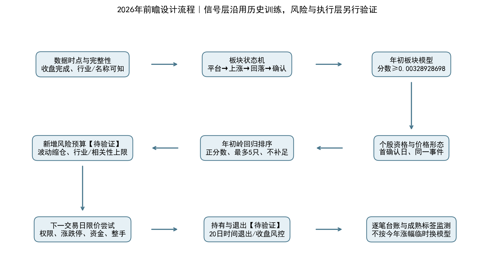
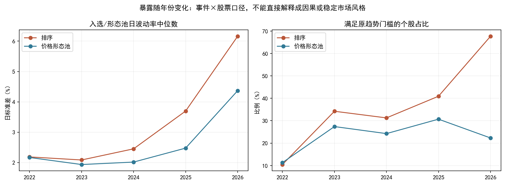
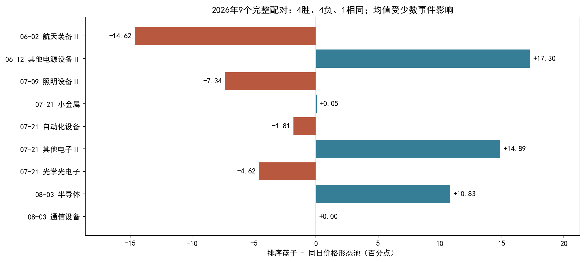
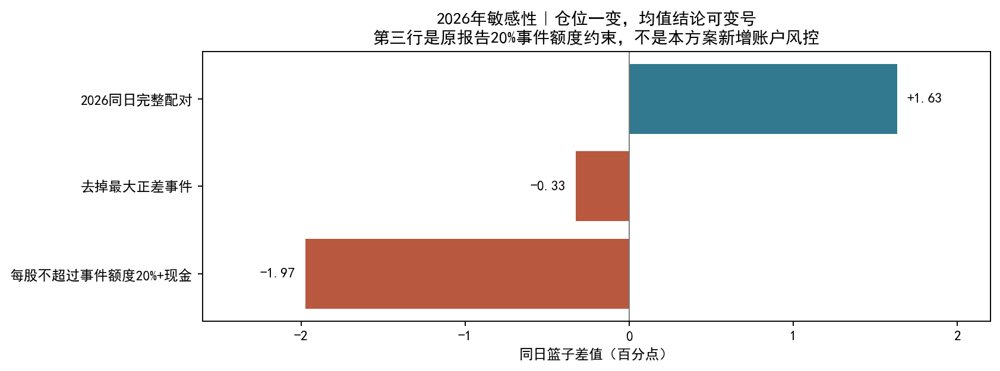
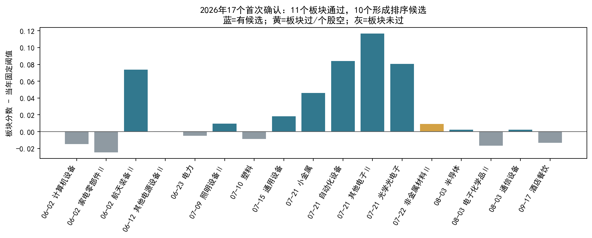

# 2026年板块—个股策略技术设计与近期触发台账

版本：sector_stock_2026_plan_v1｜制定日期：2026-10-13｜行情截至：2026-10-12。

**定位：2026年余下交易期的前瞻研究/模拟方案，尚未部署。** 历史部分是按年初信息边界重建的信号；风险预算、限价成交、止损和账户暂停规则是本次新增设计，尚无完整账户回测。不能把新方案写成2026年初已经存在或已经获利的策略。

[PDF版](TECHNICAL_DESIGN.pdf) · [离线HTML版](TECHNICAL_DESIGN.html) · [事件及暴露Excel](EVENTS_AND_EXPOSURES.xlsx) · [详细研究原报告](../stock_selection_v2_detail/REPORT.pdf)

## 1. 策略定位与证据强度

采用“板块回落确认 → 年初板块模型过滤 → 个股价格减速池 → 历史训练排序 → 波动缩仓与集中度约束 → 次日执行”的框架。2026年方案应适应可观测风险，而不是把今年上涨最大的板块和因子重新设为赢家。

年度变化提供了暴露漂移线索，但也可能来自事件构成、样本少、波动扩大或少数极端事件；目前没有完成市场、行业、规模和动量的多因子归因，不能断言具体原因。个股模型系数更不等同于因果规律。

本方案保留当前最可复核的算法时间边界：2026年使用只含2025年及以前成熟标签的模型。作为研究候选，取消个股趋势及换手量比的统一硬否决，保留价格减速门槛并使用原岭回归排序。这样打开候选范围，但不宣称已证实获得稳定净超额。



## 2. 2026年应如何解读年度差异

| 年 | 排序事件/股票 | 日波动中位 | 60日涨幅中位 | 原趋势通过占比 | 同日配对数 | 相对价格池均值差(pp) |
|---|---|---|---|---|---|---|
| 2022 | 17/67 | +2.19% | -10.38% | +10.45% | 16 | +2.03 |
| 2023 | 10/38 | +2.09% | -7.15% | +34.21% | 10 | +0.66 |
| 2024 | 10/32 | +2.45% | -0.45% | +31.25% | 10 | +0.16 |
| 2025 | 7/22 | +3.70% | -2.77% | +40.91% | 7 | +1.01 |
| 2026 | 10/34 | +6.16% | -7.44% | +67.65% | 9 | +1.63 |

统计中的股票数是事件×股票记录，同一股票不同事件可以重复；波动率为截至决策日20个日收益的样本标准差。表中60日强度是**绝对收益**，不是相对板块强度。

2026年只有17次板块首次确认、11次模型通过，分布在7个确认日；排序在10个事件选出34条记录。9个可配对事件仅覆盖5个日期、1个固定时间簇，不能当作9次完全独立实验。

排序日波动率中位数从2022年的2.19%升至2026年的6.16%，而原趋势通过占比从10.45%升至67.65%。这提示今年组合承受的风险与早年不同，不代表已找到2026年的稳定最优风格。



2026年9个同日配对事件：平均差+1.63个百分点，4个正差、4个负差、1个相同；移除最大正差事件（2026-06-12 其他电源设备Ⅱ），均值为-0.33个百分点。这是敏感性诊断，不是删除该事件后的策略。



<div style="page-break-before:always"></div>

### 资金使用率与极端事件敏感性

同一9事件用满各自篮子的均值为排序+12.98%、价格池+11.35%；按原研究每股最多占事件额度20%、余下现金后，分别为+8.51%、+10.49%，差值-1.97个百分点。不能把个股筛选改善和资金使用率混为一谈。



2022—2026合计52个同日完整配对，平均改善1.20个百分点，95%簇区间约[-0.09,+2.05]；尚未排除零。不能从2026的短样本中再选一套新权重，并称其为独立样本外结果。

## 3. 信息边界、模型版本与数据契约

所有信号在收盘数据完成后生成。北京时间17:00仅作保守下载门槛，必须同时检查交易日、文件完整性和数据时间戳；不得在14:30拿当日最终收盘、换手率计算信号。次日发生的价格与成交量只能用于执行或结果评价。

板块指数使用上一交易日成员及总市值权重，单股权重反复封顶到20%；至少5只成员，有效报价覆盖至少80%。行业按历史有效区间[in_date,out_date)归属，分类切换和行情中断重启连续段，不跨段计算事件。指数由复权收益链接，不是官方可交易指数。广度和换手使用当日成员，其口径与指数权重不完全相同。

股票使用决策日所属板块成员、上市存续期、有效正价与正成交量；历史名称公告日须严格早于决策日，未知/冲突/ST/退市名称拒绝。成分区间、名称及复权原始数据仍缺完整历史供应商版本，属于条件回放，不是当年原始信息的完全认证。

复权价用于趋势与收益连续性，原价用于订单、涨跌停及现金。公司行动必须有独立现金/股数账本；不能用复权价格直接算可买股数。

| 项目 | 2026板块模型 | 2026个股模型 |
|---|---|---|
| 逻辑启用时间 | 2026-01-01（历史模拟边界） | 2026-01-01（历史模拟边界） |
| 实际训练/产出时间 | 2026-10-13，事后重建 | 2026-10-13，事后重建 |
| 最晚可用标签界限 | 严格早于2025-12-04 | 严格早于2025-12-04 |
| 实际训练最晚标签 | 2025-11-18 | 2025-11-19 |
| 完整训练事件 | 220 | 83 |
| 内层拟合/验证 | 175/37 | 66/17 |
| 最终参数 | FNN 8规则，学习率0.003，185轮，3种子 | Ridge α=100，无截距，13特征 |
| 门槛 | 0.0032892869785428，大于等于 | 预测相对值严格>0，最多5只 |

训练最多取此前8年；外层、内层均按完整日期拆分，标签结束时间必须在相应起点前20交易日的截止日之前。同日事件不能拆到拟合与验证两侧。板块参数、股票正则参数及预处理仅在过去选定。2026年内不追加2026年收益训练该版本。

这里“全年固定”指模型的信息使用规则；不是声称该文件在2026年初已经存在。规则家族本身在今天制定的开发偏差仍然存在。本方案从文档冻结后建立真正前瞻记录。

## 4. 板块状态机：从平台到首次确认

五组平台长度按15、10、20、30、40日固定优先级。平台不含突破当天，最高/最低收盘振幅≤20%，首尾绝对收益≤10%；收盘突破平台最高收盘1%后进入该轮事件。突破后的前5日最高收盘确定参照上沿基础；未完成前不得使用未来的第5日数据。

前期峰值较平台最高收盘涨幅≥15%，峰值距突破至少5交易日。峰值处60日收益≥5%，收盘高于MA40且MA40高于10日前。峰值由已发生收盘逐步更新；新峰清空旧快速下跌/支撑证据。

回落要求距峰值2—40交易日、回撤≥10%；曾出现峰值后10日范围跌幅≥7%。参考区为平台最低收盘×0.80至上涨初期最高收盘×1.05；峰前支撑为峰值前最多20日最低收盘。日损失定义为max(-日收益,0)，最近2日平均损失≤此前3日的65%，且此前平均损失>0，才算减速。

令G=前期上涨、峰值趋势、回落幅度和年龄通过，F=同轮曾快速下跌，V=当前在参照区，B=当日跌破峰前支撑，L=当前减速：

```
watch   = G and F
trigger = watch and V
confirm = G and V and 最近5日同轮曾trigger and 最近5日同轮曾B and L
```

记忆含当日且绑定同一事件/窗口/峰值。只在首次确认收盘调用模型。同板块同段多窗口合并，新独立峰值必须晚于上一接受确认日；不能将另一个窗口的个股信号接到旧事件模型分数。最长事件180日，超过60日未完成上涨或峰后超过40日，结束该轮。

本版个股决策只看首次确认当日，不延长为5日等候买入；旧研究“5日内出现候选17次”与本版“确认当日9次”是不同口径，不能混用。新模型拒绝事件的后续再次确认也不重复评分、反复试买。

## 5. 板块模型：2026年的机会入口

13项输入为：上涨幅度、回撤、参照区距离、跌速比、相对20日换手的对数、上涨比例、广度变化、峰值年龄、平台振幅、峰值趋势收益、均线斜率、20日波动、报价覆盖率。广度覆盖不足80%设缺失。

训练中位数填补；按训练均值/标准差归一化，标准差下限0.001，截断到[-5,5]。Takagi–Sugeno高斯规则网络的局部线性输出经softmax权重加总，三个种子17/43/101平均。目标为确认收盘到20交易日后板块收盘收益；同日事件降权，历史权重半衰期1095日。阈值取最终训练预测的50%分位，并非每次实时把当日板块砍一半。

2026阈值固定0.0032892869785428047。模型分数不是胜率，不直接当预期可实现收益，也不用分数倍数加杠杆。分数≥阈值才能进入个股流程；没有完整模型或有效输入则不产生订单候选。

## 6. 个股筛选：保留价格约束，软化历史趋势与换手条件

先对板块确认当日所有合格成员计算特征，再在价格形态池选股。不能先删掉趋势未过者再重新计算分位，否则改变模型定义。

| 环节 | 2026规划规则 | 与旧规则的关系 |
|---|---|---|
| 基础资格 | 当日成员、上市存续、已知正常名称、正价正量 | 保留；权限/成交检查另加 |
| 五日价格形态 | 前3日累计≤-1%；后2日损失比≤0.65；后2日累计≤+2%；当日≥-2% | 保留全部四项 |
| 原趋势 | 作为trend特征，不作为否决门槛 | 取消硬要求，不等于断言趋势无效 |
| 前3日换手/前置20日基准≥1.4 | 作为expansion特征 | 不再统一硬拒绝 |
| 后2日换手/前3日换手≤0.7 | 作为contraction特征 | 不再统一硬拒绝 |
| 截面排序 | 岭回归分数>0，降序最多5只；并列按代码 | 不强行补满，不按分数配仓 |
| 首次确认无候选 | 记录NO_STOCK，结束本次入场 | 不临时用其它规则找补 |

原趋势特征仍按原源码：截至当日最近60日取最高收盘（同高取最近），峰前40日取最低收盘；上涨至少5日且≥15%，回落2—20日且≥4%。在峰值评价120日收益≥5%、收盘高于MA60、MA60较20日前上升。不要求当前重新站上均线。

五个连续特征为60日绝对强度、20日日波动、前期放量比、后期缩量比、跌速比。按合格成员截面排名；强度和放量比越大分位越高，低波/缩量/减速越强分位越高。每项另有缺失标记；缺失分位填0.5。再加trend、price及二者交互，共13维，全部减去同事件截面均值。

训练目标是该股20日费用压力测试价格结果减同事件全部合格成员均值；基准全体路径不完整的训练事件不使用。日期等权→同日事件等权→事件内股票等权，Ridge无截距；2026正则系数100在历史内层选定。

模型score>0表示模型拟合的相对值为正，既不是正收益保证，也不是在扣除真实执行成本后仍正。低波分位负系数意味着可能偏好高波股；风险控制应独立降低资金暴露，不能把系数解释成买高波必然赚钱。

| 特征 | 2026系数 |
|---|---|
| strength_rank | -0.00878079 |
| strength_missing | -0.00912664 |
| volatility_rank | -0.01730912 |
| volatility_missing | -0.00703626 |
| expansion_rank | +0.01052811 |
| expansion_missing | -0.00774169 |
| contraction_rank | +0.00250611 |
| contraction_missing | +0.00083291 |
| slowdown_rank | -0.00808900 |
| slowdown_missing | +0.00291716 |
| trend_flag | +0.00564524 |
| price_flag | -0.00005584 |
| trend_price | +0.00250008 |

## 7. 适应2026的风险预算【新增设计，尚未验证】

信号模型暂不随月份追涨杀跌；适应性放在决策时可见的波动和持仓相关性上。以下参数是控制试运行风险的工程起点，不是历史搜索最优值，也不承诺限制实际亏损。

| 项目 | 初始规划值 | 执行定义 |
|---|---|---|
| 总股票仓位 | 账户净资产50%上限 | 仅现金多头，不融资、不杠杆 |
| 单股/单板块 | 5% / 15%上限 | 已持仓和未成交委托都占预算 |
| 相关板块组 | 25%上限 | 过去60日收益相关≥0.70连边取连通组；至少40个共同有效日 |
| 个股波动缩仓 | 参考日波动2% | 仅降低权重，低波不放大到基础权重以上 |
| 流动性 | 单笔≤前20日平均成交额0.1% | 当日成交额不可用于事先估算；整手不足则不买 |
| 账户回撤暂停 | 自净值高点回撤≥5% | 冻结新开仓、撤销未成交买单；既有退出继续 |
| 账户未知字段 | 不下新单 | 权限、涨跌停、复权到原价映射、现金未知均拒绝 |

若事件s有n只入选股，先计算每股基础权重，再按波动降低：

```
b_i = min(5%, 15% / n)
w_i = b_i × min(1, 2% / sigma20_i)
```

sigma20缺失/≤0时该股不下单。举例：5只股票时基础每股3%；若日波动6%，每股降至1%，该事件约5%账户仓位。只有1只候选时，基础最多5%，不能把15%或全部现金塞给它。空出的预算留现金，不在其他入选股间重新放大。

先对所有当日事件同时生成目标；同股跨事件合并，已持仓不追加。再依次扣除已有持仓/委托占用，按单股、单板块、相关组、总仓位剩余预算等比例压缩新单；各步只减不增，不按代码排序抢占预算。最后执行流动性上限与交易单位向下取整。相关性资料不足的新板块统一并入保守未知组，与已有相关组取更严剩余额度；不得按“未知=独立”分散风险。

相关组只使用当日及以前板块收益，60日与40个有效日均为交易日口径。组划分固定到下次收盘检查；不使用未来持仓相关性。止损或成交失败释放的当日额度不临时重选个股。Excel给出的proposed_initial_account_weight仅为上述单事件初始权重示意，未做账户、权限、相关组或成交复核，不能当历史真实仓位。

## 8. 从候选到订单、持有和退出【新增设计，尚未验证】

T日收盘归档候选与拒绝原因；T+1开盘前检查停复牌、风险名称变化、账户板块权限、公司行动、每日官方涨跌停价及现金。研究池包含创业板和科创板；账户无权限则保留研究记录并记为执行拒绝，不用另股补位，也不得沿用原研究收益。

首次确认的候选仅在下一交易日有效。以公司行动修正后的前收原价×1.01作为买入限价上限，再向合法价格档位和官方限制内取整；开盘前提交合法限价指令，09:35撤销剩余量。仅真实成交量入账；有开盘报价不代表委托已成交。未成交或部分成交的剩余额度留现金，后续不追价、不延长等待、不替换股票。

原研究使用T+1复权开盘至其后第20个交易日开盘，是20个开盘间隔；主设计沿用这一时间锚点，到期前一交易日收盘安排次日退出。收益计算使用真实成交、费用、现金分红和股份变动；研究中的约40bp固定往返成本仅是压力口径，不是实际税费表。

新增价格风险退出：持有后收盘价相对经公司行动修正的实际买入成本≤-8%，安排下一可卖交易日退出。若与到期退出同时发生，仅发一次减仓指令；不设置获利止盈，不将日线“先高后低”假设当可执行路径。买入当天不得假设可卖；停牌/跌停/流动性不足时保持EXIT_PENDING，逐日重试并持续计入风险，不能按止损线虚构成交。

这里的限价、-8%止损、50%总仓位、5%回撤暂停等规则尚未组合回测。8%不是最大可亏幅度，5%也不是可保证的账户最大回撤。不得引用前文未应用这些规则的价格均值为本方案收益。

交易规则需按交易所、板块、证券及生效日期维护；例如[上交所2026年规则通知](https://www.sse.com.cn/lawandrules/sselawsrules2025/stocks/exchange/c/c_20260424_10816482.shtml)明确新规则2026-07-06生效且部分条文暂缓。历史订单不能统一套用今天规则；申报单位和涨跌停也不统一写死。

## 9. 更新、漂移监测与退出机制

每日记录模型分数分布、原始波动、60日强度、趋势比例、上市板分布、行业权重和相关组权重。原始数值要与训练期并列展示，不能只看被排序或标准化后的特征；截面分位可能掩盖全市场波动同时变大。

每20交易日做一次固定监测，仅评价已经结束20日路径的事件；同时展示全部事件、同日同池配对、现金约束、最大事件贡献及缺失/拒单比例。涨幅、回撤、成交失败分别归因到板块择时、个股选择、风险缩仓和执行成本。若只得到绝对上涨而无同池改善，保留为板块暴露解释。

模型效用复核至少需要20个成熟事件、5个固定时间簇（相邻事件间隔超过20交易日才起新簇）。不足时仅报告诊断，不自动换模型。若两个固定复核点均满足样本要求且同池净差均为负，并且第二次新增了成熟事件，则暂停新开仓进入审查；同一批数据不能重复计为两次失败。此监测规则也属前瞻设计，不是已验证的显著性检验。

账户回撤≥5%或数据/模型哈希失配，立即暂停新开仓；退出处理继续。恢复必须记录原因、修复或复核证据及新版本生效时点，不自动因一次反弹恢复。2026年版本默认保持到年末；2027模型只能在2027启用前按既定流程训练并冻结，训练不足则继续暂停，不把新模型改写旧记录。

为避免按年份追逐赢家，不上线“今年高波/明年低波”这样的日历切换。若研究市场状态模型，必须另立版本，在2025及以前做完整嵌套选择，再使用未来数据检验；2026已查看结果只作开发集说明。

## 10. 最近的形态触发与模型确认记录

**“trigger=形态触发”“confirm=首次确认”“selected=板块模型通过”“candidate=个股候选”“filled=实际成交”是五个不同层级。** 下表均为2026-10-13利用截至10-12的数据重建，实际成交列应为未知，不能声称当时已发送通知或执行。

截至2026-10-12，最新扫描有4个观察板块、3个处于形态触发、0个当日确认。只复用旧扫描的无模型形态状态；旧扫描中的随机冻结模型分数不进入本方案。

| 板块 | 窗口 | 回撤 | 峰后日数 | 形态trigger | 当前减速 | 5日破支撑 | 本次处理 |
|---|---|---|---|---|---|---|---|
| 农产品加工 | 40 | -12.91% | 17 | 是 | 否 | 否 | 观察，不生成买单 |
| 渔业 | 15 | -13.81% | 17 | 否 | 否 | 否 | 观察，不生成买单 |
| 贵金属 | 15 | -22.24% | 29 | 是 | 否 | 否 | 观察，不生成买单 |
| 酒店餐饮 | 15 | -14.12% | 18 | 是 | 否 | 是 | 观察，不生成买单 |

农产品加工、贵金属缺当前减速及近期破支撑；酒店餐饮缺当前减速；渔业还未进入当前参照区。这些是10-12的状态快照，不是断言它们第一次在10-12触发。酒店餐饮9-17同轮首次确认已被2026模型拒绝，后续形态恢复不覆盖原拒绝。

最近10条独立首次确认如下。分数阈值统一0.0032892869785428047；均值差以同日价格形态池为基准，未通过板块的个股不计算。价格观察含固定费用、无执行认证。

| 确认日 | 板块 | 板块分数 | 当时信息边界下结论 | 候选数 | 篮子20日 | 相对池差(pp) |
|---|---|---|---|---|---|---|
| 09-17 | 酒店餐饮 | -0.009877 | 板块拒绝 | 未筛 | 未评价 | 不适用 |
| 08-03 | 半导体 | 0.005646 | 历史重建候选 | 2 | +22.97% | +10.83 |
| 08-03 | 电子化学品Ⅱ | -0.013413 | 板块拒绝 | 未筛 | 未评价 | 不适用 |
| 08-03 | 通信设备 | 0.005685 | 历史重建候选 | 4 | +38.96% | +0.00 |
| 07-22 | 非金属材料Ⅱ | 0.012349 | 板块过/个股空 | 0 | 无候选 | 不适用 |
| 07-21 | 小金属 | 0.049113 | 历史重建候选 | 5 | +12.54% | +0.05 |
| 07-21 | 自动化设备 | 0.087428 | 历史重建候选 | 5 | +7.74% | -1.81 |
| 07-21 | 其他电子Ⅱ | 0.120068 | 历史重建候选 | 1 | +29.91% | +14.89 |
| 07-21 | 光学光电子 | 0.083927 | 历史重建候选 | 5 | +10.34% | -4.62 |
| 07-15 | 通用设备 | 0.021712 | 历史重建候选 | 5 | -3.65% | 缺失 |

最近形成排序候选的确认日仍为2026-08-03：通信设备4只、半导体2只。电子化学品Ⅱ同日板块未通过；2026-09-17酒店餐饮也未通过。它们都是历史事件，不能作为10月13日仍有效的买单。

2026-07-22非金属材料Ⅱ是重要负例：板块模型通过，但价格池内没有正预测排序候选，因此明确空过。旧原规则最近7-23才出现的301021、301568、300331属于“确认后最多5日等待”的另一口径，不补写到本方案首次确认日台账。



## 11. 近期候选明细与2026完整台账

候选代码按事件内模型分数降序排列。下一开盘和20日观察日是历史观测锚点，不是实际买卖记录；分数×100仅方便读成百分点，不代表可信的收益预测。下表包括最近10条确认中产生的全部候选。

| 确认日/板块 | 代码 | 个股分数(pp) | 日波动 | 下一开盘 | 20日观察日 | 20日价格结果 |
|---|---|---|---|---|---|---|
| 08-03 半导体 | 688584.SH | +0.779 | +8.62% | 08-04 | 09-01 | +15.84% |
| 08-03 半导体 | 688727.SH | +0.049 | +6.07% | 08-04 | 09-01 | +30.11% |
| 08-03 通信设备 | 300689.SZ | +0.963 | +6.53% | 08-04 | 09-01 | +27.53% |
| 08-03 通信设备 | 600487.SH | +0.617 | +5.44% | 08-04 | 09-01 | +38.97% |
| 08-03 通信设备 | 002491.SZ | +0.314 | +4.50% | 08-04 | 09-01 | +54.64% |
| 08-03 通信设备 | 603236.SH | +0.034 | +4.36% | 08-04 | 09-01 | +34.69% |
| 07-21 小金属 | 000962.SZ | +1.005 | +6.69% | 07-22 | 08-19 | +7.17% |
| 07-21 小金属 | 000657.SZ | +0.375 | +5.41% | 07-22 | 08-19 | +14.61% |
| 07-21 小金属 | 600259.SH | +0.335 | +4.72% | 07-22 | 08-19 | +20.62% |
| 07-21 小金属 | 002182.SZ | +0.247 | +4.48% | 07-22 | 08-19 | +6.27% |
| 07-21 小金属 | 002378.SZ | +0.040 | +4.67% | 07-22 | 08-19 | +14.02% |
| 07-21 自动化设备 | 301312.SZ | +1.136 | +6.25% | 07-22 | 08-19 | +11.30% |
| 07-21 自动化设备 | 002975.SZ | +1.120 | +6.65% | 07-22 | 08-19 | +17.53% |
| 07-21 自动化设备 | 000988.SZ | +0.993 | +6.55% | 07-22 | 08-19 | -5.40% |
| 07-21 自动化设备 | 603203.SH | +0.672 | +7.23% | 07-22 | 08-19 | +6.79% |
| 07-21 自动化设备 | 603283.SH | +0.650 | +6.55% | 07-22 | 08-19 | +8.48% |
| 07-21 其他电子Ⅱ | 600353.SH | +0.894 | +7.60% | 07-22 | 08-19 | +29.91% |
| 07-21 光学光电子 | 301379.SZ | +1.443 | +10.58% | 07-22 | 08-19 | -11.22% |
| 07-21 光学光电子 | 300489.SZ | +1.195 | +8.21% | 07-22 | 08-19 | +28.28% |
| 07-21 光学光电子 | 002137.SZ | +1.082 | +6.36% | 07-22 | 08-19 | +13.25% |
| 07-21 光学光电子 | 300162.SZ | +1.056 | +7.97% | 07-22 | 08-19 | +6.62% |
| 07-21 光学光电子 | 002654.SZ | +1.019 | +6.31% | 07-22 | 08-19 | +14.80% |
| 07-15 通用设备 | 688448.SH | +1.716 | +6.35% | 07-16 | 08-13 | +1.13% |
| 07-15 通用设备 | 301151.SZ | +1.389 | +5.27% | 07-16 | 08-13 | -13.19% |
| 07-15 通用设备 | 300503.SZ | +1.353 | +8.40% | 07-16 | 08-13 | -8.32% |
| 07-15 通用设备 | 002559.SZ | +1.299 | +5.79% | 07-16 | 08-13 | -7.45% |
| 07-15 通用设备 | 002520.SZ | +1.100 | +5.18% | 07-16 | 08-13 | +9.58% |

### 2026全部17次独立首次确认（包括板块拒绝与个股空）

| 确认日 | 板块 | 板块分数 | 状态 | 候选数 | 篮子20日 | 相对池差(pp) |
|---|---|---|---|---|---|---|
| 09-17 | 酒店餐饮 | -0.009877 | 板块拒绝 | 未筛 | 未评价 | 不适用 |
| 08-03 | 半导体 | 0.005646 | 历史重建候选 | 2 | +22.97% | +10.83 |
| 08-03 | 电子化学品Ⅱ | -0.013413 | 板块拒绝 | 未筛 | 未评价 | 不适用 |
| 08-03 | 通信设备 | 0.005685 | 历史重建候选 | 4 | +38.96% | +0.00 |
| 07-22 | 非金属材料Ⅱ | 0.012349 | 板块过/个股空 | 0 | 无候选 | 不适用 |
| 07-21 | 小金属 | 0.049113 | 历史重建候选 | 5 | +12.54% | +0.05 |
| 07-21 | 自动化设备 | 0.087428 | 历史重建候选 | 5 | +7.74% | -1.81 |
| 07-21 | 其他电子Ⅱ | 0.120068 | 历史重建候选 | 1 | +29.91% | +14.89 |
| 07-21 | 光学光电子 | 0.083927 | 历史重建候选 | 5 | +10.34% | -4.62 |
| 07-15 | 通用设备 | 0.021712 | 历史重建候选 | 5 | -3.65% | 缺失 |
| 07-10 | 塑料 | -0.005411 | 板块拒绝 | 未筛 | 未评价 | 不适用 |
| 07-09 | 照明设备Ⅱ | 0.012821 | 历史重建候选 | 3 | -9.96% | -7.34 |
| 06-23 | 电力 | -0.001633 | 板块拒绝 | 未筛 | 未评价 | 不适用 |
| 06-12 | 其他电源设备Ⅱ | 0.003854 | 历史重建候选 | 3 | +11.87% | +17.30 |
| 06-02 | 计算机设备 | -0.011398 | 板块拒绝 | 未筛 | 未评价 | 不适用 |
| 06-02 | 家电零部件Ⅱ | -0.021339 | 板块拒绝 | 未筛 | 未评价 | 不适用 |
| 06-02 | 航天装备Ⅱ | 0.077010 | 历史重建候选 | 1 | -7.53% | -14.62 |

2026全部34条入选记录以及价格形态未选股的诊断来源见Excel与原报告。7-15通用设备排序篮子有完整结果，但价格池有缺失，故不进入9个配对样本；缺失不是0。拒绝记录保留，不在结果出来后从台账删除。

## 12. 实现接口、日志及验收

生产扫描器目前仍有旧随机冻结模型接口；本方案没有切换它的配置或LATEST指针。后续实现需显式加载本报告引用的年度模型，不能仅修改个股过滤器后沿用旧板块分数。

| 组件 | 现有源码/产物 | 需要实施的工作 |
|---|---|---|
| 行业/指数 | src/sector_dataset.py + 固定dataset | 历史原始版本及接收时间继续补证 |
| 事件 | src/sector_shape_events.py、sector_shape_expansion.py、sector_multiscale_events.py | 按同一事件键贯通首确认及去重 |
| 板块年度模型 | src/sector_asof_replay.py + sector_run/models/2026_*.pt | 新增年度模型在线加载与白名单推理适配 |
| 个股排序 | src/stock_selection_asof.py + stock_run/models/2026.npz | 对齐合格成员全截面、价格池和代码并列规则 |
| 账户风控/订单/退出 | 本次YAML设计参数 | 待实现并进行统一现金账户回放 |
| 持续监测/台账 | 本报告CSV与Excel作为历史种子 | 新增不可变前瞻日志；不能伪造历史通知时间 |

建议事件记录主键：strategy_version + model_year + merged_event_id；候选再加ts_code，订单另加order_id。日志至少包括data_asof、generated_at、原始event_id/window/peak_date、数据/模型哈希、板块分数及阈值、个股资格/价格条件/分数、原始sigma20、目标权重、权限与限制检查、拒绝原因、委托/成交/撤单时间、实际费用、退出原因。

状态依次记录WATCH、TRIGGER、CONFIRMED、SECTOR_REJECT/SECTOR_PASS、NO_STOCK/CANDIDATE、EXECUTION_REJECT/ORDERED、PART_FILLED/FILLED、EXIT_PENDING/CLOSED。历史重建统一标record_origin=retrospective_asof_replay，不能填写虚构的历史generated_at。

最小验收顺序：①未来数据扰动不改变既往信号、候选、系数；②同日完整截面与事件键一致；③同股/同板块多信号不重复买，现金和风险预算不超限；④涨跌停、停牌、权限、部分成交、T+1与公司行动有正确分支；⑤同等风险预算下比较候选池与排序池，真实成本后再评价；⑥前瞻归档不得改写。新增执行层验收完成前，只输出模拟候选，不声称已具备实盘能力。

本次交付包括技术设计、独立配置、5组图和8张Excel表。它完成了策略规划与证据台账，尚未实现或验证新增账户交易引擎。

## 13. 复现与证据索引

| 来源 | 固定路径 |
|---|---|
| sector_run | alpha_lab/outputs/sector_asof_replay_v1/20261013T072855_087132Z |
| stock_run | alpha_lab/outputs/stock_selection_asof_v2/20261013T074542_476130Z |
| state_scan | alpha_lab/outputs/sector_live_scan/20261013T053630_999606Z |
| dataset | alpha_lab/data/sector_live_datasets/sw_l2_v1_20261013T053143_382413Z |
| event_source | alpha_lab/outputs/sector_multiscale_events/20260923T080028_978085Z |
| stock_rules | alpha_lab/configs/left_side_trend_v2.yaml |

生成命令：`python alpha_lab/scripts/build_strategy_2026_plan.py`。

设计配置：`alpha_lab/configs/strategy_2026_sector_stock_plan.yaml`；该文件明确status=design_only_not_deployed，现有生产入口不会读取。

本次核验两个研究目录及形态扫描目录的108个产物哈希；使用保存的2026年13维系数和当时截面特征重算739条合格个股分数，浮点误差容限内一致；入选集合逐条一致，共34条/10事件。全部17条2026板块评分的阈值逻辑一致，模型最晚标签均早于历史截止日。新增年度暴露、配对敏感性、近期台账由原数据计算，不手填收益。

这些检查不补足供应商历史版本、成交资料或样本量不足，也不构成新风险规则的收益验证。源文件、配置、生成脚本及产物哈希保存在manifest.json。
