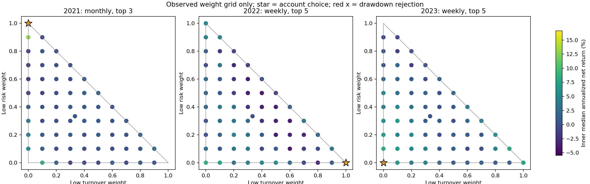

# 完整基线组合学习诊断

运行：`alpha_lab/outputs/baseline_combination/20260920T130430_653480Z`。数据与账户保持冻结；10万元、含手续费滑点，2021–2023连续账户。

本轮属于已观察历史上的机制诊断。三条基线经过既有结果筛选，不能把本轮结果称为新鲜样本外证明。

## 账户结果

| 路径 | 累计净收益 | 年化 | 最大回撤 | 交易笔数 | 费用（元） | 历史验收 |
|---|---:|---:|---:|---:|---:|---|
| 只选择单条基线 | 14.60% | 4.68% | 18.68% | 89 | 5125.47 | 通过 |
| 账户目标最优组合 | 14.60% | 4.68% | 18.68% | 89 | 5125.47 | 通过 |
| 账户目标稳健邻域 | 14.60% | 4.68% | 18.68% | 89 | 5125.47 | 通过 |
| IC目标最优组合 | 29.26% | 8.99% | 11.62% | 17 | 415.24 | 通过 |
| IC组合加基线回退 | 14.60% | 4.68% | 18.68% | 89 | 5125.47 | 通过 |
| 三因子等权 | 37.51% | 11.28% | 11.36% | 33 | 2357.89 | 通过 |
| 固定低换手基线 | 29.26% | 8.99% | 11.62% | 17 | 415.24 | 通过 |
| 固定低波/振幅基线 | 10.44% | 3.39% | 15.43% | 71 | 4723.20 | 通过 |
| 固定估值基线 | 19.98% | 6.30% | 20.43% | 123 | 6467.84 | 通过 |

## 年度锁定路径

权重顺序为低换手、低波/振幅、估值；这是评分权重，不是三个子账户资金份额。顶点强制继承原基线频率、持股数及过滤。

| 评价年 | 方法 | 权重 | 频率/持股数 | 内层年化中位数 | 内层IC | 相对端点最优值（pp） |
|---|---|---|---|---:|---:|---:|
| 2021 | 只选择单条基线 | 0/1/0 | monthly/3 | 16.66% | -0.0721 | 0.000 |
| 2021 | 账户目标最优组合 | 0/1/0 | monthly/3 | 16.66% | -0.0721 | 0.000 |
| 2021 | 账户目标稳健邻域 | 0/1/0 | monthly/3 | 16.66% | -0.0721 | 0.000 |
| 2021 | IC目标最优组合 | 1/0/0 | weekly/3 | 3.51% | -0.0329 | -13.148 |
| 2021 | IC组合加基线回退 | 0/1/0 | monthly/3 | 16.66% | -0.0721 | 0.000 |
| 2021 | 三因子等权 | 0.333/0.333/0.333 | monthly/3 | 0.40% | -0.0847 | -16.259 |
| 2022 | 只选择单条基线 | 1/0/0 | weekly/5 | 9.53% | -0.0176 | 0.000 |
| 2022 | 账户目标最优组合 | 1/0/0 | weekly/5 | 9.53% | -0.0176 | 0.000 |
| 2022 | 账户目标稳健邻域 | 1/0/0 | weekly/5 | 9.53% | -0.0176 | 0.000 |
| 2022 | IC目标最优组合 | 1/0/0 | weekly/5 | 9.53% | -0.0176 | 0.000 |
| 2022 | IC组合加基线回退 | 1/0/0 | weekly/5 | 9.53% | -0.0176 | 0.000 |
| 2022 | 三因子等权 | 0.333/0.333/0.333 | weekly/5 | -0.03% | -0.0703 | -9.552 |
| 2023 | 只选择单条基线 | 0/0/1 | weekly/5 | 13.91% | -0.0289 | 0.000 |
| 2023 | 账户目标最优组合 | 0/0/1 | weekly/5 | 13.91% | -0.0289 | 0.000 |
| 2023 | 账户目标稳健邻域 | 0/0/1 | weekly/5 | 13.91% | -0.0289 | 0.000 |
| 2023 | IC目标最优组合 | 1/0/0 | weekly/5 | 7.67% | 0.0176 | -6.245 |
| 2023 | IC组合加基线回退 | 0/0/1 | weekly/5 | 13.91% | -0.0289 | 0.000 |
| 2023 | 三因子等权 | 0.333/0.333/0.333 | monthly/3 | 3.89% | -0.0178 | -10.025 |

## 分年结果

| 方法 | 年度 | 净收益 | 年内回撤 |
|---|---:|---:|---:|
| 只选择单条基线 | 2021 | -1.05% | 12.32% |
| 只选择单条基线 | 2022 | 5.91% | 6.47% |
| 只选择单条基线 | 2023 | 9.36% | 18.68% |
| 账户目标最优组合 | 2021 | -1.05% | 12.32% |
| 账户目标最优组合 | 2022 | 5.91% | 6.47% |
| 账户目标最优组合 | 2023 | 9.36% | 18.68% |
| 账户目标稳健邻域 | 2021 | -1.05% | 12.32% |
| 账户目标稳健邻域 | 2022 | 5.91% | 6.47% |
| 账户目标稳健邻域 | 2023 | 9.36% | 18.68% |
| IC目标最优组合 | 2021 | -0.61% | 10.37% |
| IC目标最优组合 | 2022 | 4.33% | 6.86% |
| IC目标最优组合 | 2023 | 24.66% | 11.62% |
| IC组合加基线回退 | 2021 | -1.05% | 12.32% |
| IC组合加基线回退 | 2022 | 5.91% | 6.47% |
| IC组合加基线回退 | 2023 | 9.36% | 18.68% |
| 三因子等权 | 2021 | 1.37% | 9.56% |
| 三因子等权 | 2022 | 7.49% | 6.26% |
| 三因子等权 | 2023 | 26.20% | 11.36% |
| 固定低换手基线 | 2021 | -0.61% | 10.37% |
| 固定低换手基线 | 2022 | 4.33% | 6.86% |
| 固定低换手基线 | 2023 | 24.66% | 11.62% |
| 固定低波/振幅基线 | 2021 | -1.05% | 12.32% |
| 固定低波/振幅基线 | 2022 | 5.09% | 6.91% |
| 固定低波/振幅基线 | 2023 | 6.21% | 15.43% |
| 固定估值基线 | 2021 | -11.75% | 20.43% |
| 固定估值基线 | 2022 | 22.97% | 16.00% |
| 固定估值基线 | 2023 | 10.56% | 15.61% |

## 核验与适用范围

- 393个唯一内层候选，错误0；所有候选都独立重放账本。另有9个连续评价账户。
- 9个内层端点与原搜索过程表一致，3条组合端点与原基线四张账户表一致；27次原始信号/账户前缀核验。
- 独立审计20977笔交易，最大现金对账误差1.02e-10元；资金、费用、T+1、涨跌停与公司行动使用原引擎。
- 实测三点权重路径792组，其中408组收益非单调；三点全部风险可行的770组中有393组非单调。重叠三点不是独立统计样本。
- account_best、account_stable及IC加回退在每折训练评价准则下不低于可行端点最优值；该性质不保证下一年，也不保证外层连续账户回撤小于30%。
- 账户目标是多自然年净年化中位数，IC目标是决策日截面20日价格收益相关性；风险约束相同。IC本轮直接在同一候选中择优，区别于旧版按IC比例配权。
- 本轮直接估计有限网格上的组合权重，不是新训练的神经网络，也没有证明普通回归训练器自然会找到端点。
- 三条因子方向由规则先验固定，权重只允许非负；旧版有符号IC配权可反转方向。前后比较同时改变了因子窗口、资格、政策和权重约束，不能把全部差异归到某一个原因。
- 局部图中的资格交集会在权重变为零时改变，频率/持股数也是离散变量；任何收益插值、单调外推均不成立。
- 已按基线年度参数选择后再拟合组合，叠加了历史选择偏差；固定93股的全窗口质量隔离偏差继续存在。
- 未据外层结果改参数或替换基线；所有年度选择在外层计算前落盘。

完整过程：`parameter_surface.csv`、`nonmonotonic_triplets.csv`、`selected_policies.csv`、`all_trials_*.json`、`search/`及`outer/`。

## 等权结果的事后固定消融

看到主实验结果后另行登记两个固定对照及一次等权重放，不追加参数搜索，不据此改主实验选择。

| 顺序对照 | 累计净收益 | 最大回撤 | 交易笔数 | 费用（元） |
|---|---:|---:|---:|---:|
| 原低换手基线 | 29.26% | 11.62% | 17 | 415.24 |
| 低换手换成等权交易安排 | 26.68% | 11.54% | 13 | 349.05 |
| 再加三因子资格交集 | 26.68% | 11.54% | 13 | 349.05 |
| 再改为三因子等权排名 | 37.51% | 11.36% | 33 | 2357.89 |

按此固定干预顺序，交易安排对应累计收益变化-2.57pp，资格交集对应+0.00pp，排名混合对应+10.82pp。这是这段历史和固定顺序下的账户反事实，不是独立可加的普遍因果效应。
三个补充账户独立核验，9次前缀检查通过；等权重放的原始分数、持股数和四张账户表与主实验完全一致。

## 运行留痕

首次393个内层候选完成后，CSV导出遇到重复top_n字段错误，尚未进入外层账户评价。修复仅涉及导出字段合并，重跑后年度选择与2751张内层Parquet表逐字节一致。393个独立候选共执行786次内层账户，首次失败记录保留于`retry_reproducibility.json`指向的目录。
