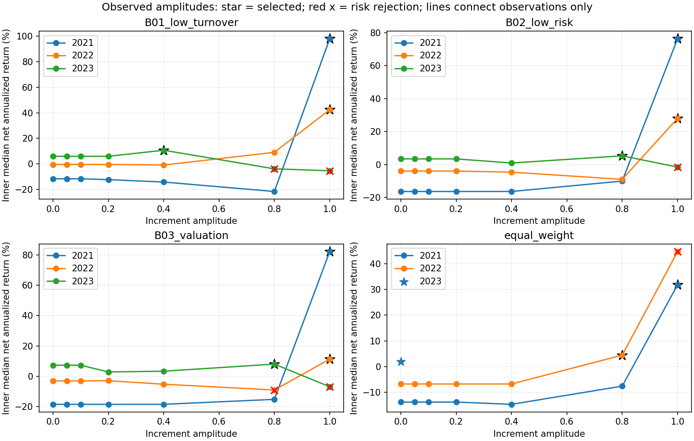

# 基线＋监督学习增量研究

运行：`alpha_lab/outputs/baseline_increment/20260920T132251_250976Z`。四个固定宿主、岭回归/浅层LightGBM，直接排名与残差排名成对训练。

10万元，2021–2023连续账户，费用、交易约束和冻结93股样本保持一致。此历史已经观察过，不是独立样本外验证。

## 配对账户结果

| 宿主 | 路径 | 累计净收益 | 年化 | 最大回撤 | 相对宿主收益差(pp) | 成交笔数 | 历史验收 |
|---|---|---:|---:|---:|---:|---:|---|
| 低换手 | 原样参照 | 29.26% | 8.99% | 11.62% | +0.00 | 17 | 通过 |
| 低换手 | 增量最优 | -4.16% | -1.42% | 36.40% | -33.41 | 201 | 未通过 |
| 低换手 | 增量邻域稳健 | -4.16% | -1.42% | 36.40% | -33.41 | 201 | 未通过 |
| 低换手 | 直接预测 | -30.20% | -11.37% | 39.54% | -59.45 | 76 | 未通过 |
| 低换手 | 直接预测加回退 | -10.07% | -3.50% | 39.54% | -39.33 | 87 | 未通过 |
| 低波/振幅 | 原样参照 | 10.44% | 3.39% | 15.43% | +0.00 | 71 | 通过 |
| 低波/振幅 | 增量最优 | -20.77% | -7.52% | 45.34% | -31.21 | 95 | 未通过 |
| 低波/振幅 | 增量邻域稳健 | -20.77% | -7.52% | 45.34% | -31.21 | 95 | 未通过 |
| 低波/振幅 | 直接预测 | -29.78% | -11.19% | 38.15% | -40.23 | 42 | 未通过 |
| 低波/振幅 | 直接预测加回退 | -25.08% | -9.24% | 38.15% | -35.52 | 87 | 未通过 |
| 估值 | 原样参照 | 19.98% | 6.30% | 20.43% | +0.00 | 123 | 通过 |
| 估值 | 增量最优 | -20.89% | -7.56% | 39.53% | -40.87 | 219 | 未通过 |
| 估值 | 增量邻域稳健 | -20.89% | -7.56% | 39.53% | -40.87 | 219 | 未通过 |
| 估值 | 直接预测 | -6.17% | -2.12% | 22.04% | -26.15 | 76 | 未通过 |
| 估值 | 直接预测加回退 | 4.19% | 1.39% | 22.04% | -15.79 | 137 | 通过 |
| 三等权 | 原样参照 | 37.51% | 11.28% | 11.36% | +0.00 | 33 | 通过 |
| 三等权 | 增量最优 | -1.01% | -0.34% | 38.01% | -38.51 | 93 | 未通过 |
| 三等权 | 增量邻域稳健 | -1.01% | -0.34% | 38.01% | -38.51 | 93 | 未通过 |
| 三等权 | 直接预测 | -13.69% | -4.82% | 31.25% | -51.20 | 78 | 未通过 |
| 三等权 | 直接预测加回退 | 9.46% | 3.08% | 31.25% | -28.04 | 101 | 未通过 |

## 年度内层锁定

| 年度 | 宿主 | 路径 | 模型规格/幅度 | 内层年化中位数 | 相对原宿主(pp) |
|---|---|---|---|---:|---:|
| 2021 | 低换手 | 增量最优 | {"amplitude": 1.0, "kind": "residual", "model_spec": {"alpha": 100.0, "horizon": 5, "model": "ridge"}} | 97.93% | +109.59 |
| 2021 | 低换手 | 增量邻域稳健 | {"amplitude": 1.0, "kind": "residual", "model_spec": {"alpha": 100.0, "horizon": 5, "model": "ridge"}} | 97.93% | +109.59 |
| 2021 | 低换手 | 直接预测 | {"kind": "direct", "model_spec": {"alpha": 100.0, "horizon": 5, "model": "ridge"}} | 44.29% | +55.94 |
| 2021 | 低换手 | 直接预测加回退 | {"kind": "direct", "model_spec": {"alpha": 100.0, "horizon": 5, "model": "ridge"}} | 44.29% | +55.94 |
| 2021 | 低波/振幅 | 增量最优 | {"amplitude": 1.0, "kind": "residual", "model_spec": {"alpha": 100.0, "horizon": 5, "model": "ridge"}} | 76.32% | +92.73 |
| 2021 | 低波/振幅 | 增量邻域稳健 | {"amplitude": 1.0, "kind": "residual", "model_spec": {"alpha": 100.0, "horizon": 5, "model": "ridge"}} | 76.32% | +92.73 |
| 2021 | 低波/振幅 | 直接预测 | {"kind": "direct", "model_spec": {"alpha": 100.0, "horizon": 5, "model": "ridge"}} | 76.43% | +92.84 |
| 2021 | 低波/振幅 | 直接预测加回退 | {"kind": "direct", "model_spec": {"alpha": 100.0, "horizon": 5, "model": "ridge"}} | 76.43% | +92.84 |
| 2021 | 估值 | 增量最优 | {"amplitude": 1.0, "kind": "residual", "model_spec": {"alpha": 1.0, "horizon": 20, "model": "ridge"}} | 82.22% | +100.80 |
| 2021 | 估值 | 增量邻域稳健 | {"amplitude": 1.0, "kind": "residual", "model_spec": {"alpha": 1.0, "horizon": 20, "model": "ridge"}} | 82.22% | +100.80 |
| 2021 | 估值 | 直接预测 | {"kind": "direct", "model_spec": {"horizon": 5, "learning_rate": 0.05, "min_child_samples": 200, "model": "lgbm", "n_estimators": 64, "num_leaves": 3, "reg_lambda": 10.0}} | 126.89% | +145.46 |
| 2021 | 估值 | 直接预测加回退 | {"kind": "direct", "model_spec": {"horizon": 5, "learning_rate": 0.05, "min_child_samples": 200, "model": "lgbm", "n_estimators": 64, "num_leaves": 3, "reg_lambda": 10.0}} | 126.89% | +145.46 |
| 2021 | 三等权 | 增量最优 | {"amplitude": 1.0, "kind": "residual", "model_spec": {"horizon": 20, "learning_rate": 0.05, "min_child_samples": 200, "model": "lgbm", "n_estimators": 64, "num_leaves": 7, "reg_lambda": 10.0}} | 31.76% | +45.49 |
| 2021 | 三等权 | 增量邻域稳健 | {"amplitude": 1.0, "kind": "residual", "model_spec": {"horizon": 20, "learning_rate": 0.05, "min_child_samples": 200, "model": "lgbm", "n_estimators": 64, "num_leaves": 7, "reg_lambda": 10.0}} | 31.76% | +45.49 |
| 2021 | 三等权 | 直接预测 | {"kind": "direct", "model_spec": {"horizon": 20, "learning_rate": 0.05, "min_child_samples": 200, "model": "lgbm", "n_estimators": 64, "num_leaves": 3, "reg_lambda": 10.0}} | 86.53% | +100.27 |
| 2021 | 三等权 | 直接预测加回退 | {"kind": "direct", "model_spec": {"horizon": 20, "learning_rate": 0.05, "min_child_samples": 200, "model": "lgbm", "n_estimators": 64, "num_leaves": 3, "reg_lambda": 10.0}} | 86.53% | +100.27 |
| 2022 | 低换手 | 增量最优 | {"amplitude": 1.0, "kind": "residual", "model_spec": {"horizon": 20, "learning_rate": 0.05, "min_child_samples": 200, "model": "lgbm", "n_estimators": 64, "num_leaves": 7, "reg_lambda": 10.0}} | 42.41% | +42.89 |
| 2022 | 低换手 | 增量邻域稳健 | {"amplitude": 1.0, "kind": "residual", "model_spec": {"horizon": 20, "learning_rate": 0.05, "min_child_samples": 200, "model": "lgbm", "n_estimators": 64, "num_leaves": 7, "reg_lambda": 10.0}} | 42.41% | +42.89 |
| 2022 | 低换手 | 直接预测 | {"kind": "direct", "model_spec": {"alpha": 100.0, "horizon": 5, "model": "ridge"}} | 46.33% | +46.81 |
| 2022 | 低换手 | 直接预测加回退 | {"kind": "direct", "model_spec": {"alpha": 100.0, "horizon": 5, "model": "ridge"}} | 46.33% | +46.81 |
| 2022 | 低波/振幅 | 增量最优 | {"amplitude": 1.0, "kind": "residual", "model_spec": {"alpha": 1.0, "horizon": 5, "model": "ridge"}} | 27.98% | +31.98 |
| 2022 | 低波/振幅 | 增量邻域稳健 | {"amplitude": 1.0, "kind": "residual", "model_spec": {"alpha": 1.0, "horizon": 5, "model": "ridge"}} | 27.98% | +31.98 |
| 2022 | 低波/振幅 | 直接预测 | {"kind": "direct", "model_spec": {"alpha": 100.0, "horizon": 5, "model": "ridge"}} | 29.71% | +33.71 |
| 2022 | 低波/振幅 | 直接预测加回退 | {"kind": "direct", "model_spec": {"alpha": 100.0, "horizon": 5, "model": "ridge"}} | 29.71% | +33.71 |
| 2022 | 估值 | 增量最优 | {"amplitude": 1.0, "kind": "residual", "model_spec": {"horizon": 20, "learning_rate": 0.05, "min_child_samples": 200, "model": "lgbm", "n_estimators": 64, "num_leaves": 7, "reg_lambda": 10.0}} | 11.28% | +14.41 |
| 2022 | 估值 | 增量邻域稳健 | {"amplitude": 1.0, "kind": "residual", "model_spec": {"horizon": 20, "learning_rate": 0.05, "min_child_samples": 200, "model": "lgbm", "n_estimators": 64, "num_leaves": 7, "reg_lambda": 10.0}} | 11.28% | +14.41 |
| 2022 | 估值 | 直接预测 | {"kind": "direct", "model_spec": {"alpha": 100.0, "horizon": 5, "model": "ridge"}} | 16.21% | +19.34 |
| 2022 | 估值 | 直接预测加回退 | {"kind": "direct", "model_spec": {"alpha": 100.0, "horizon": 5, "model": "ridge"}} | 16.21% | +19.34 |
| 2022 | 三等权 | 增量最优 | {"amplitude": 0.8, "kind": "residual", "model_spec": {"alpha": 1.0, "horizon": 20, "model": "ridge"}} | 4.47% | +11.18 |
| 2022 | 三等权 | 增量邻域稳健 | {"amplitude": 0.8, "kind": "residual", "model_spec": {"alpha": 1.0, "horizon": 20, "model": "ridge"}} | 4.47% | +11.18 |
| 2022 | 三等权 | 直接预测 | {"kind": "direct", "model_spec": {"alpha": 100.0, "horizon": 5, "model": "ridge"}} | 20.44% | +27.15 |
| 2022 | 三等权 | 直接预测加回退 | {"kind": "direct", "model_spec": {"alpha": 100.0, "horizon": 5, "model": "ridge"}} | 20.44% | +27.15 |
| 2023 | 低换手 | 增量最优 | {"amplitude": 0.4, "kind": "residual", "model_spec": {"alpha": 1.0, "horizon": 20, "model": "ridge"}} | 10.70% | +4.76 |
| 2023 | 低换手 | 增量邻域稳健 | {"amplitude": 0.4, "kind": "residual", "model_spec": {"alpha": 1.0, "horizon": 20, "model": "ridge"}} | 10.70% | +4.76 |
| 2023 | 低换手 | 直接预测 | 无可行候选，现金 | — | — |
| 2023 | 低换手 | 直接预测加回退 | 原样宿主，幅度0 | 5.94% | +0.00 |
| 2023 | 低波/振幅 | 增量最优 | {"amplitude": 0.8, "kind": "residual", "model_spec": {"alpha": 100.0, "horizon": 20, "model": "ridge"}} | 5.24% | +1.86 |
| 2023 | 低波/振幅 | 增量邻域稳健 | {"amplitude": 0.8, "kind": "residual", "model_spec": {"alpha": 100.0, "horizon": 20, "model": "ridge"}} | 5.24% | +1.86 |
| 2023 | 低波/振幅 | 直接预测 | 无可行候选，现金 | — | — |
| 2023 | 低波/振幅 | 直接预测加回退 | 原样宿主，幅度0 | 3.38% | +0.00 |
| 2023 | 估值 | 增量最优 | {"amplitude": 0.8, "kind": "residual", "model_spec": {"alpha": 100.0, "horizon": 20, "model": "ridge"}} | 7.98% | +0.73 |
| 2023 | 估值 | 增量邻域稳健 | {"amplitude": 0.8, "kind": "residual", "model_spec": {"alpha": 100.0, "horizon": 20, "model": "ridge"}} | 7.98% | +0.73 |
| 2023 | 估值 | 直接预测 | 无可行候选，现金 | — | — |
| 2023 | 估值 | 直接预测加回退 | 原样宿主，幅度0 | 7.25% | +0.00 |
| 2023 | 三等权 | 增量最优 | 原样宿主，幅度0 | 1.99% | +0.00 |
| 2023 | 三等权 | 增量邻域稳健 | 原样宿主，幅度0 | 1.99% | +0.00 |
| 2023 | 三等权 | 直接预测 | 无可行候选，现金 | — | — |
| 2023 | 三等权 | 直接预测加回退 | 原样宿主，幅度0 | 1.99% | +0.00 |

## 训练与过程核验

- 684个宿主/年度候选，0个训练/账户错误；内层768组成对拟合。
- 内外层共保存836组成对模型，即1672个训练模型，均重载核验。历史不足回退0次。
- 四个原样宿主与既有信号、持股数和四张账户表一致；60次原始输入重建、重新预测和账户前缀核验；另有17次直接/增量预测配对前缀核验。
- 独立账本核验704个账户、57520条成交记录，现金最大误差1.67e-10元。
- 480组同模型相邻幅度三点中有93组非单调；重叠点不能当成独立统计样本。
- 每次拟合均记录标签结束时间且严格早于拟合日。季度中不更新模型，年度中不重选超参数。
- 幅度0直接返回原始宿主评分；其他特征缺失不改变宿主资格。模型不能预测时回到宿主排序，不偷偷变成现金或删掉股票。
- 直接预测与增量预测来自同一训练掩码、同样本权重、同模型规格与同标签期限；区别仅为监督目标及是否加上基线排名。
- 有可行宿主时，增量最优、增量稳健和直接预测加回退在内层选择目标上均不低于宿主；该约束没有未来保证。
- 基线与等权已按历史挑选；基线年度参数再用于内层拟合，仍有选择偏差。股票池全期质量隔离偏差也未消除。

## 分年结果

| 宿主 | 路径 | 年度 | 净收益 | 年内回撤 |
|---|---|---:|---:|---:|
| 低换手 | 原样参照 | 2021 | -0.61% | 10.37% |
| 低换手 | 原样参照 | 2022 | 4.33% | 6.86% |
| 低换手 | 原样参照 | 2023 | 24.66% | 11.62% |
| 低换手 | 增量最优 | 2021 | -4.77% | 18.86% |
| 低换手 | 增量最优 | 2022 | -21.71% | 26.59% |
| 低换手 | 增量最优 | 2023 | 28.56% | 10.95% |
| 低换手 | 增量邻域稳健 | 2021 | -4.77% | 18.86% |
| 低换手 | 增量邻域稳健 | 2022 | -21.71% | 26.59% |
| 低换手 | 增量邻域稳健 | 2023 | 28.56% | 10.95% |
| 低换手 | 直接预测 | 2021 | -16.87% | 29.07% |
| 低换手 | 直接预测 | 2022 | -15.36% | 22.98% |
| 低换手 | 直接预测 | 2023 | -0.79% | 0.79% |
| 低换手 | 直接预测加回退 | 2021 | -16.87% | 29.07% |
| 低换手 | 直接预测加回退 | 2022 | -15.36% | 22.98% |
| 低换手 | 直接预测加回退 | 2023 | 27.81% | 10.86% |
| 低波/振幅 | 原样参照 | 2021 | -1.05% | 12.32% |
| 低波/振幅 | 原样参照 | 2022 | 5.09% | 6.91% |
| 低波/振幅 | 原样参照 | 2023 | 6.21% | 15.43% |
| 低波/振幅 | 增量最优 | 2021 | -26.12% | 37.06% |
| 低波/振幅 | 增量最优 | 2022 | -8.99% | 16.72% |
| 低波/振幅 | 增量最优 | 2023 | 17.84% | 7.88% |
| 低波/振幅 | 增量邻域稳健 | 2021 | -26.12% | 37.06% |
| 低波/振幅 | 增量邻域稳健 | 2022 | -8.99% | 16.72% |
| 低波/振幅 | 增量邻域稳健 | 2023 | 17.84% | 7.88% |
| 低波/振幅 | 直接预测 | 2021 | -19.34% | 29.00% |
| 低波/振幅 | 直接预测 | 2022 | -12.77% | 21.60% |
| 低波/振幅 | 直接预测 | 2023 | -0.20% | 0.32% |
| 低波/振幅 | 直接预测加回退 | 2021 | -19.34% | 29.00% |
| 低波/振幅 | 直接预测加回退 | 2022 | -12.77% | 21.60% |
| 低波/振幅 | 直接预测加回退 | 2023 | 6.49% | 15.43% |
| 估值 | 原样参照 | 2021 | -11.75% | 20.43% |
| 估值 | 原样参照 | 2022 | 22.97% | 16.00% |
| 估值 | 原样参照 | 2023 | 10.56% | 15.61% |
| 估值 | 增量最优 | 2021 | -13.52% | 23.74% |
| 估值 | 增量最优 | 2022 | -24.98% | 26.46% |
| 估值 | 增量最优 | 2023 | 21.94% | 10.49% |
| 估值 | 增量邻域稳健 | 2021 | -13.52% | 23.74% |
| 估值 | 增量邻域稳健 | 2022 | -24.98% | 26.46% |
| 估值 | 增量邻域稳健 | 2023 | 21.94% | 10.49% |
| 估值 | 直接预测 | 2021 | -0.30% | 15.44% |
| 估值 | 直接预测 | 2022 | -6.27% | 18.45% |
| 估值 | 直接预测 | 2023 | 0.41% | 0.19% |
| 估值 | 直接预测加回退 | 2021 | -0.30% | 15.44% |
| 估值 | 直接预测加回退 | 2022 | -6.27% | 18.45% |
| 估值 | 直接预测加回退 | 2023 | 11.50% | 16.81% |
| 三等权 | 原样参照 | 2021 | 1.37% | 9.56% |
| 三等权 | 原样参照 | 2022 | 7.49% | 6.26% |
| 三等权 | 原样参照 | 2023 | 26.20% | 11.36% |
| 三等权 | 增量最优 | 2021 | -21.88% | 38.01% |
| 三等权 | 增量最优 | 2022 | 2.29% | 8.60% |
| 三等权 | 增量最优 | 2023 | 23.88% | 11.04% |
| 三等权 | 增量邻域稳健 | 2021 | -21.88% | 38.01% |
| 三等权 | 增量邻域稳健 | 2022 | 2.29% | 8.60% |
| 三等权 | 增量邻域稳健 | 2023 | 23.88% | 11.04% |
| 三等权 | 直接预测 | 2021 | -2.04% | 27.15% |
| 三等权 | 直接预测 | 2022 | -12.26% | 20.99% |
| 三等权 | 直接预测 | 2023 | 0.41% | 0.23% |
| 三等权 | 直接预测加回退 | 2021 | -2.04% | 27.15% |
| 三等权 | 直接预测加回退 | 2022 | -12.26% | 20.99% |
| 三等权 | 直接预测加回退 | 2023 | 27.36% | 11.51% |

完整候选、年度选择、模型和过程表分别见`parameter_surface.csv`、`selected_policies.csv`、`inner_models/`、`outer_models/`、`search/`、`outer/`。

## 已选模型的训练目标与紧邻预测段

只读重载17条已选模型规格的首个实际拟合，核对训练掩码及保存的首段预测；不重新训练或选参。预测段截止下次拟合前且只使用届时已成熟标签，短段指标不代表全年表现，也不是相互独立的显著性样本。

| 评分 | 训练平均IC | 紧邻预测段平均IC | 训练MSE | 紧邻段MSE |
|---|---:|---:|---:|---:|
| 原宿主排名 | -0.0366 | 0.1318 | 0.17273 | 0.14466 |
| 直接预测 | 0.1059 | -0.1345 | 0.08212 | 0.08634 |
| 宿主＋幅度1增量 | 0.0935 | -0.0883 | 0.08237 | 0.08553 |
| 常数0.5 | 无排名能力 | 无排名能力 | 0.08336 | 0.08336 |

MSE降低可以仅来自预测向截面均值收缩，因此必须保留常数0.5对照，不能把相对未经校准宿主排名的MSE降低当作选股技能。这里的幅度1仅用于诊断残差监督目标，不改变已锁定的交易幅度。

内层Sharpe>3或月收益>20%的候选共117个，全部包含在独立账本审计中；宿主参数选择偏差及股票池质量隔离偏差仍存在，内层高收益不作为未来收益证据。
