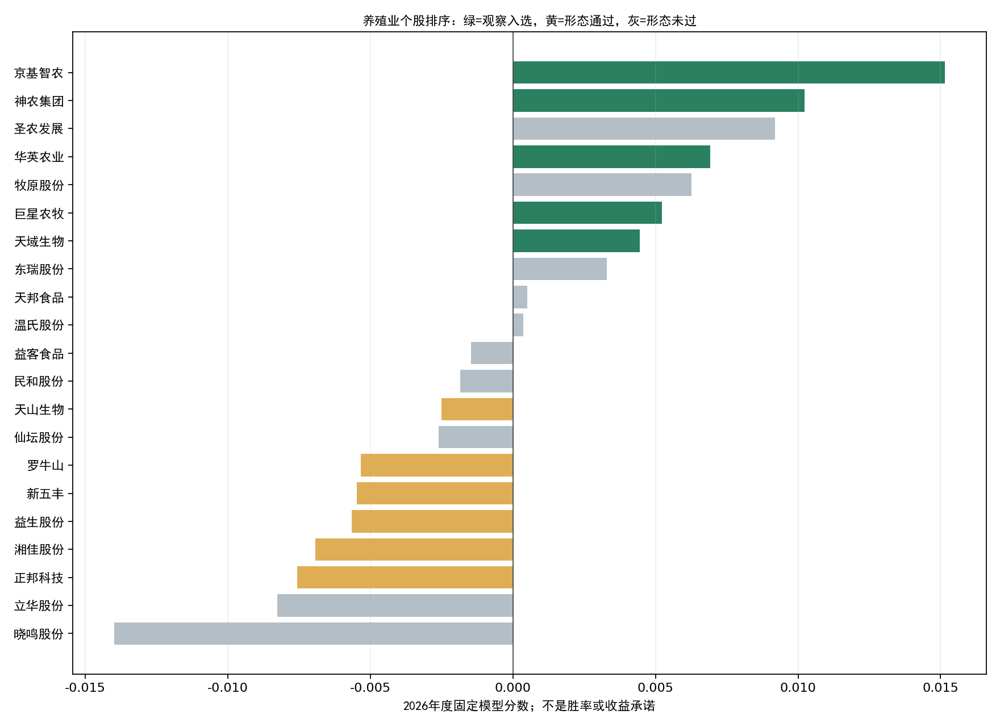
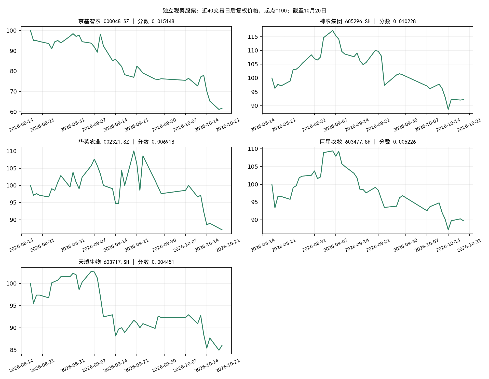

# 养殖业个股观察报告：2026-10-20收盘

**养殖业已完成首次形态确认，但年度板块模型未通过。此前正式扫描在板块层停止，未生成养殖业个股报告；本报告补充个股独立观察，正式策略候选仍为0。**

## 板块确认与模型判断

| 项目 | 结果 |
|---|---|
| 板块 | 养殖业 801017.SI |
| 首次确认日 | 2026-10-20，代表窗口 15 |
| 峰值日期 | 2026-09-07 |
| 峰值后回撤 | -10.03% |
| 当日板块涨跌 | -0.12% |
| 年度模型分数 | -0.042314928 |
| 原有通过阈值 | 0.003289287 |
| 年度板块模型通过 | 否 |

近5日价格触发、近5日支撑条件及当前减速等形态条件已经齐备。“形态确认”与“年度模型通过”是两个关口，不能互换。该事件的次日窗口是10月21日，但本次没有通过板块关口的入场信号。

## 个股独立观察结果

本次覆盖22只板块成员，21只通过资格核对，11只通过价格形态；在形态池内按原有正分数、前5名规则，得到5只独立观察股票。

| 股票     | 代码      |   收盘价 | 当日涨跌   | 5日涨跌   | 20日涨跌   | 20日日波动率   |   排序分数 |
|:---------|:----------|---------:|:-----------|:----------|:-----------|:---------------|-----------:|
| 京基智农 | 000048.SZ |    14.57 | 0.97%      | -19.99%   | -27.55%    | 4.10%          |   0.015148 |
| 神农集团 | 605296.SH |    28.68 | 0.14%      | -4.18%    | -14.44%    | 3.28%          |   0.010228 |
| 华英农业 | 002321.SZ |     1.82 | -0.55%     | -10.34%   | -12.08%    | 5.19%          |   0.006918 |
| 巨星农牧 | 603477.SH |    13.33 | -0.60%     | -2.49%    | -12.99%    | 2.08%          |   0.005226 |
| 天域生物 | 603717.SH |     5.61 | 1.26%      | -7.27%    | -7.43%     | 2.44%          |   0.004451 |

这些分数仅用于当日板块内的相对排序。该个股模型原先基于板块模型通过的历史事件研究；将它用于板块模型拒绝的事件，排序有效性尚未验证。表中顺序不是新的买入建议。





## 全部成员及未入选原因

| 股票     | 代码      |   收盘价 | 当日涨跌   | 5日涨跌   | 20日涨跌   | 20日日波动率   | 排序分数   | 资格通过   | 价格形态通过   | 说明                                                           |
|:---------|:----------|---------:|:-----------|:----------|:-----------|:---------------|:-----------|:-----------|:---------------|:---------------------------------------------------------------|
| 京基智农 | 000048.SZ |    14.57 | 0.97%      | -19.99%   | -27.55%    | 4.10%          | 0.015148   | True       | True           | 独立观察入选；年度板块模型未通过                               |
| 神农集团 | 605296.SH |    28.68 | 0.14%      | -4.18%    | -14.44%    | 3.28%          | 0.010228   | True       | True           | 独立观察入选；年度板块模型未通过                               |
| 圣农发展 | 002299.SZ |    16.78 | -2.04%     | 7.56%     | 1.51%      | 2.15%          | 0.009188   | True       | False          | 前3日跌幅不足1%；下跌减速未过；近2日涨幅超过2%；当日跌幅超过2% |
| 华英农业 | 002321.SZ |     1.82 | -0.55%     | -10.34%   | -12.08%    | 5.19%          | 0.006918   | True       | True           | 独立观察入选；年度板块模型未通过                               |
| 牧原股份 | 002714.SZ |    40.78 | -1.09%     | -0.29%    | -4.25%     | 1.94%          | 0.006271   | True       | False          | 前3日跌幅不足1%                                                |
| 巨星农牧 | 603477.SH |    13.33 | -0.60%     | -2.49%    | -12.99%    | 2.08%          | 0.005226   | True       | True           | 独立观察入选；年度板块模型未通过                               |
| 天域生物 | 603717.SH |     5.61 | 1.26%      | -7.27%    | -7.43%     | 2.44%          | 0.004451   | True       | True           | 独立观察入选；年度板块模型未通过                               |
| 东瑞股份 | 001201.SZ |    14.51 | 3.20%      | 1.26%     | 5.84%      | 4.56%          | 0.003288   | True       | False          | 近2日涨幅超过2%                                                |
| 天邦食品 | 002124.SZ |     2    | 0.00%      | -0.50%    | -13.42%    | 2.69%          | 0.000511   | True       | False          | 近2日涨幅超过2%                                                |
| 温氏股份 | 300498.SZ |    15.28 | 1.06%      | 1.87%     | 3.38%      | 1.58%          | 0.000364   | True       | False          | 前3日跌幅不足1%                                                |
| 益客食品 | 301116.SZ |     8.88 | 1.25%      | -3.79%    | -3.48%     | 1.48%          | -0.001461  | True       | False          | 下跌减速未过；个股排序分数非正                                 |
| 民和股份 | 002234.SZ |     7.41 | -0.40%     | -4.14%    | -6.91%     | 1.40%          | -0.001844  | True       | False          | 下跌减速未过；个股排序分数非正                                 |
| 天山生物 | 300313.SZ |    10.71 | 0.28%      | -12.14%   | -18.86%    | 3.93%          | -0.002503  | True       | True           | 个股排序分数非正                                               |
| 仙坛股份 | 002746.SZ |     6.18 | -1.12%     | 0.32%     | -2.35%     | 1.43%          | -0.002603  | True       | False          | 前3日跌幅不足1%；下跌减速未过；个股排序分数非正                |
| 罗牛山   | 000735.SZ |     5.25 | -0.38%     | -6.42%    | -13.08%    | 2.04%          | -0.005327  | True       | True           | 个股排序分数非正                                               |
| 新五丰   | 600975.SH |     4.84 | -0.62%     | -4.91%    | -9.87%     | 1.61%          | -0.005471  | True       | True           | 个股排序分数非正                                               |
| 益生股份 | 002458.SZ |     7.56 | -0.26%     | -4.30%    | -10.64%    | 1.19%          | -0.005663  | True       | True           | 个股排序分数非正                                               |
| 湘佳股份 | 002982.SZ |    12.17 | -1.06%     | -4.17%    | -3.03%     | 1.44%          | -0.006920  | True       | True           | 个股排序分数非正                                               |
| 正邦科技 | 002157.SZ |     2.84 | -0.35%     | -1.73%    | -8.68%     | 1.26%          | -0.007570  | True       | True           | 个股排序分数非正                                               |
| 立华股份 | 300761.SZ |    21.32 | 0.80%      | 7.35%     | 3.14%      | 1.88%          | -0.008259  | True       | False          | 前3日跌幅不足1%；近2日涨幅超过2%；个股排序分数非正             |
| 晓鸣股份 | 300967.SZ |    15.56 | 2.23%      | -0.77%    | -8.09%     | 1.45%          | -0.013974  | True       | False          | 近2日涨幅超过2%；个股排序分数非正                              |
| *ST福成  | 600965.SH |     2.26 | -0.44%     | -7.00%    | -18.12%    | 1.41%          | 未评分     | False      | False          | 资格未通过（名称/ST、上市状态或当日交易）                      |

## 原有个股筛选口径

1. 资格：截至20日已上市且未退市、名称/ST筛查通过、当日价格和成交量为正。本次重新查询全体成员名称历史，并按公告日和生效日截断到20日。
2. 价格形态：最近5日窗口的前3日累计跌幅至少1%；近2日平均负收益幅度/前3日平均负收益幅度不超过0.65；近2日累计涨幅不超过2%；当日跌幅不超过2%。减速比只计算负收益幅度，不是两个区间累计收益之比。
3. 截面排序：沿用2026年固定权重，使用强弱、波动、换手扩张/收缩、减速和趋势/形态等既有特征；在资格池内排名、去均值，然后在价格形态通过的正分数股票中取前5名。没有重新训练或调参。
4. 趋势、换手扩张和换手收缩参与评分与诊断，但当前方案不将其设为独立硬门槛。价格形态通过也不代表已经止跌。

| 股票     | 代码      | 5日窗口前3日涨跌   | 近2日涨跌   |   下跌减速比 | 趋势条件   |   换手扩张比 |   换手收缩比 |
|:---------|:----------|:-------------------|:------------|-------------:|:-----------|-------------:|-------------:|
| 京基智农 | 000048.SZ | -15.43%            | -5.39%      |     0.55561  | False      |     1.23717  |     1.00745  |
| 罗牛山   | 000735.SZ | -4.46%             | -2.05%      |     0.534337 | False      |     0.324519 |     0.92824  |
| 东瑞股份 | 001201.SZ | -1.40%             | 2.69%       |     0.13686  | True       |     0.667595 |     1.37242  |
| 天邦食品 | 002124.SZ | -2.99%             | 2.56%       |    -0        | False      |     0.684633 |     1.1885   |
| 正邦科技 | 002157.SZ | -1.38%             | -0.35%      |     0.167698 | False      |     0.725384 |     0.864982 |
| 民和股份 | 002234.SZ | -2.20%             | -1.98%      |     0.671972 | False      |     1.19649  |     0.653314 |
| 圣农发展 | 002299.SZ | 3.01%              | 4.42%       |     4.36037  | False      |     1.50852  |     1.96101  |
| 华英农业 | 002321.SZ | -8.37%             | -2.15%      |     0.357068 | False      |     0.629437 |     0.605349 |
| 益生股份 | 002458.SZ | -3.80%             | -0.53%      |     0.154459 | False      |     0.802819 |     0.832236 |
| 牧原股份 | 002714.SZ | 0.49%              | -0.78%      |     0.582117 | False      |     1.29845  |     0.972368 |
| 仙坛股份 | 002746.SZ | 0.97%              | -0.64%      |     0.688875 | False      |     0.8016   |     0.930296 |
| 湘佳股份 | 002982.SZ | -2.91%             | -1.30%      |     0.438167 | False      |     0.668482 |     1.1239   |
| 天山生物 | 300313.SZ | -9.84%             | -2.55%      |     0.416072 | False      |     0.437766 |     0.859346 |
| 温氏股份 | 300498.SZ | 1.67%              | 0.20%       |     0.551297 | False      |     1.30638  |     1.27496  |
| 立华股份 | 300761.SZ | 3.98%              | 3.24%       |     0        | False      |     0.851575 |     2.2227   |
| 晓鸣股份 | 300967.SZ | -2.87%             | 2.17%       |     0.021843 | False      |     0.659605 |     1.169    |
| 益客食品 | 301116.SZ | -3.25%             | -0.56%      |     0.664525 | False      |     0.781198 |     1.03907  |
| *ST福成  | 600965.SH | -4.53%             | -2.59%      |     0.860121 | False      |     0.789782 |     1.0412   |
| 新五丰   | 600975.SH | -4.13%             | -0.82%      |     0.220889 | False      |     0.454363 |     1.00978  |
| 巨星农牧 | 603477.SH | -2.49%             | 0.00%       |     0.167754 | False      |     0.938719 |     1.04603  |
| 天域生物 | 603717.SH | -5.45%             | -1.92%      |     0.583161 | False      |     0.970171 |     1.07844  |
| 神农集团 | 605296.SH | -4.04%             | -0.14%      |     0.052185 | False      |     1.32892  |     0.832729 |

## 数据、时序与核验

- 行情快照：`datahub/releases/selection_live_20261020_eod`，只读取截至20日的数据。
- 板块模型训练标签最晚2025-11-18；个股模型训练标签最晚2025-11-19。使用既有年度权重，不使用扫描器附带的旧随机划分模型分数。
- 最新名称历史核对完成，资格与原快照是否一致：True。成员归属沿用20日冻结板块数据；历史行业成员PIT尚未完整认证。
- 原数据工程代码、策略方案和模型权重哈希未改变；模型贡献求和与评分一致。报告不调整正式扫描结果，也未提交交易指令。
- 京基智农等股票可能在较大跌幅后仍满足减速条件，请结合表内5日/20日涨跌和日波动率理解排名；模型高分不等于低风险。

## 可复现文件

[全部成员明细 CSV](all_members_final.csv) · [独立观察名单 CSV](observation_candidates.csv) · [评分贡献 CSV](score_contributions.csv) · [核验记录](verification.json) · [20日原扫描报告](../../strategy_2026_opportunity_scan/20261020_eod/REPORT.html)

```bash
OPENBLAS_NUM_THREADS=1 OMP_NUM_THREADS=1 MKL_NUM_THREADS=1 python datahub/scripts/frozen_research.py run --release datahub/releases/selection_live_20261020_eod alpha_lab/outputs/breeding_stock_review/20261020_eod/review.py --scan alpha_lab/outputs/sector_live_scan/20261020T113957_683276Z
python alpha_lab/outputs/breeding_stock_review/20261020_eod/fetch_names.py
OPENBLAS_NUM_THREADS=1 OMP_NUM_THREADS=1 python datahub/scripts/frozen_research.py run --release datahub/releases/selection_live_20261020_eod alpha_lab/outputs/breeding_stock_review/20261020_eod/finalize.py --scan alpha_lab/outputs/sector_live_scan/20261020T113957_683276Z
python alpha_lab/outputs/breeding_stock_review/20261020_eod/build_report.py
```
