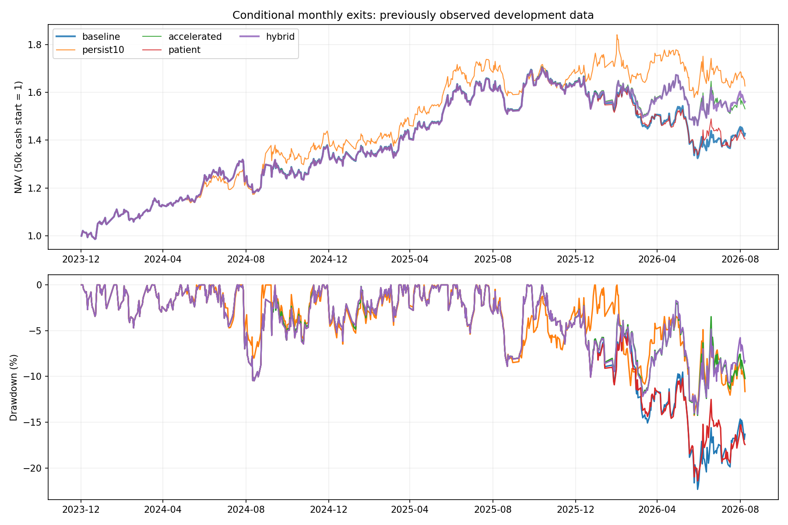

# 长期状态分治退出：30账户与固定持仓过程检验

2026-09-13；截止本地数据2026-09-08。**主假设hybrid在完整账户与近期本金/费用压力下产生改善，交易次数接近原基线；但旧窗口回撤恶化、近期增益集中于2026年及少数股票，尚未证明跨环境稳健。** 保留其为低换手研究主候选，不实盘准入。

[完整运行目录](./)、[事前协议](./PROTOCOL.md)。本轮是观察上轮结果后提出的追加开发研究，所有年份已接触，不称新样本外；没有按本轮结果改阈值。

## 1. 从统一速度改为条件速度

原趋势要求60/120日收益为正且价格高于MA120。只在原月度复核收盘、当前趋势已知且转弱时分类：

| 当时可见的状态 | 动作假设 |
|---|---|
| 120日收益仍正、价格仍高于MA120 | P：原两次月度失败确认改为三次，允许多等一次 |
| 120日收益不正、价格不高于MA120 | A：若过去20日完整可观测且至少10日弱，提前退出 |
| 上述长期条件只坏一项 | 原两次月度确认 |
| 当前趋势强 / 未知 | 不因本规则退出 / 保留未知并打断月度计数 |

hybrid=A+P；分别回放A、P、组合，再加入原baseline和上轮persist10，共五政策。状态切换不清零连续弱计数：从第一类切入混合类，当次按两次规则判断；连续弱最迟第三次确认。已提交退出不可因恢复撤销。原Top20、分数、收益预测、入场条件、月度执行、整手现金及原价费用均保持不变。

这些是已有价格条件的重组，不是“财务安全”或“持续下跌”的事实标签；两项长期条件共享价格历史，并非两条独立证据。参考[AQR原始趋势研究](https://www.aqr.com/Insights/Research/Journal-Article/A-Century-of-Evidence-on-Trend-Following-Investing)的跨环境复核思路，但该多市场研究没有验证本项目五股A股的条件或阈值。

## 2. 近期5万元：收益、回撤与换手的折中

2024年空仓启动至2026-09-08，共651交易日；费用、分红及公司行动沿用原账本。

| 政策 | 累计收益 | 年化 | 最大回撤 | Sharpe | 成交笔数 |
|---|---:|---:|---:|---:|---:|
| 原baseline | +42.71% | +14.26% | −22.34% | 0.84 | 43 |
| 上轮persist10 | +62.61% | +19.99% | −14.26% | 1.10 | 63 |
| 仅A：双弱时加速 | +53.08% | +17.30% | −14.25% | 0.96 | 44 |
| 仅P：长期条件完好时多等 | +40.50% | +13.59% | −21.41% | 0.82 | 44 |
| **hybrid：A+P** | **+56.05%** | **+18.15%** | **−14.12%** | **1.01** | **42** |

hybrid相比上轮persist10少赚6.56个百分点，但成交少21笔；相比baseline多赚6,669.92元、回撤减少8.22个百分点，成交少一笔。已结束持仓段天数中位数160个交易日，baseline149.5、persist10为98；这是各自已结束持仓段的描述，不能当作同一组股票的配对持有期。

hybrid平均股票仓位98.29%，baseline98.39%，因此不是主动空仓收益。收益差包含退出、再入场和股数变化。

## 3. 完整账户改善，旧窗口仍有代价

2022年5万元连续运行至2026-09-08：

| 政策 | 终值 | 累计收益 | 年化 | 最大回撤 | Sharpe |
|---|---:|---:|---:|---:|---:|
| baseline | 115,639.04元 | +131.28% | +19.75% | −20.56% | 1.055 |
| persist10 | 114,870.72元 | +129.74% | +19.58% | −17.43% | 1.048 |
| 仅A | 122,264.13元 | +144.53% | +21.19% | −14.38% | 1.102 |
| 仅P | 118,554.89元 | +137.11% | +20.39% | −22.96% | 1.069 |
| **hybrid** | **124,708.96元** | **+149.42%** | **+21.71%** | **−15.57%** | **1.100** |

hybrid完整账户比baseline多9,069.92元，最大回撤减少4.99个百分点；仅A的全段回撤更小。两者都保留，不能仅按收益最高选一个。

| 政策 | 2022—2023累计 / 回撤 / Sharpe | 承接各自旧仓的2024+累计 / 回撤 / Sharpe |
|---|---|---|
| baseline | +62.93% / −13.57% / 1.33 | +41.95% / −20.56% / 0.83 |
| persist10 | +34.96% / −12.63% / 0.90 | +70.23% / −17.43% / 1.16 |
| 仅A | +59.91% / −14.38% / 1.29 | +52.92% / −14.06% / 0.95 |
| 仅P | +63.73% / −15.59% / 1.28 | +44.82% / −22.96% / 0.89 |
| hybrid | +62.86% / −15.57% / 1.27 | +53.15% / −14.02% / 0.96 |

hybrid避免了persist10旧窗口收益大幅损失，但旧窗口回撤仍比baseline深约2个百分点，Sharpe也较低。近期连续收益各自以2023末权益为分母，不与5万元冷启动混淆。

## 4. 小资金和成本检验

以下为近期累计收益 / 最大回撤 / Sharpe，全部按真实股数重跑，不线性缩放：

| 情景 | baseline | 仅A | hybrid |
|---|---|---|---|
| 2万元 | +37.63% / −20.24% / 0.77 | +46.41% / −13.51% / 0.86 | +47.95% / −13.52% / 0.89 |
| 10万元 | +45.13% / −21.34% / 0.85 | +58.88% / −16.13% / 1.00 | +64.38% / −16.13% / 1.07 |
| 5万元费用翻倍 | +37.66% / −21.29% / 0.75 | +48.63% / −13.74% / 0.89 | +50.36% / −13.76% / 0.92 |

相对baseline的近期改善没有被这些执行情景推翻。但不同本金下成交笔数并非全都减少，例如10万元hybrid52笔、baseline48笔；不能用5万元的一笔减少概括全部账户。

## 5. 状态数据：判断变少，但证据仍少

固定原baseline持仓的第一次月度转弱事件：旧窗口21次、近期29次，股票/日期及后续价格与上轮逐值相同。双长期条件都弱的状态只有旧3次、近期5次；满足A完整持续性条件的仅旧2次、近期3次。不能将其当作充分验证的风险分类器。

近期固定基线中会提前退出的三次为：

| 原基线事件 | 复核日 | 此后20日复权价格变动 |
|---|---|---:|
| 工商银行601398 | 2026-02-02 | −2.47% |
| 中国银行601988 | 2026-02-02 | −0.74% |
| 中国神华601088 | 2026-07-01 | +17.71% |

三次次月均未恢复原完整趋势条件，但神华价格已明显反弹，说明“趋势未恢复”不等于“继续下跌”。此表是同一批原持仓的反事实诊断，不是hybrid真实退出清单；hybrid后来持仓路径改变，7月并无这笔神华提前退出。

hybrid近期真实持有许可只改变六处：桂冠电力2024-10、中国人寿2025-02、中国银行2026-07多等；工商银行和中国银行2026-02、桂冠电力2026-09提前。其余持仓差异是这些决定传递到后续账户的结果，不是更多独立预测成功。

P的固定原退出事件也不一致：旧窗口四次多等，随后20日价格均下跌；近期三次中桂冠−9.10%、人寿−0.66%、中行+10.76%。不能把长期两项仍正直接当作“安全回调”。价格诊断使用计划执行日复权开盘至后20交易日收盘，不含实际费用、可成交约束或替代机会，不能充当策略收益。

还有明确的边界敏感点：中行2026-07-01获准多等时，只高于MA120约0.0059%；将均线换算为当日原价，其距离约0.033个最小报价单位（tick=0.01元）。这不是计算错误，却说明这次收益贡献涉及很薄的分类边界。同期三次实际加速的均线距离约为−30、−9、−17个报价单位。完整幅度证据见[持仓复核状态](./actual_held_review_states.csv)；本轮没有据此事后修改阈值。

## 6. 改善集中与机制交互

近期hybrid相对baseline多赚6,669.92元：2024少146.36元、2025少73.31元，2026多6,889.59元，近期净增益全部来自2026并抵消前两年损失。冷启动逐年收益：baseline +36.81% / +20.18% / −13.20%；hybrid +36.51% / +20.12% / −4.83%。

中国银行、山东高速、桂冠电力三个股票的完整账户损益差占净增益87.25%。这包含不同时间、股数和再入场机会；既不是三笔独立alpha，也不是删除这三股后的反事实回测。

2×2消融中，仅A近期多赚5,183.83元，仅P少赚1,106.87元，组合多赚6,669.92元，账户利润交互为+2,592.97元；2022起完整账户交互却为−471.02元。说明P独立并不稳定，组合优势部分来自后续资金和候选路径的相互作用，不能称两个有效信号简单叠加。

## 7. 工程核验与当前结论

310项完整测试通过，30账户逐日逐股损益对账通过。原账户引擎、选择器、信号/预测、价量数据和生产配置未改；本轮无需下载数据。两个原持有矩阵baseline/persist10精确复现。五规则49,020个持有许可单元及285次历史前缀通过独立重建；未知、零值边界、分类切换、第三次退出及不可撤销pending均覆盖。

独立核验已 **complete**：30账户、1,591笔真实成交、109,600次原价估值、576次首次退出生命周期及726次原月度Top20入场通过。五组真实倒序85项CSV、两个原对照12账户204项CSV、baseline另对修复recent的102项CSV全部逐值一致。最大现金/总资产误差小于3e−11元。新长期分类无numpy/pandas边界差异；继承上轮每日一格浮点边界导致的弱日18→19不改变五个持有矩阵。[独立报告](./INDEPENDENT_VERIFICATION.md)保留全部证据。

允许度满足persist10≤A≤baseline≤P、A≤hybrid≤P；hybrid与baseline不存在统一的早晚关系。这是同股同日的许可顺序，不代表不同账户后续成交日期具有同一顺序。

**当前将hybrid作为低换手研究主候选，仅A作为更简单的风险对照，persist10保留作更敏感对照。** 已见历史中，hybrid比上轮方案更贴合少交易、保留长期持仓的目标；但改善样本集中、旧窗口回撤代价和阈值敏感性仍未解决，不升级实盘或改原默认策略。

复现入口仍为`python scripts/run_hold_sensitivity.py --run outputs/conditional_hold/20260913T123032_500204Z --case-name cold_hybrid`。该命令会写研究账户，审计时先复制目录。分治构造在`src/conditional_hold.py`，汇总在`analyze_conditional_hold.py`，固定状态与2×2分析在`diagnose_conditional_hold.py`。
