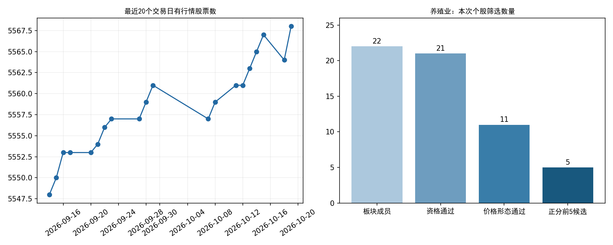

# datahub 完整性检查与模型结果（2026-10-21）

**结论：A股日线已更新至2026-10-20收盘，当日模型使用的日频字段齐备；整个 datahub 尚不能认定完整或全部同步。按暂停年度板块判断后的规则复核20日收盘数据，养殖业是唯一新的首次确认，产生5只个股候选。**

检查开始于北京时间10月21日14:45，彼时尚未收盘。本报告只使用20日完整收盘快照；21日完整EOD尚未入库。模型输出为 `policy_change_review`，不能视为21日收盘新信号，也不代表此刻可以按20日价格成交。

## 数据更新到哪里

| 数据 | 实际覆盖终点 | 本次核验结论 |
|---|---|---|
| A股日线、复权、日度指标、资金流 | 2026-10-20 | 当日5,568只有交易股票，四个接口全部覆盖 |
| A股历史日线 | 2014-01-02 至 2026-10-20 | 12,413,629行，5,838个代码，3,109个市场交易日 |
| 美股及相关33个序列 | 2026-09-17 | 落后于当前日期；本次模型不使用 |
| 国内8个基准指数 | 2026-09-08 | 落后于A股日线；本次板块指数由个股合成，不使用这些基准 |
| 名称/ST历史主表 | 最晚公告2026-09-08 | 全仓库未同步；本次单独通过既有接口重新查询养殖业22只成员的名称历史 |
| 股票主档 | 20日更新产物 | 信达、东兴仍显示上市，实际已终止上市；不能仅凭抓取时间判断正确性 |
| 本次SW二级板块数据集 | 2026-10-20 | 103个有效板块；当日成员映射覆盖79.33%，不是全A完全覆盖 |

全历史重复键、空主键、错误分区、非交易日记录、无效复权因子均为0；市场日历中没有整天行情缺失。**市场交易日齐全，不等于逐只股票全历史都已完成停牌和缺失核对**，本次逐股核对范围是最新20日。

## 20日完整性与9只无行情股票

实测日线5,568行，重复键0、OHLC异常0、负成交量/额0、复权不一致0；16项关键字段缺失均为0。原始 daily 与入库代码、收盘、成交额和成交量一致，量额已按既有单位规则转换。

| api         |   raw_rows |   daily_codes_covered |
|:------------|-----------:|----------------------:|
| daily       |       5568 |                  5568 |
| adj_factor  |       5577 |                  5568 |
| daily_basic |       5568 |                  5568 |
| moneyflow   |       5575 |                  5568 |

主档上市股票5,577只 = 5,568只有行情 + 7只全日停牌 + 2条过期上市状态。

| ts_code   | name     | 核验结论                           |
|:----------|:---------|:-----------------------------------|
| 000016.SZ | *ST康佳A | 全日停牌，无日线属预期             |
| 002388.SZ | 新亚制程 | 全日停牌，无日线属预期             |
| 002717.SZ | *ST岭南  | 全日停牌，无日线属预期             |
| 002731.SZ | *ST萃华  | 全日停牌，无日线属预期             |
| 301314.SZ | 科瑞思   | 全日停牌，无日线属预期             |
| 301468.SZ | 博盈特焊 | 全日停牌，无日线属预期             |
| 601059.SH | 信达证券 | 10月19日已终止上市，主档状态未更新 |
| 601198.SH | 东兴证券 | 10月19日已终止上市，主档状态未更新 |
| 688496.SH | *ST清越  | 全日停牌，无日线属预期             |

两家证券公司的终止上市生效日均为2026年10月19日，依据上交所[信达证券公告](https://www.sse.com.cn/disclosure/announcement/listing/stock/c/c_20261012_10834561.shtml)、[东兴证券公告](https://www.sse.com.cn/disclosure/announcement/listing/stock/c/c_20261012_10834560.shtml)。因此，这两条是主档状态错误，不能当作应补的20日行情。它们也不在本次养殖业候选范围内。本次保存证据，未改写股票主档或冻结快照。

## 仍未解决的问题

| 问题 | 本次实测 | 含义 |
|---|---|---|
| SW一级历史成员映射 | 20日1,045只无映射、10只多重映射 | datahub通用板块查询不能视为全覆盖 |
| 名称历史覆盖 | 20日20只缺少有效名称记录 | 全市场ST筛选不可直接假定完备 |
| 历史股票主档缺代码 | 3个历史代码共4,994行 | 000022、000043、300114需要身份衔接治理 |
| 上市日期冲突 | 76,267行早于主档上市日期 | 是审计报警，需核查日期语义，不能直接认定全部为错误行情；板块数据集已排除这类记录 |
| 历史数值异常 | OHLC 2行、VWAP越界78行、涨跌幅不符1行、市值恒等式不符551行 | 按审计容差识别，明细及样本在 research_readiness 中 |
| 基准指数历史缺日 | 000001.SH、399303.SZ各22日 | 2018年5月缺口，共44条代码-日期记录 |
| SW二级历史成员 | 27个历史成员请求失败，历史PIT未获认证 | 当前103个板块不等于历史全覆盖；本次养殖业22个已知成员当日行情齐备 |
| build_manifest汇总陈旧 | 声明12,280,264行，实测12,413,629行 | 相差133,365行；结束日期已更新，嵌套行数未同步，不宜只读manifest判断完整性 |

这些问题不妨碍本次在现有定义范围内生成候选，但限制全市场覆盖与历史回测可信度。本次没有重新证明策略收益或无偏性。

## 本次模型运行

使用冻结快照 `selection_live_20261020_eod`；其完整性校验通过，当前datahub与快照的24个数据文件哈希一致，20日更新记录中的13个产物哈希通过。内容ID：`f270dc89ead79a3607680baa700d1103915f33de86fc10ca4fcde61cb28c46e7`。

板块层复用并核验20日原扫描的形态状态和首次事件记录；本次重新执行当前策略入口、年度参考分数和个股模型推理，重新查询成员名称历史。年度板块过滤为关闭状态，旧随机分组模型分数没有参与决策。个股模型继续使用原2026权重，训练标签截止约束早于2026年；未重新训练。

| 环节 | 数量/结果 |
|---|---|
| 有效板块 | 103 |
| 观察/触发板块 | 8 / 8 |
| 当日形态确认 | 2：养殖业、酒店餐饮 |
| 去重后新的首次确认 | 1：养殖业 |
| 进入个股筛选 | 1个板块 |
| 养殖业成员 | 22只 |
| 资格通过并评分 | 21只；*ST福成被剔除 |
| 价格形态通过 | 11只 |
| 正分数排序前5名 | 5只 |

养殖业年度板块参考分数为-0.042315，参考门槛0.003289；**当前不用于拦截**。酒店餐饮属于此前已确认的同一事件，不能因再次满足形态重开交易窗口。



| 股票     | 代码      |   20日收盘价 |   个股模型分数 | 20日涨跌幅   | 趋势条件           |
|:---------|:----------|-------------:|---------------:|:-------------|:-------------------|
| 京基智农 | 000048.SZ |    14.570000 |       0.015148 | 0.97%        | 未通过（非硬门槛） |
| 神农集团 | 605296.SH |    28.680000 |       0.010228 | 0.14%        | 未通过（非硬门槛） |
| 华英农业 | 002321.SZ |     1.820000 |       0.006918 | -0.55%       | 未通过（非硬门槛） |
| 巨星农牧 | 603477.SH |    13.330000 |       0.005226 | -0.60%       | 未通过（非硬门槛） |
| 天域生物 | 603717.SH |     5.610000 |       0.004451 | 1.26%        | 未通过（非硬门槛） |

分数是模型排序输出，不是上涨概率或收益承诺。5只均通过当前价格形态规则，趋势条件均未通过；趋势目前是诊断项而非硬门槛，这些是左侧筛选候选。

原信号下一交易日为10月21日。本次属于新规则对20日数据的复核，不恢复已经结束的执行窗口，没有核验21日实时价格和成交条件，`execution_certified=false`。应等21日完整EOD后再形成21日收盘模型报告。

## 产物与复现

模型报告：[完整个股报告](../../strategy_2026_opportunity_scan/20261020_gate_paused_20261021T070103_535863Z/REPORT.html) · [全部21只合格个股评分与原因](../../strategy_2026_opportunity_scan/20261020_gate_paused_20261021T070103_535863Z/stock_diagnostics.csv) · [22只成员资格](../../strategy_2026_opportunity_scan/20261020_gate_paused_20261021T070103_535863Z/all_member_qualification_20261020.csv) · [本次候选](../../strategy_2026_opportunity_scan/20261020_gate_paused_20261021T070103_535863Z/stock_candidates.csv)。

审计：[日频字段覆盖](latest_field_coverage.csv) · [9只无行情原因](missing_daily_reconciled.csv) · [全历史汇总](research_readiness/summary.json) · [历史异常样本](research_readiness/anomaly_samples.csv) · [板块与名称覆盖](research_readiness/pit_coverage.csv) · [保护文件验证](verification.json) · [运行记录](run_record.json)。

```bash
python datahub/scripts/audit_research_readiness.py
python datahub/scripts/frozen_research.py verify --release datahub/releases/selection_live_20261020_eod
OPENBLAS_NUM_THREADS=1 OMP_NUM_THREADS=1 MKL_NUM_THREADS=1 python datahub/scripts/frozen_research.py run --release datahub/releases/selection_live_20261020_eod alpha_lab/experiments/sector_live_v1/scan_stocks.py --scan alpha_lab/outputs/sector_live_scan/20261020T113957_683276Z --review-policy
```

本次未修改数据工程、数据集构建程序、模型权重或历史策略配置。原审计结果已保存在 before/。报告生成脚本保存在本目录 build_report.py，仅汇总审计产物。
