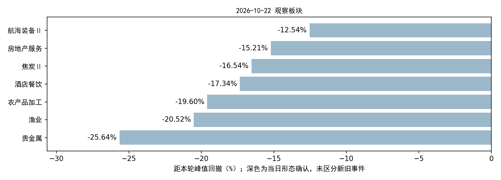

# 2026年10月22日收盘更新与模型结果

**A股行情已更新至22日，新增5,570条有效日线；当前策略新首次确认0个，新个股候选0只。对应下一交易日为2026-10-23。**

年度板块判断继续暂停。原个股资格、价格形态、正分前5名、首次确认去重及下一交易日有效规则保持原样。

## 数据核验

| api         |   raw_rows |   covered |   missing |
|:------------|-----------:|----------:|----------:|
| daily       |       5570 |      5570 |         0 |
| adj_factor  |       5579 |      5570 |         0 |
| daily_basic |       5570 |      5570 |         0 |
| moneyflow   |       5577 |      5570 |         0 |

四接口覆盖全部当日有交易股票，15项核验字段无缺失；重复键、OHLC异常、复权不一致均为0。原始成交量、成交额和收盘价与入库一致。21日及以前的2026行情与旧冻结快照逐行一致。

上市主档5,579条，5,570只有行情、7只全日停牌、2条已知终止上市但状态滞后记录。详见[逐股原因](missing_daily_reconciled.csv)、[字段覆盖](field_coverage.csv)、[核验汇总](latest_quality.json)。过期主档问题沿用[此前核验](../20261021T064829_488127Z/REPORT.html)，本次未改写历史主档。

板块数据：103个当日有效板块，成员归属覆盖79.30%。美股、基准指数和历史行业资料未在本次同步；行业历史PIT/完整性限制仍在。本次只对现有模型使用的A股数据与既定板块范围进行更新和扫描。

## 当前策略结果

| 环节 | 数量 |
|---|---:|
| 有效板块 | 103 |
| 观察板块 | 7 |
| 触发层板块 | 7 |
| 当日形态确认 | 0 |
| 去重后新首次确认 | 0 |
| 进入个股筛选的板块 | 0 |
| 本次评分股票 | 0 |
| 新个股候选 | 0 |

| 板块       | 代码      | 当日形态确认   | 距峰值回撤   | 距参照位   | 状态说明                 |
|:-----------|:----------|:---------------|:-------------|:-----------|:-------------------------|
| 农产品加工 | 801012.SI | 否             | -19.60%      | 2.35%      | 近期未破支撑；下跌未减速 |
| 渔业       | 801015.SI | 否             | -20.52%      | 3.55%      | 下跌未减速               |
| 贵金属     | 801053.SI | 否             | -25.64%      | -12.26%    | 近期未破支撑；下跌未减速 |
| 房地产服务 | 801183.SI | 否             | -15.21%      | -0.43%     | 下跌未减速               |
| 酒店餐饮   | 801219.SI | 否             | -17.34%      | -9.67%     | 下跌未减速               |
| 航海装备Ⅱ  | 801744.SI | 否             | -12.54%      | -2.81%     | 近期未破支撑；下跌未减速 |
| 焦炭Ⅱ      | 801952.SI | 否             | -16.54%      | -4.62%     | 下跌未减速               |

## 候选与旧事件

无新个股候选。当日没有新首次事件，个股评分流程按规则跳过，不代表所有个股模型评分失败。

- 养殖业：距峰值回撤-8.01%，回落门槛未过；近期未破支撑；下跌未减速。
- 酒店餐饮：距峰值回撤-17.34%，下跌未减速。

养殖业20日旧事件和酒店餐饮9月17日旧事件不会因为形态再次通过而重开入场；只有新的独立首次确认才能进入个股流程。20日养殖业候选的原有效日为21日，不顺延至23日。分数是排序输出，模型候选不等于实际成交。

## 运行记录

本次依次执行原 `update_market.py`、`build_sector_dataset.py`、`scan_sectors.py` 和当前策略 `scan_stocks.py`；仅新增日期配置和本目录的调用/审计/报告脚本。原数据工程代码、模型权重及策略配置哈希未变，数据和模型产物哈希均通过检查。

快照：`datahub/releases/selection_live_20261022_eod`；内容ID：`6b0908addd9048da828d6c65901d39e567c8b278ef9bee494040d5b4f49004cd`。

[模型报告](../../strategy_2026_opportunity_scan/20261022_gate_paused_20261022T160739_495956Z/REPORT.html) · [候选CSV](../../strategy_2026_opportunity_scan/20261022_gate_paused_20261022T160739_495956Z/stock_candidates.csv) · [首次事件](../../strategy_2026_opportunity_scan/20261022_gate_paused_20261022T160739_495956Z/first_confirmations.csv) · [完整状态](../../sector_live_scan/20261022T160204_763709Z/sector_states_today.csv) · [相较21日的变化](state_changes.csv) · [调用参数及返回码](pipeline.json) · [保护文件验证](verification.json)

日志：[更新](update.log)、[构建](build_dataset.log)、[板块扫描](scan_sectors.log)、[当前策略](scan_stocks.log)、[审计](audit.log)。
