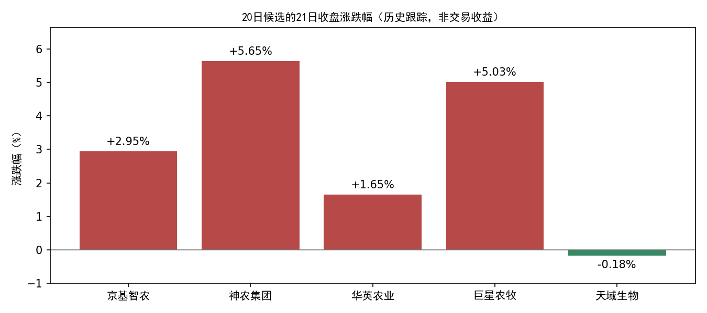

# 21日收盘数据与模型结果：22日开盘前

**已将A股数据更新至2026年10月21日收盘，完成冻结、板块构建和当前策略扫描。新首次确认0个，进入个股筛选0个板块，新个股候选0只。**

年度板块模型继续暂停过滤，仅保留诊断；不使用旧随机分组模型评分决定资格。数据更新与数据集构建使用原封装程序，只增加本次日期配置，原工程代码、模型权重及策略规则哈希未变。

## 数据完整性

本次新增1个交易日、5,568条有效股票日线。行情、复权、日度指标和资金流覆盖本次全部有交易股票；关键字段无缺失，重复键、OHLC异常、复权不一致均为0，成交量、成交额与原始数据按既有单位换算后一致。

| api         |   raw_rows |   covered |   missing |
|:------------|-----------:|----------:|----------:|
| daily       |       5568 |      5568 |         0 |
| adj_factor  |       5578 |      5568 |         0 |
| daily_basic |       5568 |      5568 |         0 |
| moneyflow   |       5576 |      5568 |         0 |

上市主档5,578条 = 5,568条有效行情 + 8只全日停牌 + 2条此前已发现的过期上市状态（信达、东兴）。停牌名单已通过既有接口按21日重新查询，详见[无行情原因](missing_daily_reconciled.csv)。两家终止上市依据沿用[上次核验报告](../20261021T064829_488127Z/REPORT.html)。

更新前后20日及以前全部2026日线逐行一致；更新产物哈希和冻结快照校验通过。2026分区实测1,051,857行。

新板块数据含103个有效板块，当日成员归属覆盖79.31%。既有行业历史完整性/PIT限制仍在；美股、基准指数和全仓库名称历史未在本次同步。这些数据不参与本次信号生成，不能把本次A股更新描述成全仓库已完整。

## 模型结果与事件有效期

| 环节 | 21日结果 |
|---|---:|
| 有效板块 | 103 |
| 观察池 | 7 |
| 触发层 | 7 |
| 当日形态确认 | 1 |
| 去重后新首次确认 | 0 |
| 进入个股筛选的板块 | 0 |
| 本次评分个股 | 0 |
| 新候选 | 0 |

| 板块       | 代码      | 21日形态确认   | 本轮涨幅   | 距峰值回撤   | 距参照位   | 最近首次确认        | 是否21日首次   | 状态说明                   |
|:-----------|:----------|:---------------|:-----------|:-------------|:-----------|:--------------------|:---------------|:---------------------------|
| 农产品加工 | 801012.SI | 否             | 31.01%     | -17.22%      | 2.82%      | 2019-05-13 00:00:00 | 否             | 近期未破支撑               |
| 渔业       | 801015.SI | 否             | 26.83%     | -16.85%      | 1.71%      | 2025-01-07 00:00:00 | 否             | 近期未破支撑               |
| 贵金属     | 801053.SI | 否             | 30.42%     | -22.69%      | -8.79%     | 2024-07-01 00:00:00 | 否             | 近期未破支撑；下跌尚未减速 |
| 房地产服务 | 801183.SI | 否             | 19.86%     | -12.16%      | 3.14%      | 无                  | 否             | 近期未破支撑               |
| 酒店餐饮   | 801219.SI | 是             | 16.99%     | -15.47%      | -7.62%     | 2026-09-17 00:00:00 | 否             | 旧事件再次满足形态         |
| 航海装备Ⅱ  | 801744.SI | 否             | 16.83%     | -10.12%      | -0.12%     | 2025-10-21 00:00:00 | 否             | 近期未破支撑；下跌尚未减速 |
| 焦炭Ⅱ      | 801952.SI | 否             | 17.73%     | -13.18%      | -0.78%     | 2025-11-25 00:00:00 | 否             | 近期未破支撑               |

当日满足形态与新的首次确认是两件事。养殖业20日事件的原入场有效日是21日，不顺延至22日；酒店餐饮旧事件也不重开。暂停年度板块判断没有取消事件去重或延长入场窗口。

与20日相比：养殖业、医疗服务退出观察层，航海装备Ⅱ进入观察层。养殖业21日反弹后距本轮峰值回撤为-7.49%，未达到原规则至少10%的回撤要求，当前回落门槛未过。航海装备Ⅱ仍缺近期跌破支撑和下跌减速两个条件。[状态变化明细](state_changes.csv)

**本次没有新个股候选。** 当前策略只对当日去重后的首次确认执行个股筛选；无新事件时，个股评分流程按规则跳过，不是个股评分全部失败。

本次是21日的正式当前策略扫描，记录类型 `current_policy_scan`，对应下一交易日22日；不是按新规则回填旧信号。模型报告不等同于订单或成交，未执行任何交易。

## 20日候选后续跟踪

以下保留20日的候选身份，仅列21日价格变化；不是22日新推荐，也没有按21日涨跌重新排序。涨跌幅采用行情字段，不是实际买入收益或策略回测收益。

| 20日候选   | 代码      |   20日收盘 |   21日收盘 | 21日涨跌幅   |
|:-----------|:----------|-----------:|-----------:|:-------------|
| 京基智农   | 000048.SZ |      14.57 |      15.00 | +2.95%       |
| 神农集团   | 605296.SH |      28.68 |      30.30 | +5.65%       |
| 华英农业   | 002321.SZ |       1.82 |       1.85 | +1.65%       |
| 巨星农牧   | 603477.SH |      13.33 |      14.00 | +5.03%       |
| 天域生物   | 603717.SH |       5.61 |       5.60 | -0.18%       |



## 产物与复现

- [当前模型报告](../../strategy_2026_opportunity_scan/20261021_gate_paused_20261021T173036_633714Z/REPORT.html)
- [当前候选CSV](../../strategy_2026_opportunity_scan/20261021_gate_paused_20261021T173036_633714Z/stock_candidates.csv)
- [首次确认事件](../../strategy_2026_opportunity_scan/20261021_gate_paused_20261021T173036_633714Z/first_confirmations.csv)
- [完整板块状态](../../sector_live_scan/20261021T172443_233422Z/sector_states_today.csv)
- [本次字段覆盖](field_coverage.csv)、[更新验证](update_verification.json)、[保护文件核验](verification.json)
- [更新日志](update.log)、[板块构建日志](build_dataset.log)、[板块扫描日志](scan_sectors.log)、[当前策略日志](scan_stocks.log)

行情快照：`datahub/releases/selection_live_20261021_eod`；内容ID：`615021535699c648a382255f3bfd6fc3ac9fdb985032dfef19ab91f1f182a8a3`。

```bash
python alpha_lab/experiments/sector_live_v1/update_market.py --config alpha_lab/experiments/sector_live_v1/config_20261021_eod.yaml
python datahub/scripts/frozen_research.py run --release datahub/releases/selection_live_20261021_eod alpha_lab/scripts/build_sector_dataset.py --config alpha_lab/experiments/sector_live_v1/dataset_config_20261021_eod.yaml
python datahub/scripts/frozen_research.py run --release datahub/releases/selection_live_20261021_eod alpha_lab/experiments/sector_live_v1/scan_sectors.py --dataset /root/autodl-tmp/alpha_lab/data/sector_live_datasets/sw_l2_v1_20261021T171918_920041Z --config alpha_lab/experiments/sector_live_v1/config_20261021_eod.yaml
python datahub/scripts/frozen_research.py run --release datahub/releases/selection_live_20261021_eod alpha_lab/experiments/sector_live_v1/scan_stocks.py --scan /root/autodl-tmp/alpha_lab/outputs/sector_live_scan/20261021T172443_233422Z
```

更新已完成，不应再次执行首条增量下载；复现模型可以直接使用已冻结快照及后续命令。未重新训练模型、修改筛选门槛或回填历史事件。
