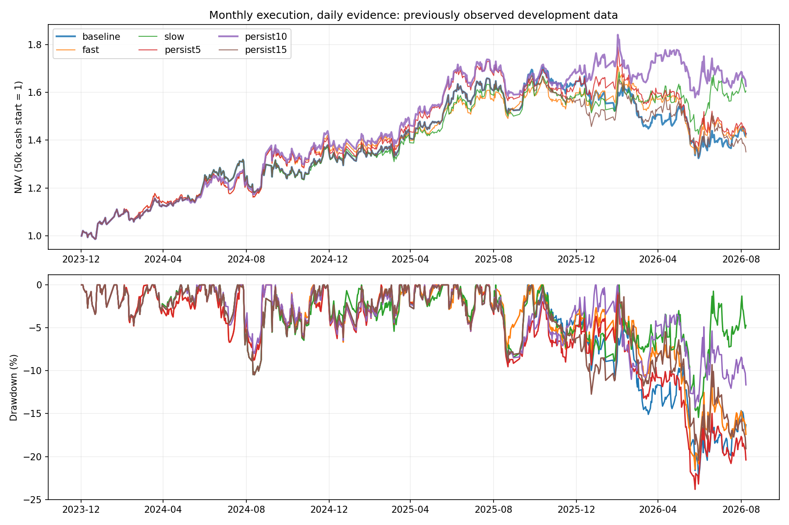

# 退出灵敏性与鲁棒性：36账户及过程检验

日期：2026-09-13；截止本地数据2026-09-08。**近期出现两个数值改善候选，但跨年份与门槛稳定性尚未支持替换原基线。** 所有年份都已被研究接触，以下是开发样本复验，不是全新样本外或实盘成绩。

[完整运行目录](./)，[事前协议](./PROTOCOL.md)，[原始研究与适用边界](../../../docs/SENSITIVITY_ROBUSTNESS_RESEARCH_20260913.md)。

## 1. 本轮改变了什么

原趋势要求60/120日收益均为正且价格高于120日均线；任一条件失败记为弱。原基线等两次月度复核失败后退出。本轮保持原月度日历、下一开盘成交、原全A截面排序后的主板Top20、2021冻结收益常数、入场与恢复规则、费用及0—5只整手分配，只改变持有许可。

| 方案 | 退出确认 |
|---|---|
| baseline | 原连续两次月度失败 |
| fast | 一次月度失败 |
| slow | 连续三次月度失败 |
| persist10（事前主假设） | 原两次兜底；当前仍弱，且过去20交易日完整可观测、至少10日弱时提前退出 |
| persist5 / persist15 | 同主假设，仅日线弱天数为5/15；事前邻域检查，不事后择优替代主假设 |

累计弱日可以不连续，窗口含复核当天收盘；每日观察不等于每日交易。未知打断月度计数，缺完整20日不得加速；原两次确认仍可兜底。原股趋势未恢复不重新入场，已经确认的延期卖单不撤销。没有叠加上一轮相关性门或集体退出暂停。

## 2. 近期5万元：改善真实存在，但不均匀

2024空仓启动，651个交易日，收益包含原交易费用和公司行动记账。

| 方案 | 累计收益 | 年化 | 最大回撤 | Sharpe | 成交笔数 |
|---|---:|---:|---:|---:|---:|
| baseline | +42.71% | +14.26% | −22.34% | 0.84 | 43 |
| fast | +41.08% | +13.77% | −21.48% | 0.81 | 92 |
| slow | +60.50% | +19.40% | −15.44% | 1.11 | 39 |
| persist5 | +42.43% | +14.17% | −23.83% | 0.81 | 78 |
| persist10 | **+62.61%** | **+19.99%** | **−14.26%** | **1.10** | 63 |
| persist15 | +35.07% | +11.93% | −20.43% | 0.70 | 58 |

主假设相比原基线多赚9,948.21元、累计收益增加19.90个百分点、最大回撤减少8.08个百分点，但成交增加约47%。已结束持仓段的持有天数中位数从149.5降至98个交易日；fast则降到44日。该统计只包含结束的持仓段，不是相同股票的因果延长/缩短比较。

主方案平均股票仓位97.82%、slow为97.47%，均不是主动空仓策略。改善来自退出及后续持仓路径变化，不能宣称现金择时成功。

## 3. 年份、延续账户与本金压力

| 方案 | 2022—2023累计 / 回撤 / Sharpe | 2024+承接旧仓累计 / 回撤 / Sharpe |
|---|---|---|
| baseline | +62.93% / −13.57% / 1.33 | +41.95% / −20.56% / 0.83 |
| fast | +41.56% / −12.02% / 1.07 | +47.73% / −20.16% / 0.89 |
| slow | +43.40% / −17.88% / 0.99 | +55.34% / −16.66% / 1.01 |
| persist5 | +39.45% / −12.26% / 1.08 | +51.38% / −20.94% / 0.90 |
| persist10 | **+34.96% / −12.63% / 0.90** | +70.23% / −17.43% / 1.16 |
| persist15 | +66.89% / −14.10% / 1.41 | +35.49% / −22.72% / 0.71 |

连续账户的近期收益以各自2023末权益为分母，不与冷启动同本金终值混用。主假设在2022—2023的收益及Sharpe明显下降；slow在此期间连回撤也恶化。persist15旧窗口较好、近期较差，不能只挑有利年份。

把2022年5万元账户一路连续运行至终点，更能看到“折中”而非单独挑近期的效果：

| 方案 | 终值 | 全段累计 | 年化 | 最大回撤 | Sharpe |
|---|---:|---:|---:|---:|---:|
| baseline | 115,639.04元 | +131.28% | +19.75% | −20.56% | 1.055 |
| slow | 111,380.59元 | +122.76% | +18.79% | −17.88% | 0.996 |
| persist10 | 114,870.72元 | +129.74% | +19.58% | −17.43% | 1.048 |

主方案全段少赚768.32元、最大回撤减少3.13个百分点，属于值得继续验证的风险收益取舍；不要求所有指标一齐提高。但旧窗口收益损失及5/15邻域退化仍然存在，不能将这个全段折中直接认定为稳健最优。

近期冷启动逐年收益：

| 方案 | 2024 | 2025 | 2026至9月8日 |
|---|---:|---:|---:|
| baseline | +36.81% | +20.18% | −13.20% |
| slow | +36.41% | +16.42% | +1.07% |
| persist10 | +42.46% | +17.82% | −3.12% |

本金与成本压力下，两个候选近期改善仍存在：

| 情景：累计 / 回撤 / Sharpe | baseline | slow | persist10 |
|---|---|---|---|
| 2万元 | +37.63% / −20.24% / 0.77 | +42.62% / −19.36% / 0.87 | +52.32% / −15.56% / 0.95 |
| 10万元 | +45.13% / −21.34% / 0.85 | +64.71% / −15.93% / 1.14 | +56.94% / −14.33% / 1.03 |
| 5万元成本翻倍 | +37.66% / −21.29% / 0.75 | +58.62% / −17.40% / 1.08 | +48.86% / −14.62% / 0.93 |

这支持保留两个研究候选，而不是否定所有改善；但它不能抵消旧窗口和参数邻域的不稳定。完整六方案全部情景见[recent_summary.csv](./recent_summary.csv)。

## 4. 同一批持仓上的误判与等待代价

固定原基线“第一次月度转弱但仍持有”的事件：旧窗口21次、近期冷启动29次。所有快慢规则面对同一组事件，避免用各自换仓后的不同股票夸大判断能力。

主假设在近期29次中会提前退出15次，其中13次有完整后续20日价格，**8次随后上涨，平均复权价格变动+6.14%**；下次月度状态已知的13次中6次恢复。旧窗口会提前退出7次，其中4次随后上涨，平均+4.81%。这不支持“累计弱10天就意味着接下来持续下跌”的解释。

上述价格变动为计划执行日复权开盘至20交易日后收盘，不含费用、替代股票收益或实际无法成交影响，不是可交易利润；尾部未满20日明确排除并报告分母。事件可能重复涉及同一股票，不能当相互独立样本做显著性宣告。

反向看原基线已确认退出而slow会多等的同一组事件：旧窗口10次，后续20日平均−2.39%；近期16次，平均+4.88%。**多等一个复核周期的利弊随窗口改变**，说明把所有“趋势弱”合并成一种状态不足以决定退出速度。

进一步只按原三条件拆分、未新增阈值：近期“仅60日收益转负，其他两项仍好”有9次，后续20日6次上涨、均值+4.60%；旧窗口同类也是9次，但仅4次上涨、均值−0.60%。同一种布尔转弱状态的后果也随窗口变化。各类样本很小，这只能定位问题，不能据此立即拟合新的退出条件；逐事件证据见[原条件分解](./fixed_failure_components.csv)。

## 5. 净利润差异来自哪里

主方案近期比基线多9,948.21元，其中中国人寿601628、东方盛虹000301、山东高速600350三只的账户损益差合计约7,994.67元，占净差约80%。同时，华能水电600025和中国银行601988两项合计损失约4,751元优势。这里比较的是各股完整账户路径，包含持股时间、股数和再入场差异，不能全部归因某次提前卖出。

按各年实际人民币损益差分解，主方案近期净改善约82.8%来自2026；slow在2026多赚约11,701元，抵消2024—2025的损失后才得到整段改善。此为账户损益会计分解，不是独立年份可加的百分比收益。

slow比基线多8,894.69元，中国石油601857和桂冠电力600236两项合计贡献约7,493.07元，占净差约84%。较少的交易也可能改变后续可选股票，不能把收益增加简单解释为“耐心必然有回报”。

结合5/10/15阈值结果，主方案并未呈现稳定的宽阈值优势。应保留其已观察改善，同时将少数股票贡献、跨窗口翻转作为进一步验证的核心条件；不继续围绕10日扫描以拟合当前行情。

## 6. 复现与检验

36组为六政策×六情景：近期5万元、连续账户、2万/10万元、费用翻倍和真实倒序。完整测试300项通过，36账户逐日逐股损益对账通过。原账户/选择/持有规则源码均未改，仅新增持有矩阵构造和研究driver；原预测及执行数据按哈希复用。

首次driver把172列执行证据直接替换全A持有矩阵，被原引擎列对齐检查拒绝，未形成账户收益；失败日志/配置/源码/manifest保存在attempts/subset_hold_interface。修复以原全A矩阵为模板，只覆盖原Top20代码并集，保留原硬校验，没有修改信号、候选或经济参数。

独立矩阵核验覆盖3,084日×172股、1,060,896个趋势/可观测单元、58,824个六政策持有单元及342次历史前缀截断。发现一格均线浮点边界：605296.SH在2025-10-15，价格41.65625、numpy均值相等，而原pandas均值低约7e−15；严格大于比较产生不同布尔值。翻转该格仅使11月复核弱天数18变19，六持有矩阵均0格变化，所有账户决策输入不变。原失败核验日志与边界证据完整保留，未调整冻结趋势公式或用容差掩盖差异。

独立核验状态为 **complete**：36账户、2,450笔真实成交、131,520次原价收盘估值通过；六变体真实倒序共102项CSV、六情景原基线与parent共102项CSV逐值一致。现金/股份/公司行动/T+1/整手/限价、原月度入场及退出生命周期均复核。已知月度许可逐格满足fast≤persist5≤persist10≤persist15≤baseline≤slow，未知掩码一致；不同账户换股后的成交日期不因此具有同一顺序。详见[独立报告](./INDEPENDENT_VERIFICATION.md)。测试通过仅代表这些约束和账本通过检查，不能证明预测有效。

## 7. 当前判断

保留persist10为事前主假设研究候选、slow为低交易次数对照，原基线继续保留。**尚未找到跨窗口稳定的灵敏性—鲁棒性平衡，两个候选均不升级为默认或实盘版本。** 新证据将问题缩小到了转弱后“继续下跌”和“暂时回调”的区分，以及不同退出后可获得的替代机会；统一加快、统一放慢都不能稳定解决。

复现：在alpha_lab目录运行`python scripts/run_hold_sensitivity.py --run outputs/hold_sensitivity/20260913T120108_236041Z --case-name cold_persist10`；此命令会重新写该研究账户产物，审计时优先复制运行目录。统计脚本为`analyze_hold_sensitivity.py`，逐股对账脚本为`write_entry_guard_daily_attribution.py`。
