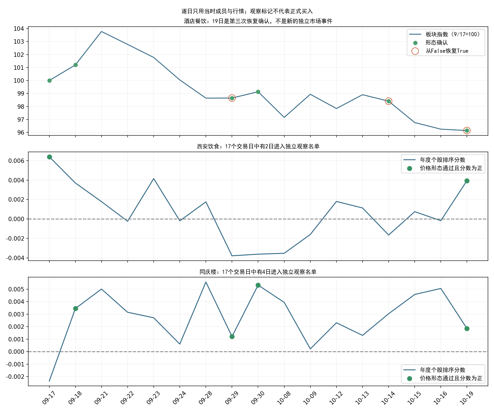
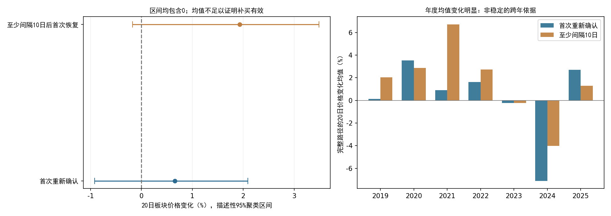

# 酒店餐饮重复确认与补买依据复核

**结论：新增证据不足以将西安饮食、同庆楼从独立观察名单升级为正式买入候选。19日是旧事件第三次恢复确认；重复确认的历史价格表现不够稳定，个股在该场景下的排序收益仍未验证。**

研究整理于北京时间2026-10-20凌晨，使用的最新完整行情为10月19日。没有20日收盘数据，也没有将19日数据换日期冒充新行情。原始市场日历与[上交所休市安排](https://www.sse.com.cn/disclosure/dealinstruc/closed/)一致。本次没有修改数据工程程序、正式策略参数、年度模型权重或原机会扫描候选。

## 本轮真正发生了什么

| 日期       |   距首次确认交易日 | 状态                   | 西安饮食             | 同庆楼               |
|:-----------|-------------------:|:-----------------------|:---------------------|:---------------------|
| 2026-09-17 |                  0 | 首次确认、板块模型拒绝 | 进入观察（0.006399） | 未入选（-0.002354）  |
| 2026-09-29 |                  7 | 第1次恢复确认          | 未入选（-0.003787）  | 进入观察（0.001212） |
| 2026-10-14 |                 13 | 第2次恢复确认          | 未入选（-0.001649）  | 未入选（0.003036）   |
| 2026-10-19 |                 16 | 第3次恢复确认          | 进入观察（0.003943） | 进入观察（0.001857） |

9月17日至10月19日共17个交易日，19日距首次确认16个交易日。9月18日、9月30日虽然也保持确认，但分别是前一日的连续状态，不另计恢复次数。酒店餐饮本轮峰值仍为9月8日，首次确认年度板块分数-0.009877低于0.003289阈值。

同庆楼在9月29日已进入过独立观察名单；西安饮食在9月17日也曾满足个股条件。这些都是以对应日期全部合格板块成员重算的结果，不使用未来收益挑选股票。两只当前股票的展示属于19日观察名单的回顾，不是预先固定股票组合的业绩检验。

## 拒绝后再次确认的历史诊断

复用五个窗口原状态机，核对256个既有年度已评分首次事件，记录499次确认恢复、涉及185个原事件。主分析每个原事件仅保留第一次恢复，避免同一行情重复计数。各年度的训练标签均早于年初和隔离截止日；没有重训模型。

下面只展示原年度板块模型拒绝组，历史2019—2025与2026监测分开。

**价格观察口径：恢复确认后的下一交易日收盘作为观察起点，再过3/10/20个交易日的自算板块指数收盘变化。该指数不可直接成交，表中数字不是个股收益、可成交回测收益或账户收益；没有扣成本，也没有证明相对市场的超额。**

| 口径         |   观察日数 |   事件数 |   完整路径 |   缺失路径 |   时间簇 | 平均价格变化   | 上涨比例   | 最差价格变化   | 描述性95%区间   |
|:-------------|-----------:|---------:|-----------:|-----------:|---------:|:---------------|:-----------|:---------------|:----------------|
| 首次恢复     |          3 |      108 |        107 |          1 |       16 | 0.36%          | 55.14%     | -7.45%         | -0.21%～0.88%   |
| 首次恢复     |         10 |      108 |         93 |         15 |       16 | 0.30%          | 48.39%     | -10.82%        | -0.20%～1.19%   |
| 首次恢复     |         20 |      108 |         92 |         16 |       15 | 0.66%          | 53.26%     | -21.39%        | -0.92%～2.09%   |
| 间隔至少10日 |          3 |       78 |         78 |          0 |       15 | 0.43%          | 57.69%     | -6.39%         | -0.57%～1.12%   |
| 间隔至少10日 |         10 |       78 |         77 |          1 |       14 | 0.11%          | 50.65%     | -10.82%        | -0.85%～1.59%   |
| 间隔至少10日 |         20 |       78 |         77 |          1 |       14 | 1.93%          | 59.74%     | -11.38%        | -0.18%～3.49%   |

主口径20日观察有108个事件，其中92个路径完整、16个因报价/连续段问题不可比较。完整路径来自15个时间簇；均值+0.66%，95%描述性聚类区间约-0.92%至+2.09%，不能排除平均变化为零。缺失事件若统一按0变化计，均值约0.56%；若假设其均为-20%的压力情景，整体均值为-2.40%。后者是假设压力测试，不是估计的实际损失。

更接近当前较晚时点的“间隔至少10个交易日后首次恢复”是由本轮问题提出的补充口径：78个事件，77个完整，14个时间簇，20日均值+1.93%，区间约-0.18%至+3.49%，同样包含0。它不能因均值更高就替换主口径，也不能直接代表第三次恢复确认。

年份差异明显：主口径20日平均变化在2020年约+3.53%，2024年约-7.10%；2023、2024连续为负。2026年拒绝组主口径只有5个事件，20日仅4个完整；至少间隔10日口径只有4个事件、3个完整，无法单凭这年的小样本定新规则。

## 这对两只观察股票意味着什么

- 西安饮食19日收盘5.87元、排序分数0.003943；同庆楼11.77元、排序分数0.001857。9月17日至10月19日的逐日重算，与上次19日结果一致。
- 当前两只都满足个股价格形态，但它们在不同日期的入选状态明显变化。正排序分数不保证绝对上涨，也不能替代板块层的准入依据。
- 原“五日延后资格”研究保留的是已通过板块事件的短期资格，使用的模型/个股规则亦不同，不能外推到本轮拒绝事件在第16个交易日补买。
- 继续按原策略执行时，仍不开放本轮新入场。若考虑独立于原策略的补买规则，尚缺重复确认场景下的个股逐笔验证、同日基准与成本检验；本次仅完成板块价格诊断和本轮个股状态复原，没有把这些未完成环节冒充已验证。

## 下一次更新时的观察标准

1. 用完整新交易日重新计算价格形态与全体合格成员排序。价格形态不通过、排序分数非正或名称/ST资格变化，都应移出独立观察名单。
2. 区分旧事件保持/恢复确认与新的独立首次确认。只有满足既定板块准入的新事件才进入正式买入流程；当前账户空仓不会自动重置市场事件。
3. 20日盘中上涨或低开本身不代表收盘形态已经成立；本报告不预设20日收盘分数，不给出未经验证的限价买单。

## 复核边界与产物

- 逐日行业成员完全核对，本轮9只成员未变化；每个日期按已公告名称历史排除ST，再在8只合格股票中建立截面特征。未用收益标签选择两只股票。
- 9月17日、9月30日特征使用截断行情重算一致；19日候选与之前独立复核一致；现有程序、年度模型文件哈希未变。
- 未发现旧事件的恢复状态跨越下一独立事件。原始确认、板块指数连续段、日期以及窗口均匹配。
- 自算板块非直接可成交资产；行业成员历史PIT尚未完整认证。模型设计和本轮补买假设均来自已观察历史，描述性聚类区间不能替代新的独立样本检验。对缺失路径不作正向填补。

[逐日板块状态](hotel_daily_states.csv) · [全部成员逐日评分](stock_daily_scores.csv) · [关键日期](key_dates.csv) · [全部恢复事件](all_reconfirmation_starts.csv) · [逐事件价格观察](sector_price_observations_NOT_TRADABLE.csv) · [年度结果](yearly_NOT_TRADABLE.csv) · [区间与压力情景](uncertainty_NOT_TRADABLE.csv) · [运行前口径](PREREG.md)

复现：在项目根目录顺序运行本目录`replay.py`、通过`frozen_research.py run --release datahub/releases/selection_live_20261019_eod`运行`stock_timeline.py`，随后运行`uncertainty.py`、`report.py`。
