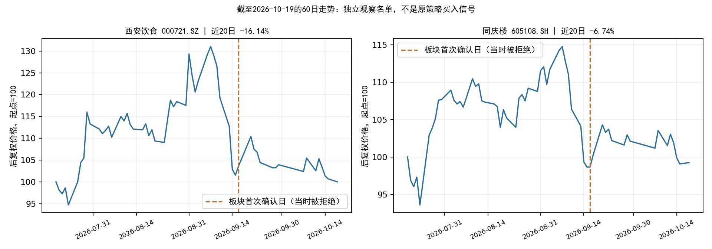

# 酒店餐饮个股独立观察：2026-10-19收盘

**可以列入观察名单的两只：西安饮食（000721）、同庆楼（605108）。原策略正式新入场候选仍为0。**

本次按用户要求，对板块中的个股单独筛选。没有修改数据工程程序、策略参数或重训模型。板块模型拒绝、旧事件重复确认后的个股排序效果尚未验证，不能据此宣称原策略出现新的买点。

## 两只观察对象

| 名称     | 代码      |   19日收盘价 | 当日涨跌   | 近20日涨跌   | 20日日收益波动率   |   减速比 |   排序分数 |
|:---------|:----------|-------------:|:-----------|:-------------|:-------------------|---------:|-----------:|
| 西安饮食 | 000721.SZ |         5.87 | -0.68%     | -16.14%      | 3.01%              | 0.538648 |   0.003943 |
| 同庆楼   | 605108.SH |        11.77 | 0.17%      | -6.74%       | 1.88%              | 0.415168 |   0.001857 |

以上价格、收益与模型分数来自10月19日冻结行情快照及本地重算。排序分数仅用于板块内相对排序，不是胜率，也不是可兑现的预期收益。

- **西安饮食**：价格形态通过，正分数在形态通过股票中最高。前3日收益-1.16%、最近2日-1.34%，减速比0.539低于0.65。近20日下跌16.14%，20日日收益波动率3.01%，承受的波动明显较高。
- **同庆楼**：价格形态通过且分数为正。前3日收益-1.58%、最近2日-0.68%，减速比0.415。近20日下跌6.74%，20日日收益波动率1.88%，在这两只中波动较低。该比较不证明其未来表现优于西安饮食。

两只的既有趋势标记均为False。2026个股方案不将趋势单独作为硬门槛，因此未据此删除；也不能把通过价格形态说成趋势反转已获确认。减速比使用平均负日收益，不是将两段累计收益直接相除。

## 基本面交叉核对

- 西安饮食2026年上半年归母净亏损5,230.45万元，营业收入同比下降16.09%，经营现金净流出2,375.39万元。模型排序较高并不代表财务质量更好。[公司2026年半年报摘要](https://static.cninfo.com.cn/finalpage/2026-08-20/1225483808.PDF)
- 同庆楼2026年上半年归母净利润139.66万元，同比下降98.06%；经营现金净流入3.07亿元。两者均有盈利压力，同庆楼不能因当前股价波动较低就被视作低风险资产。[公司2026年半年报](https://money.finance.sina.com.cn/corp/view/vCB_AllBulletinDetail.php?id=12571560&stockid=605108)

以上财务数据仅作独立判断的补充，未临时混入模型或改变原有筛选规则。本次没有穷尽公司所有公告，不能等同于完整的事件风险审查。

## 全部9只成员的筛选

| 名称     | 代码      |   19日收盘价 | 个股价格形态   | 排序分数   | 未入选原因/状态                       |
|:---------|:----------|-------------:|:---------------|:-----------|:--------------------------------------|
| 华天酒店 | 000428.SZ |         3.51 | False          | 0.002165   | 下跌减速未过；当日跌幅超过2%          |
| 西安饮食 | 000721.SZ |         5.87 | True           | 0.003943   | 个股条件通过；板块/首次事件入口不通过 |
| 全聚德   | 002186.SZ |         9.09 | True           | -0.001117  | 个股排序分数非正                      |
| ST云网   | 002306.SZ |         1.86 | False          | 未评分     | ST资格排除                            |
| 君亭酒店 | 301073.SZ |        16.28 | True           | -0.000792  | 个股排序分数非正                      |
| 首旅酒店 | 600258.SH |        11.26 | False          | 0.007716   | 前3日跌幅不足1%；下跌减速未过         |
| 锦江酒店 | 600754.SH |        17.95 | True           | -0.007464  | 个股排序分数非正                      |
| 金陵饭店 | 601007.SH |         6.58 | True           | -0.006307  | 个股排序分数非正                      |
| 同庆楼   | 605108.SH |        11.77 | True           | 0.001857   | 个股条件通过；板块/首次事件入口不通过 |

9只成员中，ST云网被资格筛选排除，8只进行截面排序，6只通过价格形态，最终2只在形态池内分数为正。所有截面特征先在合格成员中计算，再取价格形态池；没有先挑选这两只后重新排名。

首旅酒店虽分数为正，但前3日累计上涨0.99%，并未满足先跌至少1%的结构，减速比也未通过；华天酒店还受到19日跌幅2.50%超过2%限制的排除。全聚德、君亭酒店、锦江酒店、金陵饭店虽然价格形态通过，但排序分数非正。

## 为什么空仓也不等于可以补买

原规则按市场事件的首次确认日开放一个交易日的入场窗口，与账户是否已经持有无关。酒店餐饮本轮首次确认在9月17日，年度板块分数-0.009877，低于0.003289阈值；当时就不是通过模型的买点。

19日的形态重现不会自动产生新的原策略入场窗口。本次两只名单来自人为单独审视板块成员，模型适用场景已经超出“板块首次确认且模型通过”的训练/研究条件。若坚持执行原策略，当前继续等待；如果仅建立自选观察名单，两只都可以跟踪，尚不足以给出直接买入的结论。

## 数据与复核

- 行情快照：`datahub/releases/selection_live_20261019_eod`，截至19日收盘；价格为未复权收盘，收益和波动按后复权价格计算。
- 本次通过既有查询封装重新拉取全部9只股票的名称历史，保存于本报告目录，未改活动数据集或冻结数据集；资格与更新前一致，ST云网仍排除，两只观察股票当前名称与在市主档一致。
- 年度个股模型训练标签最晚2025-11-19，参数、现有程序哈希验证通过。新名称历史复核前后，8只股票评分一致。
- 个股筛选复用现有`stock_at_date`、`stock_shape`、`cross_section_features`、`select_positive_top`；研究产物单独保存，不写入正式机会扫描的买入候选。

[全部成员数据](all_members_final.csv) · [两只观察对象](observation_candidates.csv) · [摘要](summary.json) · [复核记录](verification.json)
