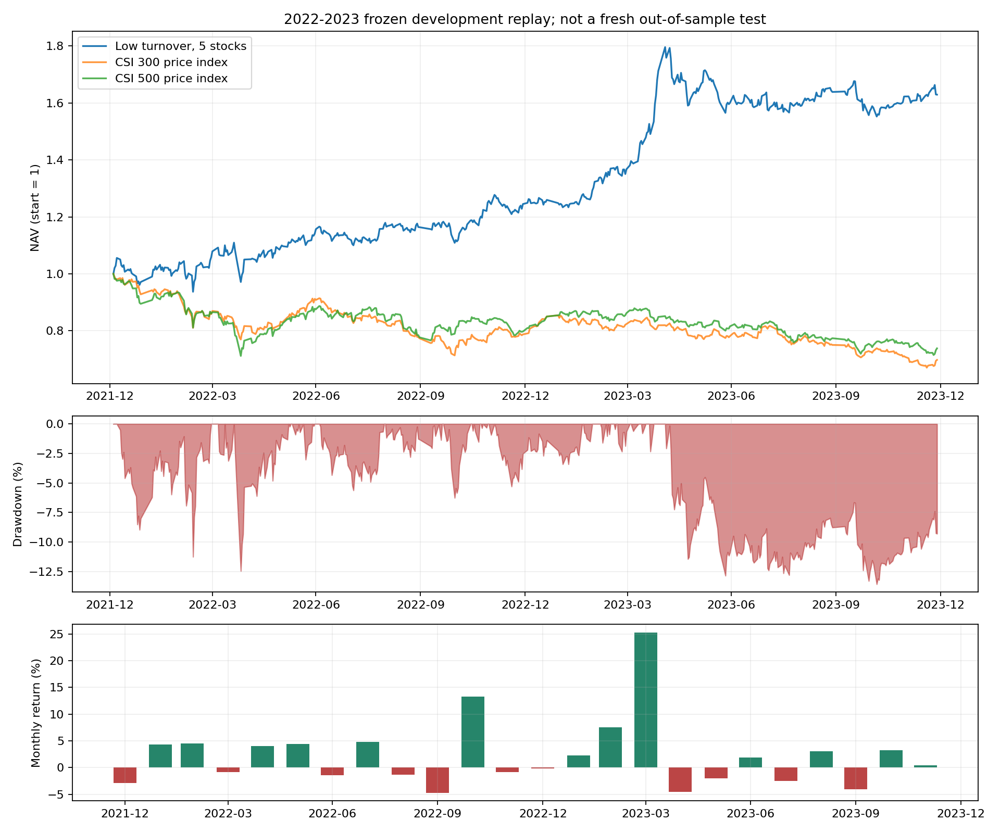

# 低换手五股基线：历史表现与过程归因

复核日期：2026-09-13。对象为沪深主板 `low_turnover`、月度复核、耐心持有、最多五股、无附加市场警报门槛的5万元账户。**这是重复开发窗口中的领先对照，状态仍为 NOT_ADMITTED。** 本报告重新计算冻结账本，不是重新运行整个选股回测，也不是实盘业绩。

## 1. 历史覆盖与统计口径

这组最终账户参数的完整现金、成交、股份及公司行动回放覆盖 **2022-01-04—2023-12-29，共484个交易日**。首日为5万元现金，首次买入在2022-01-05。月度复核不要求每月换股；旧仓在持有许可下保留，趋势退出、ST退出及复核时的仓位约束仍生效。

2014—2018用于较早的拟合，2019—2021有选股机会检验，但没有在这里提供相同最终账户规则的完整历史净值。因此，不能把该账户称为“十年验证”。本轮没有读取2024年及以后行情。

收益基于每日总权益，含分红及费用；年化采用244交易日，Sharpe采用每日账户收益、样本标准差和零无风险利率。分红现金按配置统一扣减20%，并非逐笔还原个人实际税率。买入成本0.1%、卖出0.2%、每笔最低5元；这是模拟成本假设。成交价为下一交易日原价开盘，股票估值为原价收盘；期末仍持有的股票按市值计入，不假设已清仓到账。

## 2. 总体与年度表现

| 指标 | 结果 |
|---|---:|
| 初始 / 期末权益 | 50,000 / 81,464.48元 |
| 两年净利润 | 31,464.48元 |
| 累计收益 / 年化收益 | +62.93% / +27.90% |
| 最大回撤 / Sharpe | −13.57% / 1.33 |
| 盈利月份 | 13/24，54.17% |
| 模拟费用合计 | 494.21元 |
| 扣减后分红到账合计 | 4,434.69元 |

| 年份 | 年初权益 | 年末权益 | 区间收益 | 年内最大回撤 | Sharpe |
|---|---:|---:|---:|---:|---:|
| 2022 | 50,000.00 | 62,255.64 | +24.51% | −12.45% | 1.13 |
| 2023 | 62,255.64 | 81,464.48 | +30.85% | −13.57% | 1.58 |

匹配账户起止日期，沪深300价格指数累计−30.23%，中证500价格指数−26.18%。账户在这个窗口明显跑赢这两个市场参照，但指数不含分红和交易成本，且没有匹配五股组合的行业、估值和风险暴露；差额不能直接叫纯选股alpha。2022比较从1月4日收盘开始，不是官方自然年指数收益。



## 3. 月度路径

| 月份 | 2022 | 2023 |
|---|---:|---:|
| 1月 | −2.87% | −0.18% |
| 2月 | +4.29% | +2.29% |
| 3月 | +4.53% | +7.55% |
| 4月 | −0.82% | +25.26% |
| 5月 | +4.07% | −4.59% |
| 6月 | +4.41% | −2.06% |
| 7月 | −1.42% | +1.88% |
| 8月 | +4.83% | −2.53% |
| 9月 | −1.31% | +3.10% |
| 10月 | −4.71% | −4.07% |
| 11月 | +13.29% | +3.22% |
| 12月 | −0.89% | +0.41% |

盈利集中于少数月份。2022年11月赚7,368.11元，2023年4月赚17,273元，两个月合计约占两年净利润78.31%。这是已发生损益的会计归因，不代表删除这两个月后可执行的策略表现。

## 4. 对2023年4月大涨的专项核对

月初权益68,367.64元，月末85,640.64元，增加17,273元。该月没有新买入，只有中国石化200股减仓。收益来自已有五只股票的价格变动：

| 股票 | 该月净贡献 |
|---|---:|
| 新华文轩 601811.SH | +9,802元 |
| 中国石化 600028.SH | +3,259元 |
| 中国人寿 601628.SH | +2,284元 |
| 农业银行 601288.SH | +1,488元 |
| 宁沪高速 600377.SH | +440元 |

新华文轩3月31日原价收盘11.88元，4月28日19.42元，持有1300股，价格差对应9,802元；该仓早在2022年1月买入。4月没有分红到账，净贡献已扣当月5元卖出费用。所有当日持仓标价均与本地原价行情一致。

**这一月占两年净利润54.90%，单股又贡献该月利润56.75%。** 大涨不是当月反复交易累积，而是较早入场后等待上涨。此处排除了汇总算术、串价和将复权涨幅重复计入现金等账本层问题；并没有据此排除整个研究过程的选择偏差或未来泛化风险。

## 5. 回撤深度、持续时间与来源

| 前高 | 谷底 | 最大跌幅 | 恢复前高 |
|---|---|---:|---|
| 2022-01-07 | 2022-03-15 | −11.25% | 2022-03-31，距前高54个交易日 |
| 2022-04-20 | 2022-04-26 | −12.45% | 2022-06-07，距前高30个交易日 |
| 2023-05-04 | 2023-11-06 | −13.57% | 截至年底未恢复，距前高163个交易日 |

最大回撤期间，权益从89,810.64元降至77,623.72元，减少12,186.92元。年底恢复到81,464.48元，但仍比前高低9.29%。因此，持有体验包含接近八个月没有再创新高，而不只是一个−13.57%的数字。

从2023年5月4日收盘到11月6日收盘，新华文轩贡献−7,198.68元、中国人寿−3,566.01元、中国石油−2,100.23元、中国石化−1,218.96元；其余仓位部分抵消。这里中国人寿包含两段不同买入的损益，不应误解为同一仓位连续持有。

最差单日为2022-04-25，−6.15%；最好单日为2023-05-04，+4.87%。月度复核和低换手没有消除单日跳跌风险。

## 6. 全部股票贡献与实际交易行为

下列损益含费用、分红和期末估值，重复买入同一股票已合并。

| 股票 | 两年净贡献 |
|---|---:|
| 新华文轩 601811.SH | +8,813.05元 |
| 飞科电器 603868.SH | +7,105.51元 |
| 中国石化 600028.SH | +6,858.89元 |
| 农业银行 601288.SH | +4,727.66元 |
| 华能水电 600025.SH | +3,270.58元 |
| 宁沪高速 600377.SH | +2,360.27元 |
| 中国神华 601088.SH | +389.73元 |
| 宁波港 601018.SH | +335.24元 |
| 中国人寿 601628.SH | +293.59元 |
| 大秦铁路 601006.SH | +112.24元 |
| 中国银行 601988.SH | −258.50元 |
| 茂业商业 600828.SH | −632.65元 |
| 中国石油 601857.SH | −1,911.13元 |

前三只股票合计贡献净利润72.39%。这说明存在成功长持仓，也说明结果对少数股票高度敏感。

两年共24次月度复核，仅12个日期实际成交，共29笔：15笔买入、14笔卖出，涉及13只股票。卖出中10次为整段退出、4次为部分减仓。10个已结束持仓段中6个盈利，胜率60%；持仓估值日数中位数127.5，最长404。还有5个持仓段未结束，不能用已结束样本推断全部持仓寿命或稳定胜率。

平均股票仓位97.85%，除初始化首日外每日持有五股。实际单股市值权重最高30.92%；复核时的仓位限制不是逐日绝对上限。虽然规则允许空仓，这个领先版本没有展示出持续的主动空仓能力。

## 7. 小资金与成本敏感性

同一窗口、同一无市场门槛政策的实际整手账户回放：

| 初始资金 / 成本 | 累计收益 | 年化 | 最大回撤 | Sharpe |
|---|---:|---:|---:|---:|
| 2万元 / 基准成本 | +52.85% | +23.85% | −13.16% | 1.27 |
| 5万元 / 基准成本 | +62.93% | +27.90% | −13.57% | 1.33 |
| 10万元 / 基准成本 | +58.86% | +26.28% | −13.95% | 1.28 |
| 5万元 / 成本翻倍 | +55.66% | +24.99% | −14.35% | 1.26 |

没有强求等额，成交股数均满足100股整数倍。收益随资金并非线性缩放：整手、现金余额和仓位约束会改变实际配置。成本翻倍也会改变可买股数及后续路径，不能仅把基准收益减去额外手续费。

此前5万元警报仅禁新仓为+49.85%、直接清仓+12.02%、警报加个股失败提前退出+36.51%；均未形成更好的收益与回撤组合。这些是已比较的特定动作，不是对所有空仓策略的否定。

## 8. 更早历史能说明什么

早期桥接表中，低换手月度Top5在2019—2021的60交易日机会收益均值为+3.78%，2022—2023为+4.97%。前窗33个成熟月，后窗21个成熟月；各有3个月未成熟。

这是重叠的、费前的单位机会结果，包含后复权路径，既不反映合法整手配置，也不是实际长持有账户收益。它支持继续研究该选择方向，但不能弥补相同最终规则缺少更长账户回放的问题。两段窗口均被反复用于开发，不能再作为全新样本外证据。

## 9. 复核范围与产物

本轮独立从CSV复算每日现金加市值、持仓市值汇总、每日收益、逐股逐日损益、月度复利、年度和总指标；全部对上冻结结果。另核对2415条持仓收盘价及29笔成交开盘价，全部与本地原价面板一致；交易信号早于成交日，最多五股，股数符合整手。这里是价格和账本一致性核验，不是独立供应商对行情真伪的验证，也未重新拟合模型。

- [总指标及检查记录](stats.json)、[年度](annual.csv)、[月度](monthly.csv)、[回撤过程](drawdowns.csv)。
- [逐日逐股损益](daily_asset_pnl.csv)、[逐月逐股损益](monthly_asset_pnl.csv)、[关键阶段归因](key_period_attribution.csv)。
- [本金与费用敏感性](capital_cost_sensitivity.csv)、[输入文件摘要](manifest.json)、[复核脚本快照](report_low_turnover_history.py)。
- 原始账户：[冻结目录](../../policy_cash/20260913T063048_495344Z/cash_execution/base_50000_none/)。
- 早期机会证据：[桥接表](../../symmetric_phase/20260913T061312_007478Z/entry_bridge/same_horizon_window_bridge.csv)。

从仓库根目录复核，输出必须为尚不存在的新目录：

```bash
python alpha_lab/scripts/report_low_turnover_history.py \
  --output alpha_lab/outputs/low_turnover_history/another_report
```

当前最有价值的证据是：低频、少量股票和耐心持有在这个窗口能够形成盈利，且不是日频交易堆出的结果。尚未解决的是盈利集中、长期不创新高、退出后利润保留，以及真正未知市场时期能否重复这些收益。下一步有效检验应针对这些缺口，不能把本报告的好看月份当作继续调参的目标。
