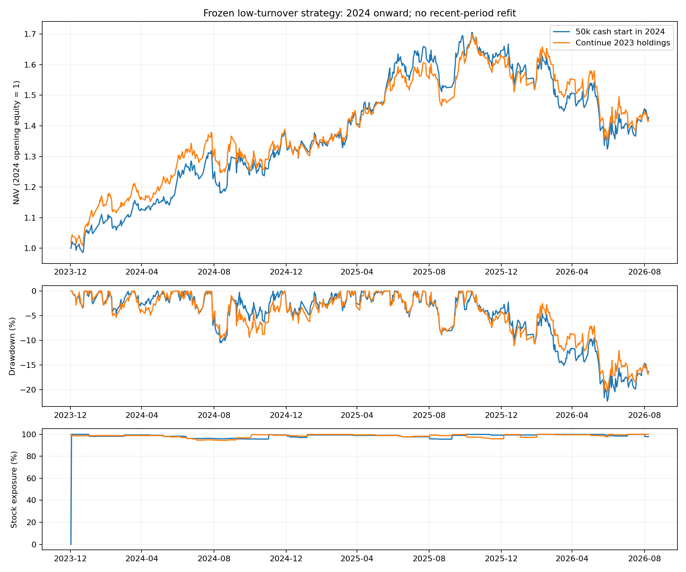

# 低换手五股版本：2024—2026近期冻结回放

日期：2026-09-13。策略未准入，生产未变更。用户确认后首次将当前五股版本扩展至2024年以后，固定参数、不重新拟合、不按近期收益选择参数。

**近期表现弱于原开发窗口：5万元从2024年空仓启动，累计+42.71%、年化+14.26%、最大回撤−22.34%、Sharpe 0.84；2026年截至9月8日亏损13.20%。承接原账户同样在2026年亏损12.99%。** 这不足以将原2022—2023年的优秀表现外推为稳定收益。

正式产物：[修复后run](./)。[首次run](../20260913T085313_818456Z/)因源数据缺口失效，原输入与六组回放全部保留，不能作为策略业绩。

## 1. 冻结范围与初始状态

沿用主板、低换手排序、全A合格截面PIT排名、60/120日趋势判断、月度复核、两次可观察失败确认退出、最多五股、合法整手与先选名单后分股数。无附加市场警报门槛，不强求等额，也不预先排除高价股票。

2021年底模型常数保持原值：60日预期收益约3.1094%，预期不利幅度约13.3987%，均非近期重新估计。财务增强尚未进入策略。买入成本0.1%、卖出0.2%、最低每笔5元，分红统一扣减20%；均是冻结模拟假设，不是个体账户实际费税承诺。信号收盘生成，次交易日按原价开盘执行，期末未清仓股票计市值。

本地面板最新到2026-09-08，2024年以后共651个交易日。2026仅为截至该日，不是全年。244交易日年化、每日账户收益计算Sharpe、无风险利率取零。2024+被旧项目接触过，本轮不是整个项目全新未见样本。

两种起点预先登记并同时报告：

| 起点 | 2024起始权益 | 期末权益 | 近期累计收益 | 年化 | 最大回撤 | Sharpe |
|---|---:|---:|---:|---:|---:|---:|
| 2024年初5万元空仓启动 | 50,000.00 | 71,356.85 | +42.71% | +14.26% | −22.34% | 0.84 |
| 从2022年原账户连续持有 | 81,464.48 | 115,639.04 | +41.95% | +14.03% | −20.56% | 0.83 |

续跑近期收益的分母是2023年末权益81,464.48元，绝不是最初5万元；不以整个2022—2026累计收益代替近期检验。



## 2. 年度表现与市场参照

| 年度 | 5万元空仓启动 | 承接原持仓 | 沪深300价格指数 | 中证500价格指数 |
|---|---:|---:|---:|---:|
| 2024 | +36.81% | +37.59% | +14.68% | +5.46% |
| 2025 | +20.18% | +18.57% | +17.66% | +30.39% |
| 2026截至9月8日 | **−13.20%** | **−12.99%** | −1.54% | +4.09% |
| 整段累计 | +42.71% | +41.95% | +32.86% | +43.13% |

价格指数从2023最后交易日收盘至各期末，不含分红和费用，也没有行业/风格匹配。策略包含扣减后的分红和模拟费用，因此不是完全同口径的alpha检验。即便如此，近期5万元基线对中证500价格指数也没有明显累计优势；2026年两个起点均明显落后两个参照。

5万元空仓启动的年内最大回撤/Sharpe：2024为−10.47%/1.84，2025为−8.89%/1.25，2026截至终点为−20.56%/−0.94。2026年内回撤重置年初峰值，故小于跨年整段−22.34%。

## 3. 回撤过程与2026逐月结果

5万元基线在2025-11-12达到85,260.79元，2026-06-30降至66,213.04元，回吐19,047.75元，形成−22.34%最大回撤。到2026-09-08回到71,356.85元，仍比前高低16.31%；距离前高已201个交易日，尚未恢复。

| 2026月份 | 收益 |
|---|---:|
| 1月 | −2.41% |
| 2月 | −5.09% |
| 3月 | −0.77% |
| 4月 | −0.28% |
| 5月 | +0.52% |
| 6月 | **−12.57%** |
| 7月 | +6.32% |
| 8月 | +2.98% |
| 9月至8日 | −1.57% |

最差单日为2025-04-07的−3.98%。月度复核并未消除持仓期间的快速下跌。

## 4. 收益来源与失败机制

2024年工商银行、农业银行、中国银行分别贡献5,955.35、5,553.15、5,076.93元，三者合计约占该年净利润90.12%。2025年农业银行和工商银行再贡献7,798.56、3,270.85元。这些是逐股已发生损益归因，不是删除股票后的可执行对照。

在2025-11-12前高，农业银行、工商银行、中国人寿合计占账户权益69.17%。股票数虽为五，风险方向并不分散。2026年主要负贡献为：

| 股票 | 2026净贡献 |
|---|---:|
| 中国人寿 | −3,489.48元 |
| 农业银行 | −3,215.94元 |
| 工商银行 | −2,385.36元 |
| 中国石油 | −1,845.45元 |
| 中国银行 | −1,301.89元 |
| 山东高速 | −1,297.31元 |
| 东方盛虹（主要正贡献） | +2,902.43元 |

3月3日卖出农业银行、工商银行、中国银行后，同日买入龙源电力、华能水电、中国神华；4月退出中国人寿后又买入中国银行。账户完成了换股，但没有退出股票风险。6月五只持仓全部负贡献：中国石油−2,786元、龙源电力−2,754元、中国神华−2,364元、华能水电−1,269元、中国银行−350元，合计−9,523元。

5万元基线651天中，首日为初始化现金，其余650天均为五股；平均股票仓位98.39%。共16个交易日期、43笔成交、15只股票。低频与少持仓要求已满足，主动空仓能力仍未体现。

过程证据指向两个缺口：低换手排名容易让少数持仓集中于相似风险方向；趋势退出释放仓位后，新的候选立即补满。原常数收益估计并不区分这些股票的近期盈利空间或组合风险。此处是对已观察决策的解释，不是已验证的新择时规则。

## 5. 本金与成本压力

同一2024起点，全部按真实整数股数回放：

| 情景 | 累计收益 | 年化 | 最大回撤 | Sharpe |
|---|---:|---:|---:|---:|
| 2万元 | +37.63% | +12.72% | −20.24% | 0.77 |
| 5万元 | +42.71% | +14.26% | −22.34% | 0.84 |
| 10万元 | +45.13% | +14.98% | −21.34% | 0.85 |
| 5万元、成本翻倍 | +37.66% | +12.73% | −21.29% | 0.75 |

各情景2026均亏损约10%—13%。不同本金会改变合法整手配置，费用翻倍也会改变持仓路径，不能简单线性缩放或只减手续费。倒序输入是执行不变性验证，不是第六种备选策略。

## 6. 数据失败、修复与核验边界

第一轮发现2024-08-19、2025-01-20、2025-04-21、2026-01-29四日`daily_basic`原缓存为0行，对应面板市值和换手率全缺。60日换手率均值因此出现连续缺口，近期33次复核中13次没有任何预测行。最初适配器未检查预测日历完整性，把缺数据变成了无新仓机会；即使现金和股份账本全部对上，也不能采信那条现金路径。

修复按四日API原始值恢复43,148个字段，仅涉及市值与换手率。所有价格及其余12,253,984行五列特征投影逐格不变；主面板及旧缓存未覆盖写入。新投影、原响应、逐格变更和哈希都留在run/data_repair。新增覆盖门明确区分“有完整候选但策略拒绝”和“整月没有预测数据”。

修复后57/57复核月覆盖完整，至少每月2,835条主板预测；全部持有状态矩阵与第一轮精确一致。新增38,491条主板预测。已有完整月份9格有效分数出现极小滚动浮点尾差，Top5/Top20名单及顺序均不变，差异原样保留。2022—2023特征、预测和实际账户前缀均保持精确一致。

独立核验范围包括数据修复、预测覆盖、现金/股份/分红应收/权益、逐段损益、官方限价、原价成交与估值、T+1、整手与成交量约束、全部倒序CSV及原账户前缀。六账户共298笔成交、21,920条有效收盘估值、17份倒序CSV及8份旧账户前缀全部通过；完整280项测试通过。最终核验摘要见run/execution/independent_recent_verification.json和run下的独立修复/组合核验报告；测试日志见run/unittest_final.log。

这些核验确认当前输入与执行口径的一致性，不证明行情供应商无误或策略具有未来稳定收益。没有重新训练财务增强模型，没有改动生产，也没有下单。

## 7. 产物与复核入口

- [逐年收益与风险](./annual.csv)、[全部情景](./recent_summary.csv)、[逐月收益](./monthly.csv)。
- [逐股归因](./asset_attribution.csv)、[2026逐股贡献](./asset_pnl_2026.csv)。
- [修复证据](./data_repair/)、[输入覆盖与差异](./input_coverage_audit/)。

在alpha_lab内运行以下只读复核：

```bash
python scripts/validate_recent_input_coverage.py --run outputs/recent_low_turnover/20260913T090336_282870Z
python scripts/verify_recent_repaired_run.py --run outputs/recent_low_turnover/20260913T090336_282870Z
python -m unittest discover -s tests -p 'test_*.py'
```

当前结论是保留研究对照、继续不准入。近期数据没有支持“已找到适合小账户、能主动避险的稳定版本”；下一步研究应处理选择集中和卖出后是否值得重新投入资金，而不是沿着2022—2023的高收益数字继续微调。
