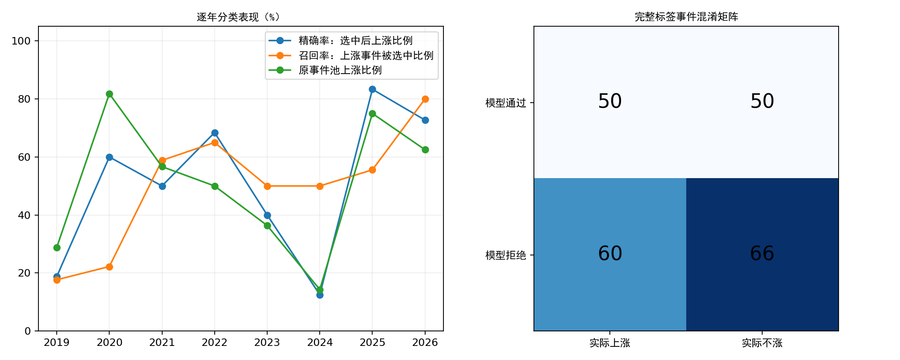

# 年度板块模型：准确率与召回率补充核验

核验日期2026-10-21；行情截至2026-10-20。既有年度模型报告没有提供这组分类指标，本次用保存的逐年预测补算，不训练、不调门槛、不修改数据工程。

## 评价定义

- 样本：原年度研究保存的256个板块首次确认事件；每年使用只含此前成熟标签的模型。没有把未形成形态的板块日纳入负样本，所以召回率仅覆盖该形态事件池，不代表捕获全市场所有上涨。
- 预测正类：保存的分数≥该年原有阈值（selected）。
- 实际正类：确认日收盘至20交易日后板块收盘收益严格>0；收益等于0归负类。这里是自算板块指数的价格涨跌，没有扣费用，不是可成交收益。
- 准确率=(TP+TN)/全部；精确率=TP/(TP+FP)，即通过事件的上涨比例；召回率=TP/(TP+FN)，即实际上涨事件中被通过的比例；平衡准确率为正负两类召回率均值。
- “实际上涨”是本次事后新增的诊断口径。原模型做收益回归，训练时没有直接优化这些分类指标。

## 结果

| 期间          |   完整标签 |   未评价 |   模型通过 | 准确率   | 精确率   | 召回率   | 原池上涨率   | 平衡准确率   |
|:--------------|-----------:|---------:|-----------:|:---------|:---------|:---------|:-------------|:-------------|
| 2019–2026合计 |        226 |       30 |        100 | 51.33%   | 50.00%   | 45.45%   | 48.67%       | 51.18%       |
| 2019–2025     |        210 |       29 |         89 | 50.00%   | 47.19%   | 42.00%   | 47.62%       | 49.64%       |
| 2019          |         59 |        0 |         16 | 54.24%   | 18.75%   | 17.65%   | 28.81%       | 43.35%       |
| 2020          |         33 |        0 |         10 | 24.24%   | 60.00%   | 22.22%   | 81.82%       | 27.78%       |
| 2021          |         30 |        0 |         20 | 43.33%   | 50.00%   | 58.82%   | 56.67%       | 40.95%       |
| 2022          |         40 |        0 |         19 | 67.50%   | 68.42%   | 65.00%   | 50.00%       | 67.50%       |
| 2023          |         22 |        0 |         10 | 54.55%   | 40.00%   | 50.00%   | 36.36%       | 53.57%       |
| 2024          |         14 |        4 |          8 | 42.86%   | 12.50%   | 50.00%   | 14.29%       | 45.83%       |
| 2025          |         12 |       25 |          6 | 58.33%   | 83.33%   | 55.56%   | 75.00%       | 61.11%       |
| 2026          |         16 |        1 |         11 | 68.75%   | 72.73%   | 80.00%   | 62.50%       | 65.00%       |



合计TP=50、FP=50、TN=66、FN=60。始终预测上涨的准确率为原池上涨率48.67%；始终预测不涨的准确率为51.33%。因此单看准确率可能误导，需同时观察精确率、召回率、平衡准确率和基准。

模型拒绝事件中，仍有47.62%后来上涨；拒绝不等于确定会跌。分类指标也不能判断平均盈亏比、成交成本和账户收益。

## 缺失标签的影响

30条未评价样本中，29条因报价缺失或指数连续段中断，1条为尚未成熟的2026-09-17酒店餐饮。尤其2025年37条中25条不可评价，12条完整样本不能代表全年。完整样本过滤可能产生非随机缺失偏差。

未评价事件中模型通过5条、拒绝25条。保留原预测不变，将未知实际涨跌作所有可能赋值，可得到完整256条样本各项指标的数学边界（不是置信区间；各指标端点不要求同时实现）：

| metric    | low    | high   |
|:----------|:-------|:-------|
| accuracy  | 45.31% | 57.03% |
| precision | 47.62% | 52.38% |
| recall    | 37.04% | 47.83% |

即使缺失标签全部按有利于模型的情况补齐，通过事件的上涨比例上界仍为52.38%。这不修复标签缺失，只说明缺失样本对本组分类结论的最大可能影响。

## 相关性与不确定性

事件等权；同日、临近日期不同板块不是独立样本。按相隔超过20个交易日划分20个行情簇，整簇重采样2000次，给出描述性95%分位区间：

| metric            | estimate   | low     | high   |   clusters |   finite_replicates |
|:------------------|:-----------|:--------|:-------|-----------:|--------------------:|
| accuracy          | 51.33%     | 40.62%  | 59.94% |         20 |                2000 |
| precision         | 50.00%     | 33.63%  | 66.67% |         20 |                2000 |
| recall            | 45.45%     | 29.60%  | 63.64% |         20 |                2000 |
| balanced_accuracy | 51.18%     | 40.82%  | 59.63% |         20 |                2000 |
| precision_lift    | 1.33%      | -10.86% | 9.83%  |         20 |                2000 |

precision_lift为通过事件上涨率减原池上涨率，单位为比例点。区间用于说明样本不确定性，不修复研究家族事后开发偏差。跨年度合计还会混入各年市场和模型保留比例的变化，不能替代逐年比较。

## 数据与时间边界

- 用10月20日板块数据重新计算全部256条目标路径；此前完整标签逐值一致。尚未满20交易日、缺报价或跨连续段的样本单独列出，不按亏损或零收益处理。
- 本报告只评价原保存的256条预测；10月20日养殖业是后续扫描新增事件，尚未成熟，未加入分类统计。
- 2026年模型最晚训练标签为2025-11-18；模型文件实际在10月13日按历史信息边界重建。历史供应商版本与行业公告时点仍有缺口，规则家族本身也由事后研究确定；不能称完全独立的实盘前瞻测试。
- 原研究清单全部产物哈希核对通过；各年训练标签截止与当年事件不相交检查通过；不改动任何模型权重、门槛或正式策略。

## 明细与复现

[逐事件预测和标签](event_predictions_and_labels.csv) · [未评价样本及原因](excluded_labels.csv) · [指标CSV](metrics.csv) · [区间CSV](cluster_intervals.csv)

```bash
OPENBLAS_NUM_THREADS=1 OMP_NUM_THREADS=1 python alpha_lab/outputs/sector_classification_audit/20261021/evaluate.py
```
