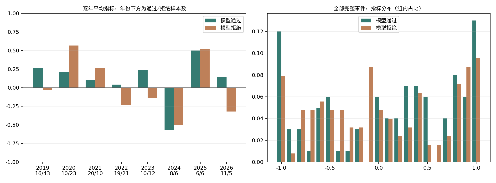

# 年度板块模型：未来20日盈亏天数差评价

评价日期2026-10-21，行情截至2026-10-20。用户已确认：正负收益相对确认日收盘计算，而非每天相对前一天涨跌。本次更换评价指标，沿用已保存年度模型分数和原有门槛，不重新训练，不修改数据构建与正式策略。

## 指标定义

令P0为首次确认日板块收盘，Pt为之后第t个交易日的板块收盘（t=1…20）。

`指标 S = [Σ 1(Pt/P0−1 > 0) − Σ 1(Pt/P0−1 < 0)] / 20`

确认当天不计入；平价日记0，分母固定20。范围[-1,1]，15天盈利、5天亏损得到0.5；没有平价日时，S=2×盈利天数占比−1。0意味着盈亏天数相等，并不意味着终点收益为0。

这个指标衡量相对信号日收盘的盈利持续性，能区分“途中大多盈利”和“仅终点盈利”。它不度量盈亏幅度：19天微赚、最后一天大跌仍可能得到0.9，因此保留终点收益对照。该收盘价为观察基准，不是假定能够在信号生成后按该价成交。

## 原模型在新指标下的表现

| 期间      |   完整事件 |   通过 |   拒绝 |   通过组均值 |   拒绝组均值 |   通过减拒绝 |   通过组平均盈利天数 |   拒绝组平均盈利天数 |
|:----------|-----------:|-------:|-------:|-------------:|-------------:|-------------:|---------------------:|---------------------:|
| 2019–2026 |        226 |    100 |    126 |        0.116 |        0.05  |        0.066 |                11.16 |                10.5  |
| 2019–2025 |        210 |     89 |    121 |        0.112 |        0.065 |        0.047 |                11.12 |                10.65 |
| 2019      |         59 |     16 |     43 |        0.263 |       -0.035 |        0.297 |                12.62 |                 9.65 |
| 2020      |         33 |     10 |     23 |        0.21  |        0.57  |       -0.36  |                12.1  |                15.7  |
| 2021      |         30 |     20 |     10 |        0.1   |        0.27  |       -0.17  |                11    |                12.7  |
| 2022      |         40 |     19 |     21 |        0.042 |       -0.229 |        0.271 |                10.42 |                 7.71 |
| 2023      |         22 |     10 |     12 |        0.24  |       -0.142 |        0.382 |                12.4  |                 8.58 |
| 2024      |         14 |      8 |      6 |       -0.562 |       -0.5   |       -0.062 |                 4.38 |                 5    |
| 2025      |         12 |      6 |      6 |        0.5   |        0.517 |       -0.017 |                15    |                15.17 |
| 2026      |         16 |     11 |      5 |        0.145 |       -0.32  |        0.465 |                11.45 |                 6.8  |



事件等权，完整标签仍为226条（通过100、拒绝126）。通过组指标均值+0.116，拒绝组+0.050，差值+0.066。相对未经过模型筛选的完整事件池，通过组提升+0.037。平均盈利天数分别为11.16和10.50天，差+0.66天。

## 与终点收益并列

| 期间      | 通过组指标>0占比   | 拒绝组指标>0占比   | 通过组20日终点平均收益   | 拒绝组20日终点平均收益   |
|:----------|:-------------------|:-------------------|:-------------------------|:-------------------------|
| 2019–2026 | 59.00%             | 46.83%             | 1.13%                    | 0.49%                    |
| 2019–2025 | 59.55%             | 47.11%             | 0.35%                    | 0.35%                    |
| 2019      | 62.50%             | 39.53%             | -2.16%                   | -1.15%                   |
| 2020      | 70.00%             | 78.26%             | 4.33%                    | 8.18%                    |
| 2021      | 60.00%             | 60.00%             | -0.16%                   | 1.38%                    |
| 2022      | 52.63%             | 23.81%             | 2.94%                    | -4.02%                   |
| 2023      | 70.00%             | 50.00%             | 0.12%                    | -2.76%                   |
| 2024      | 25.00%             | 16.67%             | -7.37%                   | -3.25%                   |
| 2025      | 83.33%             | 66.67%             | 4.56%                    | 4.41%                    |
| 2026      | 54.55%             | 40.00%             | 7.47%                    | 3.96%                    |

指标>0表示盈利天数多于亏损天数。此处均为未扣费用的自算板块指数观察，不是交易胜率或账户收益。

## 不确定性与缺失标签

同日及临近事件相关，按超过20交易日的日期间隔分行情簇，整簇重采样2000次。以下为描述性95%区间：

| period    | metric        |   estimate |    low |   high |   clusters |   replicates |
|:----------|:--------------|-----------:|-------:|-------:|-----------:|-------------:|
| 2019–2026 | passed_mean   |      0.116 | -0.072 |  0.285 |         20 |         2000 |
| 2019–2026 | rejected_mean |      0.05  | -0.126 |  0.333 |         20 |         2000 |
| 2019–2026 | difference    |      0.066 | -0.205 |  0.252 |         20 |         2000 |
| 2019–2026 | lift_vs_all   |      0.037 | -0.116 |  0.135 |         20 |         2000 |
| 2019–2025 | passed_mean   |      0.112 | -0.111 |  0.302 |         19 |         2000 |
| 2019–2025 | rejected_mean |      0.065 | -0.122 |  0.367 |         19 |         2000 |
| 2019–2025 | difference    |      0.047 | -0.225 |  0.24  |         19 |         2000 |
| 2019–2025 | lift_vs_all   |      0.027 | -0.126 |  0.138 |         19 |         2000 |

原预测256条，30条不能评价：29条报价路径或连续段不完整，1条酒店餐饮未满20交易日。2025年37条中25条缺完整标签，不能以剩余12条代表全年。未知路径不取部分天数、不缩分母、不填零。假设未知完整指标可在[-1,1]中任取，完整256条的数学边界如下（不是置信区间）：

| metric        |     low |   high |
|:--------------|--------:|-------:|
| passed_mean   |  0.0629 | 0.1581 |
| rejected_mean | -0.1238 | 0.2073 |
| difference    | -0.1444 | 0.2819 |

2026年仅16条成熟事件；当年较好表现不等于稳定性已验证。整体差异还可能受到各年度通过比例与市场环境影响，应同时查看逐年表。

## 评价与重新训练的区别

原模型学习的是20日终点收益，本次回答的是“这个旧模型是否也能筛出盈利持续性更好的事件”。本次没有把新指标改成训练标签。若以后用它训练新模型，需要重新执行年度时间推进、历史内层选参和完整20日标签成熟隔离；不能据这份全历史结果调整门槛后，再把同一批结果当独立测试。

此次口径是看到旧评价后的新增研究定义，需保留这一研究历史。模型文件仍是10月13日按年初信息边界重建，供应商历史版本和成员公告时点的缺口仍在。10月20日养殖业尚未成熟，不纳入该评价。

## 核验与文件

全部完整事件终点收益与上一份评价逐值一致，完整/缺失集合完全一致；逐事件正/负/平天数之和均为20。原年度研究与前次评价清单哈希通过核对，预测通过集合未改变。

[逐事件指标](event_metrics.csv) · [逐日路径与符号](daily_paths.csv) · [逐年数据](metrics_by_year.csv) · [区间](cluster_intervals.csv) · [缺失样本](excluded.csv)

```bash
OPENBLAS_NUM_THREADS=1 OMP_NUM_THREADS=1 python alpha_lab/outputs/sector_profit_days_audit/20261021/evaluate.py
```
