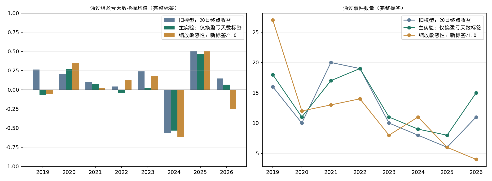
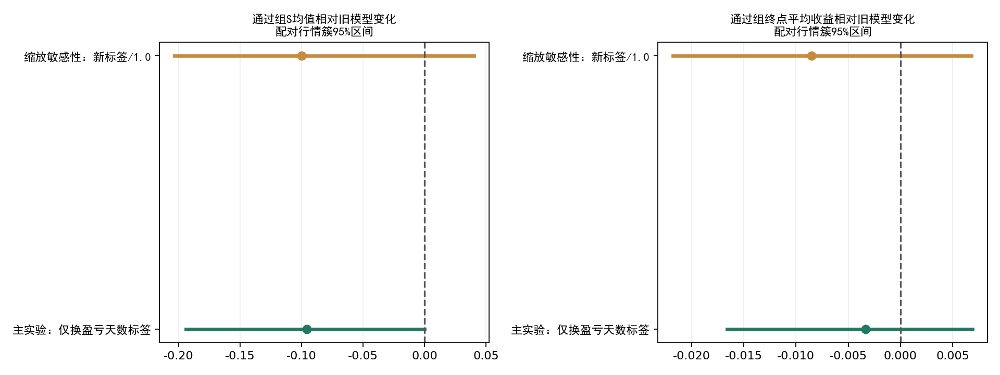

# 年度板块模型：盈亏天数标签重训实验

2026-10-21。研究实验，未替换正式模型。沿用原331个事件及13项特征，重做2019—2026年度训练；最终对同一256个年度预测事件比较，其中226个有完整20日标签。原数据工程和模型权重未改动。

**主实验通过组S均值+0.020，旧模型为+0.116，差-0.0956；配对行情簇95%区间[-0.1942, -0.0001]。** 这份报告只评价新旧模型，不根据结果改选股规则或下单。

本次可评价样本没有显示换标签带来改善：主实验通过组平均盈利天数下降，且通过组S均值低于自身拒绝组；预设缩放检查组也没有改善。主实验全样本的重采样差值区间上界非常接近0，剔除2026年的历史期区间仍跨0，不将其解释成稳定的显著劣势。新模型通过但缺标签的事件更多，必须保留缺失偏差。这也不构成旧模型已被证明有效的证据。

## 标签和实验口径

新标签S=(未来20日相对确认日收盘盈利天数−亏损天数)/20；第1—20个交易日，平价记0，范围[-1,1]。必须全路径有效且同一指数连续段；缺失不缩短窗口、不补零。原标签是20日终点收益，新标签衡量盈利持续性而不衡量盈亏幅度。

主实验只替换标签，target_scale保留0.1，即网络学习S/0.1，输出乘回0.1。另在训练前固定scale=1.0敏感性，网络直接学习S。SmoothL1损失、权重衰减和优化对标签尺度敏感，因此两组可能不同；不能把尺度差异伪装成纯标签收益。没有按测试结果选择上线版本。

两组都沿用原年度时间推进：最多此前8年、标签在年初前20交易日截止之前成熟；内层按日期末25%验证，同样隔离标签；仅历史内层选4/8规则、学习率0.003/0.01及早停轮数。3种子集成；同日事件降权、历史半衰期1095日。

**每个新模型的门槛由该年度历史训练预测中位数确定，不能套用旧收益分数门槛0.003289。** 新输出是S的回归评分，不是收益率或胜率；FNN不是有界输出层，本实验不事后截断预测。

## 新旧模型比较

| 期间      | 模型                     |   完整事件 |   完整通过 |   通过但无标签 |   通过组S |   拒绝组S |   通过组盈利天数 | 通过组终点收益   | S>0精确率   | S>0召回率   |
|:----------|:-------------------------|-----------:|-----------:|---------------:|----------:|----------:|-----------------:|:-----------------|:------------|:------------|
| 2019–2026 | 旧模型：20日终点收益     |        226 |        100 |              5 |     0.116 |     0.05  |            11.16 | 1.13%            | 59.00%      | 50.00%      |
| 2019–2026 | 主实验：仅换盈亏天数标签 |        226 |        108 |             22 |     0.02  |     0.133 |            10.2  | 0.80%            | 50.93%      | 46.61%      |
| 2019–2026 | 缩放敏感性：新标签/1.0   |        226 |         95 |              9 |     0.016 |     0.125 |            10.16 | 0.28%            | 49.47%      | 39.83%      |
| 2019–2025 | 旧模型：20日终点收益     |        210 |         89 |              5 |     0.112 |     0.065 |            11.12 | 0.35%            | 59.55%      | 48.18%      |
| 2019–2025 | 主实验：仅换盈亏天数标签 |        210 |         93 |             21 |     0.013 |     0.143 |            10.13 | -0.25%           | 50.54%      | 42.73%      |
| 2019–2025 | 缩放敏感性：新标签/1.0   |        210 |         91 |              8 |     0.027 |     0.129 |            10.27 | 0.15%            | 50.55%      | 41.82%      |
| 2026      | 旧模型：20日终点收益     |         16 |         11 |              0 |     0.145 |    -0.32  |            11.45 | 7.47%            | 54.55%      | 75.00%      |
| 2026      | 主实验：仅换盈亏天数标签 |         16 |         15 |              1 |     0.067 |    -1     |            10.67 | 7.27%            | 53.33%      | 100.00%     |
| 2026      | 缩放敏感性：新标签/1.0   |         16 |          4 |              1 |    -0.25  |     0.083 |             7.5  | 3.26%            | 25.00%      | 12.50%      |

通过组终点收益是未扣费的自算板块指数观察。S>0精确率指通过事件中“盈利天数多于亏损天数”的比例；召回率仅针对本次形态事件池中S>0的事件。不能与上一份“终点收益>0”的分类指标混淆。



|   期间 | 模型                     |   完整事件 |   完整通过 |   通过但无标签 |   通过组S |   拒绝组S |   通过组盈利天数 | 通过组终点收益   | S>0精确率   | S>0召回率   |
|-------:|:-------------------------|-----------:|-----------:|---------------:|----------:|----------:|-----------------:|:-----------------|:------------|:------------|
|   2019 | 旧模型：20日终点收益     |         59 |         16 |              0 |     0.263 |    -0.035 |            12.62 | -2.16%           | 62.50%      | 37.04%      |
|   2019 | 主实验：仅换盈亏天数标签 |         59 |         18 |              0 |    -0.072 |     0.098 |             9.28 | -1.84%           | 44.44%      | 29.63%      |
|   2019 | 缩放敏感性：新标签/1.0   |         59 |         27 |              0 |    -0.052 |     0.128 |             9.48 | -2.18%           | 37.04%      | 37.04%      |
|   2020 | 旧模型：20日终点收益     |         33 |         10 |              0 |     0.21  |     0.57  |            12.1  | 4.33%            | 70.00%      | 28.00%      |
|   2020 | 主实验：仅换盈亏天数标签 |         33 |         11 |              0 |     0.273 |     0.555 |            12.73 | 3.01%            | 72.73%      | 32.00%      |
|   2020 | 缩放敏感性：新标签/1.0   |         33 |         12 |              0 |     0.35  |     0.524 |            13.5  | 5.51%            | 75.00%      | 36.00%      |
|   2021 | 旧模型：20日终点收益     |         30 |         20 |              0 |     0.1   |     0.27  |            11    | -0.16%           | 60.00%      | 66.67%      |
|   2021 | 主实验：仅换盈亏天数标签 |         30 |         17 |              0 |     0.071 |     0.269 |            10.71 | 0.50%            | 52.94%      | 50.00%      |
|   2021 | 缩放敏感性：新标签/1.0   |         30 |         13 |              0 |     0.023 |     0.259 |            10.23 | 0.55%            | 53.85%      | 38.89%      |
|   2022 | 旧模型：20日终点收益     |         40 |         19 |              0 |     0.042 |    -0.229 |            10.42 | 2.94%            | 52.63%      | 66.67%      |
|   2022 | 主实验：仅换盈亏天数标签 |         40 |         19 |              0 |    -0.042 |    -0.152 |             9.58 | -0.01%           | 36.84%      | 46.67%      |
|   2022 | 缩放敏感性：新标签/1.0   |         40 |         14 |              0 |     0.129 |    -0.223 |            11.29 | 3.26%            | 50.00%      | 46.67%      |
|   2023 | 旧模型：20日终点收益     |         22 |         10 |              0 |     0.24  |    -0.142 |            12.4  | 0.12%            | 70.00%      | 53.85%      |
|   2023 | 主实验：仅换盈亏天数标签 |         22 |         11 |              0 |     0.018 |     0.045 |            10.18 | -1.41%           | 63.64%      | 53.85%      |
|   2023 | 缩放敏感性：新标签/1.0   |         22 |          8 |              0 |     0.175 |    -0.05  |            11.75 | -0.38%           | 75.00%      | 46.15%      |
|   2024 | 旧模型：20日终点收益     |         14 |          8 |              2 |    -0.562 |    -0.5   |             4.38 | -7.37%           | 25.00%      | 66.67%      |
|   2024 | 主实验：仅换盈亏天数标签 |         14 |          9 |              2 |    -0.533 |    -0.54  |             4.67 | -5.03%           | 22.22%      | 66.67%      |
|   2024 | 缩放敏感性：新标签/1.0   |         14 |         11 |              1 |    -0.618 |    -0.233 |             3.82 | -6.45%           | 18.18%      | 66.67%      |
|   2025 | 旧模型：20日终点收益     |         12 |          6 |              3 |     0.5   |     0.517 |            15    | 4.56%            | 83.33%      | 55.56%      |
|   2025 | 主实验：仅换盈亏天数标签 |         12 |          8 |             19 |     0.463 |     0.6   |            14.62 | 3.69%            | 75.00%      | 66.67%      |
|   2025 | 缩放敏感性：新标签/1.0   |         12 |          6 |              7 |     0.5   |     0.517 |            15    | 4.56%            | 83.33%      | 55.56%      |
|   2026 | 旧模型：20日终点收益     |         16 |         11 |              0 |     0.145 |    -0.32  |            11.45 | 7.47%            | 54.55%      | 75.00%      |
|   2026 | 主实验：仅换盈亏天数标签 |         16 |         15 |              1 |     0.067 |    -1     |            10.67 | 7.27%            | 53.33%      | 100.00%     |
|   2026 | 缩放敏感性：新标签/1.0   |         16 |          4 |              1 |    -0.25  |     0.083 |             7.5  | 3.26%            | 25.00%      | 12.50%      |

## 配对比较与入选变化

同一行情簇同时重采样新旧模型预测，区间保留同日板块及相近事件相关性。improvement为新模型通过组S均值减旧模型通过组S均值；gap为该模型通过组减拒绝组。各模型通过数量不相同，本实验未强行在测试集调门槛配平数量。

| period    | variant                  | metric      |   estimate |     low |    high |   clusters |   replicates |
|:----------|:-------------------------|:------------|-----------:|--------:|--------:|-----------:|-------------:|
| 2019–2026 | 主实验：仅换盈亏天数标签 | gap         |    -0.1127 | -0.3772 |  0.097  |         20 |         2000 |
| 2019–2026 | 主实验：仅换盈亏天数标签 | improvement |    -0.0956 | -0.1942 | -0.0001 |         20 |         2000 |
| 2019–2026 | 缩放敏感性：新标签/1.0   | gap         |    -0.1094 | -0.4036 |  0.1525 |         20 |         2000 |
| 2019–2026 | 缩放敏感性：新标签/1.0   | improvement |    -0.1002 | -0.2036 |  0.0403 |         20 |         2000 |
| 2019–2025 | 主实验：仅换盈亏天数标签 | gap         |    -0.1298 | -0.3998 |  0.0934 |         19 |         2000 |
| 2019–2025 | 主实验：仅换盈亏天数标签 | improvement |    -0.0995 | -0.2062 |  0.0128 |         19 |         2000 |
| 2019–2025 | 缩放敏感性：新标签/1.0   | gap         |    -0.1019 | -0.4029 |  0.178  |         19 |         2000 |
| 2019–2025 | 缩放敏感性：新标签/1.0   | improvement |    -0.0849 | -0.1927 |  0.058  |         19 |         2000 |



| variant              | status   |   events |   complete |   mean_s |   mean_terminal |
|:---------------------|:---------|---------:|-----------:|---------:|----------------:|
| bounded_scale_1      | 新增通过 |       37 |         31 |  -0.1742 |         -0.008  |
| bounded_scale_1      | 转为拒绝 |       38 |         36 |   0.1306 |          0.0172 |
| bounded_scale_1      | 都拒绝   |      114 |         95 |   0.1232 |          0.0091 |
| bounded_scale_1      | 都通过   |       67 |         64 |   0.1078 |          0.008  |
| label_only_scale_0p1 | 新增通过 |       57 |         40 |  -0.125  |         -0.0027 |
| label_only_scale_0p1 | 转为拒绝 |       32 |         32 |   0.1375 |          0.005  |
| label_only_scale_0p1 | 都拒绝   |       94 |         86 |   0.1314 |          0.0084 |
| label_only_scale_0p1 | 都通过   |       73 |         68 |   0.1059 |          0.0143 |

## 最近事件：仅作新旧模型诊断

| variant                  | sector                 | date       |     score |   threshold | selected   | diagnostic_only   |
|:-------------------------|:-----------------------|:-----------|----------:|------------:|:-----------|:------------------|
| 旧模型：20日终点收益     | 养殖业                 | 2026-10-20 | -0.042315 |    0.003289 | False      | True              |
| 旧模型：20日终点收益     | 酒店餐饮（原首次事件） | 2026-09-17 | -0.009877 |    0.003289 | False      | True              |
| 主实验：仅换盈亏天数标签 | 养殖业                 | 2026-10-20 | -0.051037 |    0.066053 | False      | True              |
| 主实验：仅换盈亏天数标签 | 酒店餐饮（原首次事件） | 2026-09-17 |  0.109464 |    0.066053 | True       | True              |
| 缩放敏感性：新标签/1.0   | 养殖业                 | 2026-10-20 | -0.272051 |    0.088405 | False      | True              |
| 缩放敏感性：新标签/1.0   | 酒店餐饮（原首次事件） | 2026-09-17 |  0.584311 |    0.088405 | True       | True              |

酒店餐饮行对应9月17日首次事件，不是今天新买点；养殖业行对应10月20日首次确认。二者完整20日标签均尚未成熟，新评分没有利用它们未来走势。上述仅为研究模型诊断，不改变原扫描结果。

## 年度拟合记录

| variant                  |   year |   train |   fit |   validation |   rules |   learning_rate |   epochs |   threshold | last_label          |   target_scale |
|:-------------------------|-------:|--------:|------:|-------------:|--------:|----------------:|---------:|------------:|:--------------------|---------------:|
| 主实验：仅换盈亏天数标签 |   2019 |      61 |    49 |            9 |       8 |           0.01  |      775 |    0.14589  | 2018-11-12 00:00:00 |            0.1 |
| 主实验：仅换盈亏天数标签 |   2020 |     120 |    62 |           57 |       4 |           0.003 |      190 |   -0.019528 | 2019-11-29 00:00:00 |            0.1 |
| 主实验：仅换盈亏天数标签 |   2021 |     154 |    62 |           37 |       8 |           0.003 |      190 |    0.071283 | 2020-12-01 00:00:00 |            0.1 |
| 主实验：仅换盈亏天数标签 |   2022 |     184 |   154 |           30 |       4 |           0.003 |      100 |    0.099737 | 2021-11-30 00:00:00 |            0.1 |
| 主实验：仅换盈亏天数标签 |   2023 |     222 |   166 |           53 |       8 |           0.003 |      100 |    0.0535   | 2022-11-30 00:00:00 |            0.1 |
| 主实验：仅换盈亏天数标签 |   2024 |     239 |   181 |           53 |       4 |           0.003 |      100 |    0.064319 | 2023-10-31 00:00:00 |            0.1 |
| 主实验：仅换盈亏天数标签 |   2025 |     223 |   155 |           40 |       8 |           0.003 |      100 |    0.040168 | 2024-08-07 00:00:00 |            0.1 |
| 主实验：仅换盈亏天数标签 |   2026 |     220 |   175 |           37 |       8 |           0.003 |      100 |    0.066053 | 2025-11-18 00:00:00 |            0.1 |
| 缩放敏感性：新标签/1.0   |   2019 |      61 |    49 |            9 |       8 |           0.003 |      655 |    0.170446 | 2018-11-12 00:00:00 |            1   |
| 缩放敏感性：新标签/1.0   |   2020 |     120 |    62 |           57 |       4 |           0.003 |      100 |    0.00656  | 2019-11-29 00:00:00 |            1   |
| 缩放敏感性：新标签/1.0   |   2021 |     154 |    62 |           37 |       8 |           0.003 |      100 |    0.098995 | 2020-12-01 00:00:00 |            1   |
| 缩放敏感性：新标签/1.0   |   2022 |     184 |   154 |           30 |       8 |           0.003 |      100 |    0.092608 | 2021-11-30 00:00:00 |            1   |
| 缩放敏感性：新标签/1.0   |   2023 |     222 |   166 |           53 |       8 |           0.003 |      150 |    0.060978 | 2022-11-30 00:00:00 |            1   |
| 缩放敏感性：新标签/1.0   |   2024 |     239 |   181 |           53 |       4 |           0.003 |      100 |    0.070865 | 2023-10-31 00:00:00 |            1   |
| 缩放敏感性：新标签/1.0   |   2025 |     223 |   155 |           40 |       8 |           0.003 |      100 |   -0.00387  | 2024-08-07 00:00:00 |            1   |
| 缩放敏感性：新标签/1.0   |   2026 |     220 |   175 |           37 |       4 |           0.01  |      120 |    0.088405 | 2025-11-18 00:00:00 |            1   |

所有年度新旧训练/拟合/验证事件ID完全一致。2026模型训练最晚标签仍为2025-11-18；文件实际于2026-10-21训练，不能称当年初真实存在。

## 缺失、偏差和边界

原256条预测有30条无完整评价标签，其中29条路径缺失或连续段中断、1条9月17日酒店餐饮未成熟。2025年37条中25条无法评价；结果不代表完整全年。通过但无标签数量已列入表，不删除候选数。按未知S取[-1,1]得到各组全样本均值数学边界：

| variant              | group   |   events |   unknown |     low |   high |
|:---------------------|:--------|---------:|----------:|--------:|-------:|
| bounded_scale_1      | 通过    |      104 |         9 | -0.0721 | 0.101  |
| bounded_scale_1      | 拒绝    |      152 |        21 | -0.0303 | 0.2461 |
| label_only_scale_0p1 | 通过    |      130 |        22 | -0.1523 | 0.1862 |
| label_only_scale_0p1 | 拒绝    |      126 |         8 |  0.0611 | 0.1881 |
| original_return      | 通过    |      105 |         5 |  0.0629 | 0.1581 |
| original_return      | 拒绝    |      151 |        25 | -0.1238 | 0.2073 |

本次是在查看旧模型表现之后改变目标的研究，使用今天的历史供应商数据，存在开发与历史版本偏差；即使某组改善，也不是全新前瞻检验。2026仅16个成熟事件。盈利持续性不限制最大亏损或终点损失，必须与收益幅度并看。

个股模型没有重训。新板块模型会改变个股模型历史训练事件分布，不能直接组合后声称全流程已验证。本次不改正式策略配置、生产扫描或数据构建代码。

## 核验与复现

- 331个事件的新旧标签完整性和结束日期逐条一致，288个完整标签的旧终点收益重算一致；226个可评分完整事件与上一轮评价一致。
- 所有年度训练计划在当年及未来标签、特征扰动后不变；2026主实验全量输入与删除未来输入实际重训后的预测逐值一致。
- 16组年度拟合、48份种子模型均保存；权重重载后的预测与训练结束预测一致。预测先落盘再合并评价标签。
- 原模型与数据工程哈希未改变；[实验前固定协议](PREREG.md)、[标签审计](label_audit.json)、[时序审计](timing_plan_audit.json)、[拟合记录](fits.json)均保留。

[逐事件新旧比较](all_event_comparison.csv) · [入选变化](selection_changes.csv) · [逐年指标](metrics_by_year.csv) · [近期事件评分](recent_event_diagnostics.csv) · [配对区间](paired_cluster_intervals.csv)

```bash
OPENBLAS_NUM_THREADS=1 OMP_NUM_THREADS=1 MKL_NUM_THREADS=1 python alpha_lab/experiments/sector_profit_days_v1/train.py
OPENBLAS_NUM_THREADS=1 OMP_NUM_THREADS=1 python alpha_lab/experiments/sector_profit_days_v1/report.py
```
