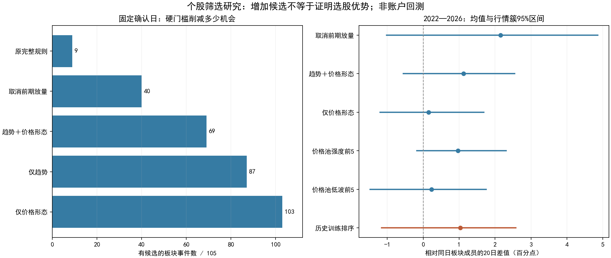

# 板块通过后的个股筛选：同日对照与历史训练排序

2026-10-13；行情截至2026-10-12。延续逐时点板块模型，未使用随机冻结模型回填。

**结果：硬门槛明显压缩候选；历史训练的连续评分在20日观察上值得继续验证，但尚无稳定净交易优势证据。不能直接将本轮历史优胜方案部署为买入规则。**



## 1. 本轮隔离了什么

统一板块首次确认日收盘选股、次日开盘进入，固定3/10/20交易日后开盘观察。各方案在同一事件同一天比较，不把更晚的企稳日期混入选股效果。事件等权，板块内股票等权；股票不是独立事件。

因此原规则本轮为9个事件，上轮等待5日内首次出现候选为17个事件，口径不同并非信号消失。固定约40bp费用压力测试已经包含，但仍缺少实际资金/整手/限价成交账本，下面全部是价格观察。

## 2. 固定确认日的候选与表现

| 筛选方式 | 有候选事件/105 | 完整价格路径事件 | 20日均值 | 20日中位数 | 相对同日板块均值 |
|---|---:|---:|---:|---:|---:|
| 原完整规则 | 9 | 9 | +5.18% | +5.85% | +4.61% |
| 取消前期放量 | 40 | 40 | +2.83% | +0.04% | +1.76% |
| 趋势＋价格形态 | 69 | 67 | +3.23% | +1.22% | +0.95% |
| 仅趋势 | 87 | 83 | +2.45% | +1.41% | +0.24% |
| 仅价格形态 | 103 | 98 | +1.77% | +0.90% | +0.27% |
| 价格池强度前5 | 103 | 102 | +1.77% | +0.59% | +0.51% |
| 价格池低波前5 | 103 | 103 | +1.69% | +0.68% | +0.22% |

表中相对值的百分数读作百分点。方案覆盖事件不同，不能直接拿各自均值排名选赢家；原规则仅9事件，其中仅6个事件可与完整板块篮子配对，样本很小。全部区间、缺失数见summary_NOT_ACCOUNT.csv。

## 3. 趋势和换手是否必须硬过滤

在同日同板块的价格形态池中，趋势通过组相对趋势未通过组：
- 62个配对事件，20日均值差+0.69%，95%区间[-1.01%, +2.20%]。
- 个股趋势有弱的正向迹象，但证据不足以证明必须将未通过者全部删除；也不能由“不显著”反推趋势无效。

在已通过趋势和价格形态的池内，换手条件通过组相对未通过组：

| 条件 | 配对事件 | 均值差 | 95%区间 |
|---|---:|---:|---|
| 前期放量≥1.4倍 | 10 | +3.10% | [-1.96%, +9.78%] |
| 后期换手≤前期0.7倍 | 28 | +2.03% | [-2.14%, +5.16%] |

方向偏正、样本很少、区间较宽。取消门槛能增加候选，并不证明条件应被删除。更合理的待验证假设是保留这些信息作为连续评分，而不要求所有股票跨过相同绝对阈值。

## 4. 历史训练排序如何工作

只使用五类截面分位：60日强度、20日波动、前期换手扩张、后期换手收缩、跌速变化；另加趋势/价格条件、交互及缺失标记。标签为同事件内相对合格成员的20日价格观察。

每年只训练此前已结束且已隔离20交易日的标签；个股训练事件还必须是其当年的板块模型通过者。正则强度在历史内层验证中选择，日期不拆分。2019—2021样本不足跳过，2022—2026可评分59事件。每个真实年度删除未来记录重训，参数和权重完全一致。

只在价格形态池里选择预测相对值大于0的前5只，允许空缺。59个事件中54个出现候选，共193个事件×股票；选出数量为：1只对应8事件、2只对应10事件、3只对应5事件、4只对应5事件、5只对应26事件。

## 5. 与相同事件的价格池比较

| 持有观察期 | 配对事件 | 排序相对价格池均值 | 95%区间 |
|---|---:|---:|---|
| 3交易日 | 53 | +0.26% | [-0.36%, +0.99%] |
| 10交易日 | 52 | -0.19% | [-1.96%, +1.21%] |
| 20交易日 | 52 | +1.20% | [-0.09%, +2.05%] |

20日差值按年度拆分：

| 年份 | 配对事件 | 排序相对价格池均值 |
|---|---:|---:|
| 2022 | 16 | +2.03% |
| 2023 | 10 | +0.66% |
| 2024 | 10 | +0.16% |
| 2025 | 7 | +1.01% |
| 2026 | 9 | +1.63% |

五个年度方向均为正；去掉2022年后均值差+0.83%，去掉最大单事件贡献后+0.85%。但主区间仍包含零，短期观察不一致，不能当作已验证alpha。

基准不同也会影响判断：排序相对全体板块成员的均值约+1.03个百分点，去掉2022年后约+0.11个百分点；相对价格形态池的改善更稳定。不要将两个基准混用。

## 6. 仓位和风险会吃掉多少表面改善

在相同的52个可配对事件中，若入选股等分全部事件额度，20日均值差约+1.20个百分点。若每股最多20%、不足5只留现金：

- 排序平均投入比例70.4%，价格池92.7%。
- 排序的事件额度价格观察均值+2.24%，价格池+2.06%。
- 差值缩小为+0.19%，95%区间[-1.21%, +1.84%]。

这仍是独立事件额度的假设观察，不是可相加的账户收益；同时出现的事件可能占用同一笔现金。缺失价格路径在主表不报收益，另有−20%/−100%缺失压力情景，见missing_path_stress_NOT_ACCOUNT.csv。

排序选中股票的20日波动率中位数为2.79%，价格池为2.49%；有偏向更高波动的迹象。其放量倍数中位数约1.00，仅17.6%达到1.4倍硬门槛。大多数新增候选是相对换手更强，而非满足绝对放量阈值。

## 7. 当前研究结论

1. 不继续用“同时满足全部条件”来定义唯一研究池。保留基础资格和价格形态作为扩展观察池，让趋势、换手、波动参与连续评分，并与原规则并列验证。
2. 本轮历史训练排序仅获得研究候选资格；尚不支持替换实盘规则。其20日改善有线索，但区间、仓位约束和风险暴露都限制结论。
3. 下一项关键验证应是固定本轮版本后的新增事件与统一资金占用、公司行动、停牌及限价执行，而不是继续向历史里添加更多参数。生产配置和通知均未修改。

## 8. 审计边界与复现

三项时序单元测试通过；5个真实年度的删除未来记录重训通过。模型权重、内层搜索、候选生成和评价分开落盘。事件簇在完整105事件时间线上固定，不能按各方案结果重划簇。

研究仍使用供应商当前历史区间，缺少逐日原始版本和行业公告时间；策略家族及候选网格在今天指定。完整标签事件过滤也可能产生非随机缺失偏差。没有新独立测试或实盘成交收益的证明。

```bash
OPENBLAS_NUM_THREADS=1 OMP_NUM_THREADS=1 MKL_NUM_THREADS=1 python -m unittest discover -s alpha_lab/tests -p 'test_stock_selection_asof.py'
OPENBLAS_NUM_THREADS=1 OMP_NUM_THREADS=1 MKL_NUM_THREADS=1 python alpha_lab/scripts/research_stock_selection_asof_v2.py
python alpha_lab/scripts/report_stock_selection_asof_v2.py <输出目录>
```
