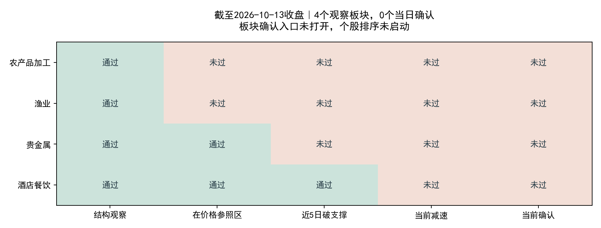

# 2026-10-13收盘机会扫描（2026年策略）

**结果：现有103个有效申万二级自算板块中，4个观察、2个价格触发、0个当日确认、0个新增首次确认；新买入候选为0。**

本次扫描使用10月13日完整收盘数据。整理完成时北京时间已进入10月14日凌晨；不将10月13日数据称为10月14日收盘数据。

2026年方案要求首次确认日才启动板块模型和个股排序。本次入口未满足，个股模型没有待评分的新事件；0只候选不是逐只筛选全部股票后被淘汰，也不是根据旧随机冻结模型作出的拒绝。

## 板块状态

| 板块 | 13日涨跌 | 峰值回撤 | 价格触发 | 当前尚缺 |
|---|---|---|---|---|
| 农产品加工 | +0.65% | -12.34% | 否 | 价格参照区、近5日破峰前支撑、当前减速 |
| 渔业 | +2.18% | -11.93% | 否 | 价格参照区、近5日破峰前支撑、当前减速 |
| 贵金属 | +1.52% | -21.06% | 是 | 近5日破峰前支撑、当前减速 |
| 酒店餐饮 | +1.09% | -13.19% | 是 | 当前减速 |



## 与10月12日比较

- 观察池仍为农产品加工、渔业、贵金属、酒店餐饮；价格触发由3个降至2个，当日确认仍为0。
- 农产品加工13日上涨0.65%，退出价格触发。代表窗口由40日切回15日，不能将两个窗口的前期涨幅或参照距离直接视作同一参数下的变化。
- 贵金属13日上涨1.52%，峰值回撤由-22.24%收窄至-21.06%，仍缺近5日破支撑和当前减速。
- 酒店餐饮13日上涨1.09%，回撤由-14.12%收窄至-13.19%，仍缺当前减速。最近2日平均负收益约0.555%，此前3日约0.665%，比值约0.834，高于0.65门槛；单日反弹不等于五日减速条件通过。

## 酒店餐饮的同轮事件限制

酒店餐饮当前仍是峰值在2026-09-08的同一轮、15日平台事件；对应的独立首次确认是9月17日。该事件2026年度模型分数为-0.009877，低于阈值0.0032892869785428047。按既定首次确认策略，即使同轮后续重新满足形态确认，也不能把旧拒绝事件当作新买点重新评分。

因此，当前保持观察，不因今天上涨就追加买入候选。报告只讨论新增入场机会，未取得账户持仓，不对既有仓位给出卖出指令。

## 数据、模型及代码核验

- 今日补充5,561条有效日线；复权因子、市值/流通股本和换手率覆盖100%，无重复股票—日期键；收盘/前收推导的涨跌幅与来源字段最大舍入差约0.00005个百分点。
- 使用原版build_sector_dataset.py完成全量构建，原版scan_sectors.py完成五窗口扫描；旧板块历史及确认事件检查通过。此次恢复扫描前记录的5个现有程序哈希，完成后全部未变。
- 2026板块模型只装载既有权重，17个历史分数复核最大误差约7.45e-9；训练标签最晚2025-11-18。未重新训练、调参，未使用旧随机冻结模型分数作策略判断。
- 既有扫描器保留的旧随机模型接口，本次因无新确认而未产生新评分；策略层另存2026口径结果，数据构建与读取程序没有改动。
- 当前范围是有覆盖限制的103个有效申万二级自算板块；历史成员未获完整PIT认证。本次无新候选，因此未进行账户权限、资金与涨跌停成交认证。

## 产物

[今日摘要](summary.json) · [全部板块观察明细](watch_today.csv) · [前后日对比](comparison_20261012_20261013.csv) · [2026口径候选表](stock_candidates_asof.csv) · [代码与数据核验](verification.json)

固定行情快照：`datahub/releases/selection_live_20261013_eod`。板块版本：`alpha_lab/data/sector_live_datasets/sw_l2_v1_20261013T154901_328088Z`。

策略层复现命令：

```bash
OPENBLAS_NUM_THREADS=1 OMP_NUM_THREADS=1 MKL_NUM_THREADS=1 python datahub/scripts/frozen_research.py run --release datahub/releases/selection_live_20261013_eod alpha_lab/outputs/strategy_2026_opportunity_scan/20261013_eod/evaluate_existing_models.py
```
