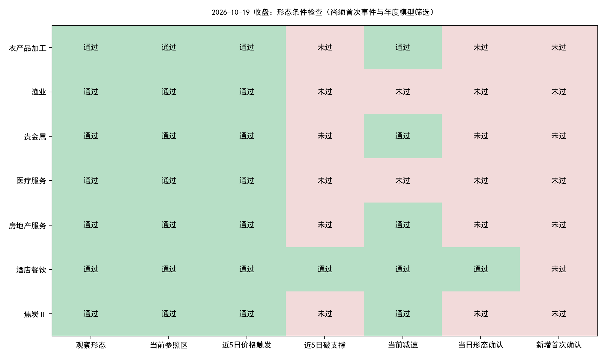
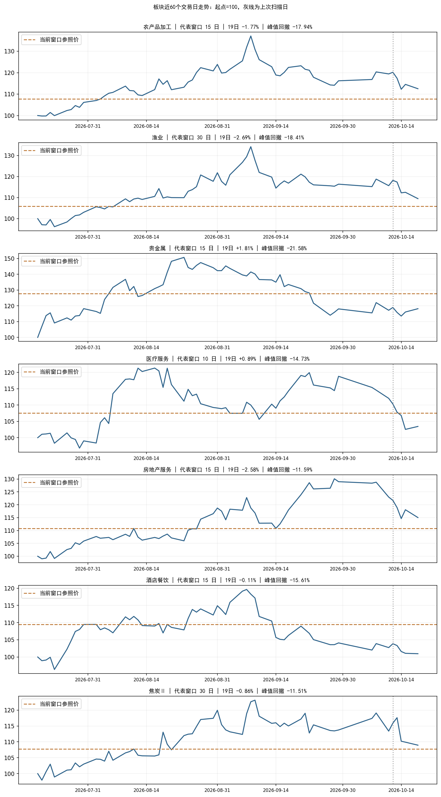

# 2026-10-19 收盘机会扫描

**今日结果：103个有效申万二级自算板块中，7个观察、7个价格触发、1个当日形态确认；新增首次确认0个，年度板块模型通过0个，个股新入场候选0只。**

本次补齐10月14、15、16、19日四个交易日，共22,259条有效日线，其中19日5,564条。扫描依据为19日完整收盘数据。

## 今日板块状态

| 板块 | 窗口 | 19日涨跌 | 峰值回撤 | 价格触发 | 形态确认 | 减速比 | 尚缺条件 |
| --- | --- | --- | --- | --- | --- | --- | --- |
| 农产品加工 | 15 | -1.77% | -17.94% | 是 | 否 | 0.397 | 近5日破支撑 |
| 渔业 | 30 | -2.69% | -18.41% | 是 | 否 | 0.799 | 近5日破支撑、当前减速 |
| 贵金属 | 15 | +1.81% | -21.58% | 是 | 否 | 0.000 | 近5日破支撑 |
| 医疗服务 | 10 | +0.89% | -14.73% | 是 | 否 | 1.255 | 近5日破支撑、当前减速 |
| 房地产服务 | 15 | -2.58% | -11.59% | 是 | 否 | 0.557 | 近5日破支撑 |
| 酒店餐饮 | 15 | -0.11% | -15.61% | 是 | 是 | 0.438 | 旧事件再次确认，非新入场事件 |
| 焦炭Ⅱ | 30 | -0.86% | -11.51% | 是 | 否 | 0.272 | 近5日破支撑 |





观察、价格触发、形态确认、去重后的首次确认、年度模型通过是不同阶段。只有新的首次确认通过年度板块模型，才启动同日个股筛选。减速比为最近2日平均负收益／此前3日平均负收益，门槛沿用0.65；分母须大于0。

## 酒店餐饮为何不是新买点

酒店餐饮19日重新满足形态确认，但仍是9月8日见峰、9月17日首次确认的同一轮事件。首次确认年度模型分数约-0.009877，低于0.003289阈值；既定策略不会因后续重复确认重新给旧事件开放入场。今天没有新的板块事件进入个股层，因此阻塞点不是个股筛选。

| 板块 | 源事件 | 本轮峰值日 | 首次确认日 | 首次确认年度分数 | 年度阈值 | 首次模型通过 |
| --- | --- | --- | --- | --- | --- | --- |
| 酒店餐饮 | 801219.SI_s5_20260728 | 2026-09-08 | 2026-09-17 | -0.009877156466245651 | 0.0032892869785428047 | False |

与13日相比，观察板块由4个增至7个，价格触发由2个增至7个；医疗服务、房地产服务、焦炭Ⅱ进入当前观察池。不同日期的代表窗口可能变化，不能将不同窗口的参照价直接作连续比较。酒店餐饮是由“缺减速”变成“形态满足，但旧事件不可重复入场”。

## 补扫期间的首次确认

10月14日至19日新增首次确认共0个，年度板块模型通过0个；按各确认日当时的成员及行情形成的历史候选共0条。

无。

策略的入场有效期是确认后的一个交易日；14日至16日的信号即使入选，也不能当成19日收盘后新出现的机会。19日确认的候选最早进入10月20日流程。交易日采用本地日历，并核对[上交所2026年休市安排](https://www.sse.com.cn/disclosure/dealinstruc/closed/c/c_20251222_10802510.shtml)。

## 今日个股候选

无。

今日未进入个股评分：没有通过年度板块模型的新首次确认。候选为0不表示将全市场个股逐只评分后全部淘汰。

## 数据与模型核验

| date | rows | nontrading_placeholders_removed | basic_coverage | turnover_coverage | adjustment_coverage |
| --- | --- | --- | --- | --- | --- |
| 20261014 | 5563 | 0 | 1.0 | 1.0 | 1.0 |
| 20261015 | 5565 | 0 | 1.0 | 1.0 | 1.0 |
| 20261016 | 5567 | 0 | 1.0 | 1.0 | 1.0 |
| 20261019 | 5564 | 0 | 1.0 | 1.0 | 1.0 |

- 日线股票—日期无重复；正价格、复权和覆盖检查通过；来源涨跌幅与收盘/前收推导值的最大舍入差约0.00005个百分点。
- 原有更新、全量构建、五窗口扫描入口完成；旧行情前缀、旧板块前缀和既有确认事件一致性检查通过。现有程序、策略参数及4份年度模型权重的哈希未变。
- 年度模型只装载已有权重，无重新训练或调参。板块训练标签最晚2025-11-18，个股最晚2025-11-19；17个既有年度板块预测复核最大误差7.45e-09，板块阈值0.003289286979。
- 既有扫描器仍保留旧随机模型评分接口，本报告未采用该评分。本次没有新的首次确认，未执行新事件的板块及个股评分；年度板块模型装载后复核了已有17条预测，酒店餐饮引用同轮首次确认日的年度分数。
- 年度权重是此前研究按历史信息边界生成的模型，并不意味着权重文件在2026年初已经存在。历史成员数据尚未获得完整PIT认证。
- 最新有效板块103个；行业映射覆盖79.33%，历史成员获取失败记录27个。范围并非全市场完整行业覆盖。财务、名称历史、历史行业、指数、美股未在此次四接口更新中刷新；名称历史公告最新到2026-09-08，如有个股候选仍须补核之后的名称/ST变化。

## 产物与复现

[摘要](summary.json) · [期间首次确认](interval_first_confirmations_asof_model.csv) · [个股期间诊断](stock_diagnostics_interval.csv) · [今日候选](stock_candidates_asof.csv) · [与13日对比](comparison_20261013_20261019.csv) · [哈希与时序核验](verification.json)

行情快照：`datahub/releases/selection_live_20261019_eod`。板块数据：`alpha_lab/data/sector_live_datasets/sw_l2_v1_20261019T143622_793293Z`。扫描产物：`alpha_lab/outputs/sector_live_scan/20261019T144154_853953Z`。

```bash
OPENBLAS_NUM_THREADS=1 OMP_NUM_THREADS=1 MKL_NUM_THREADS=1 python datahub/scripts/frozen_research.py run --release datahub/releases/selection_live_20261019_eod alpha_lab/outputs/strategy_2026_opportunity_scan/20261019_eod/evaluate_existing_models.py --scan alpha_lab/outputs/sector_live_scan/20261019T144154_853953Z
```
