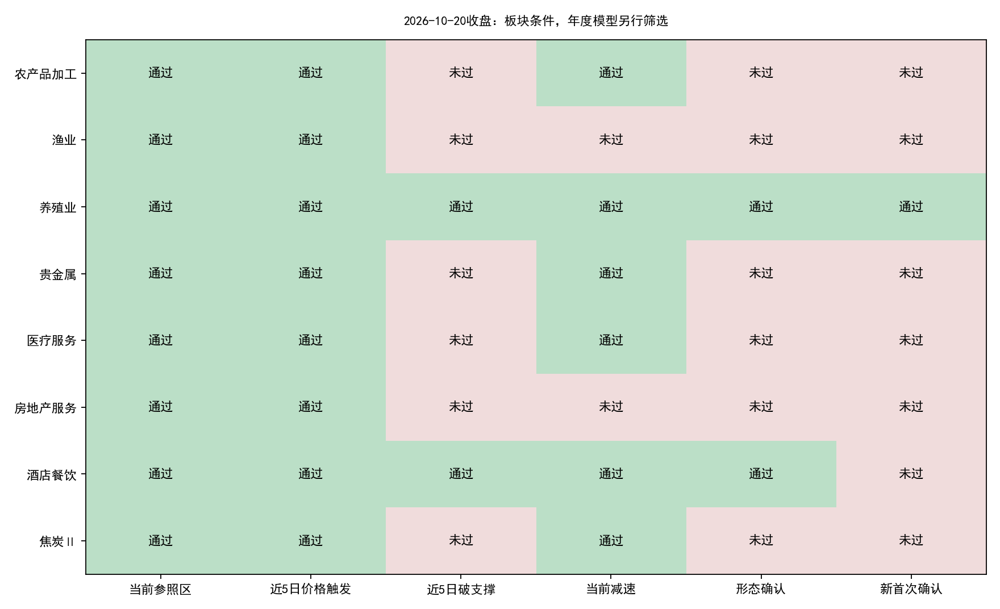
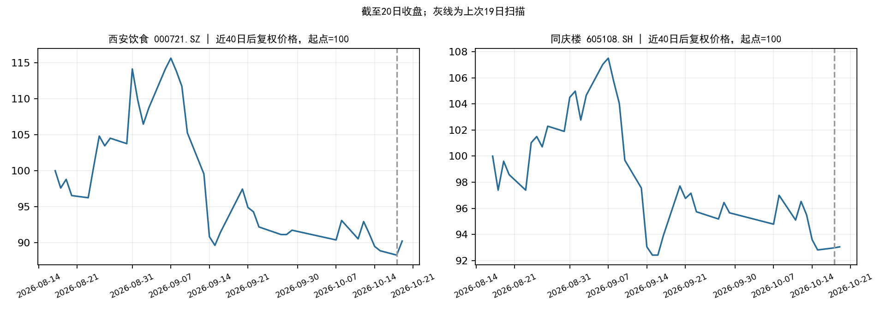

# 2026-10-20收盘数据与模型扫描

**正式策略结果：103个有效板块中，8个观察、8个价格触发、2个当日形态确认；新增独立首次确认1个，年度板块模型通过0个，正式模型新入场候选0只。**

20日新增5,568条有效日线，收盘数据冻结完成。数据工程代码、正式策略参数和年度模型权重均未修改；没有重新训练模型。

## 正式策略扫描

| 板块       |   窗口 | 20日涨跌   | 峰值回撤   | 形态确认   | 新增首次确认   | 当前条件缺口                       |
|:-----------|-------:|:-----------|:-----------|:-----------|:---------------|:-----------------------------------|
| 农产品加工 |     15 | +0.09%     | -17.87%    | 否         | 否             | 近5日破支撑                        |
| 渔业       |     30 | -0.02%     | -18.43%    | 否         | 否             | 近5日破支撑、减速确认              |
| 养殖业     |     15 | -0.12%     | -10.03%    | 是         | 是             | 形态齐备，须核对事件去重及年度模型 |
| 贵金属     |     15 | -0.88%     | -22.26%    | 否         | 否             | 近5日破支撑                        |
| 医疗服务   |     10 | +2.30%     | -12.77%    | 否         | 否             | 近5日破支撑                        |
| 房地产服务 |     15 | -0.63%     | -12.14%    | 否         | 否             | 近5日破支撑、减速确认              |
| 酒店餐饮   |     15 | +0.35%     | -15.32%    | 是         | 否             | 形态齐备，须核对事件去重及年度模型 |
| 焦炭Ⅱ      |     30 | -1.96%     | -13.25%    | 否         | 否             | 近5日破支撑                        |



价格触发、当日形态确认和去重后的首次确认分别记录。只有新首次确认通过年度板块模型，才进入正式个股排序。

### 今日新增首次确认及年度评分

| 日期       | 板块   |   年度分数 |       阈值 | 年度模型通过   | 最早入场日   |
|:-----------|:-------|-----------:|-----------:|:---------------|:-------------|
| 2026-10-20 | 养殖业 | -0.0423149 | 0.00328929 | False          | 2026-10-21   |

### 正式模型个股候选

无。

今日没有通过年度板块模型的新首次事件，因此正式流程未进入个股评分；不能理解为全市场股票逐只评分后被淘汰。

## 西安饮食与同庆楼的更新

以下是用户指定的酒店餐饮独立观察复核，与正式模型候选分开。即使这里个股条件通过，也不会自动绕过首次事件和板块模型门槛。

| 股票     | 代码      |   19日收盘 |   20日收盘 | 20日涨跌   | 20日价格形态   |   19日排序分数 |   20日排序分数 | 仍在观察名单   | 说明                                  |
|:---------|:----------|-----------:|-----------:|:-----------|:---------------|---------------:|---------------:|:---------------|:--------------------------------------|
| 西安饮食 | 000721.SZ |       5.87 |       6    | +2.21%     | 是             |       0.003943 |       0.000268 | 是             | 个股条件通过；板块/首次事件入口不通过 |
| 同庆楼   | 605108.SH |      11.77 |      11.78 | +0.08%     | 是             |       0.001857 |      -0.002074 | 否             | 个股排序分数非正                      |

酒店餐饮20日形态确认：是；当日板块涨跌+0.35%。当前代表窗口对应首次确认日为2026-09-17。该首次事件的年度模型分数-0.009877，阈值0.003289；后续重复形态不能自动重开入场。



酒店餐饮全部9只成员重新检查，8只通过资格筛选，6只通过个股价格形态，4只进入价格形态池内正分数的独立观察名单。年度分数仅用于板块内相对排序，不是预期收益或胜率。名称/ST历史通过原查询封装重新拉取，保存在独立研究目录，未更改冻结行情。

| 名称     | 代码      |   20日收盘 | 20日涨跌   | 价格形态   | 排序分数   |   独立观察入选 | 原因                                  |
|:---------|:----------|-----------:|:-----------|:-----------|:-----------|---------------:|:--------------------------------------|
| 华天酒店 | 000428.SZ |       3.56 | +1.42%     | True       | 0.001169   |              1 | 个股条件通过；板块/首次事件入口不通过 |
| 西安饮食 | 000721.SZ |       6    | +2.21%     | True       | 0.000268   |              1 | 个股条件通过；板块/首次事件入口不通过 |
| 全聚德   | 002186.SZ |       9.14 | +0.55%     | True       | -0.005274  |              0 | 个股排序分数非正                      |
| ST云网   | 002306.SZ |       1.83 | -1.61%     | False      | 未评分     |            nan | ST资格排除                            |
| 君亭酒店 | 301073.SZ |      16.49 | +1.29%     | True       | 0.002782   |              1 | 个股条件通过；板块/首次事件入口不通过 |
| 首旅酒店 | 600258.SH |      11.25 | -0.09%     | False      | 0.000497   |              0 | 前3日跌幅不足1%                       |
| 锦江酒店 | 600754.SH |      17.87 | -0.45%     | True       | 0.003758   |              1 | 个股条件通过；板块/首次事件入口不通过 |
| 金陵饭店 | 601007.SH |       6.57 | -0.15%     | False      | -0.001126  |              0 | 下跌减速未过；个股排序分数非正        |
| 同庆楼   | 605108.SH |      11.78 | +0.08%     | True       | -0.002074  |              0 | 个股排序分数非正                      |

## 数据和模型核验

|       date |   rows |   nontrading_placeholders_removed |   basic_coverage |   turnover_coverage |   adjustment_coverage |
|-----------:|-------:|----------------------------------:|-----------------:|--------------------:|----------------------:|
| 2.0261e+07 |   5568 |                                 0 |                1 |                   1 |                     1 |

- 新增日线无重复键；复权因子、市值/流通股本、换手率覆盖均通过既有质量门槛。涨跌幅与收盘/前收推导值最大舍入差0.00005000个百分点。
- 更新产物13项哈希核验通过；旧行情前缀、板块历史和原确认事件保持一致。
- 年度板块模型的17个历史预测复核最大误差7.45e-09。板块训练标签最晚2025-11-18、个股最晚2025-11-19，未调用旧随机划分模型分数作策略判断。
- 原扫描入口保留旧随机模型接口；本报告使用独立的2026年度评价结果。既有年度权重是历史信息边界复核产物，不意味着文件在2026年初已经存在。
- 行业映射最新覆盖79.33%，有效板块103个，历史成员请求失败记录27个；历史成员PIT尚未完整认证。此次更新四个A股日线接口和在市主档，未全量刷新财务、历史名称、历史行业、指数、美股；酒店餐饮名称历史另行核对。
- 原“旧拒绝事件重复确认”的历史诊断未证明补买有效，本次没有放宽这一规则。

## 产物

[摘要](summary.json) · [新首次确认](today_first_confirmations_asof_model.csv) · [正式候选](stock_candidates_asof.csv) · [与19日板块对比](comparison_20261019_20261020.csv) · [两只股票前后对比](hotel_tracking_20261019_20261020.csv) · [代码与模型核验](verification.json)

行情快照：`datahub/releases/selection_live_20261020_eod`。板块数据：`alpha_lab/data/sector_live_datasets/sw_l2_v1_20261020T113446_268600Z`。原扫描：`alpha_lab/outputs/sector_live_scan/20261020T113957_683276Z`。

```bash
OPENBLAS_NUM_THREADS=1 OMP_NUM_THREADS=1 MKL_NUM_THREADS=1 python datahub/scripts/frozen_research.py run --release datahub/releases/selection_live_20261020_eod alpha_lab/outputs/strategy_2026_opportunity_scan/20261020_eod/evaluate_existing_models.py --scan alpha_lab/outputs/sector_live_scan/20261020T113957_683276Z
```
